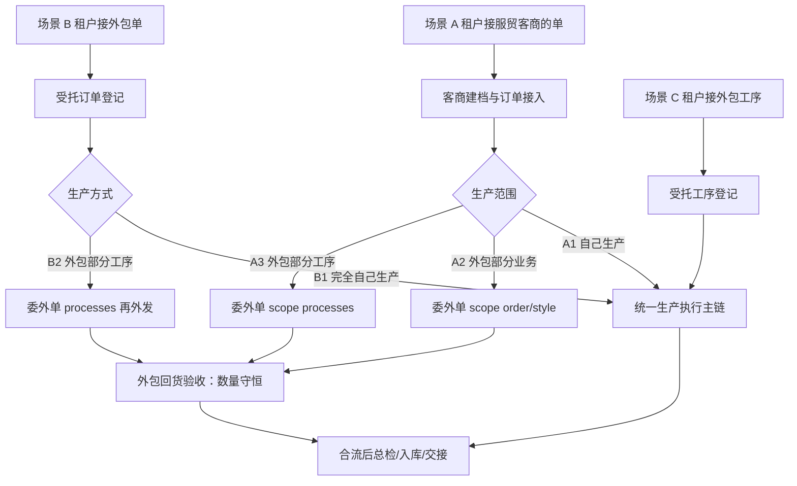
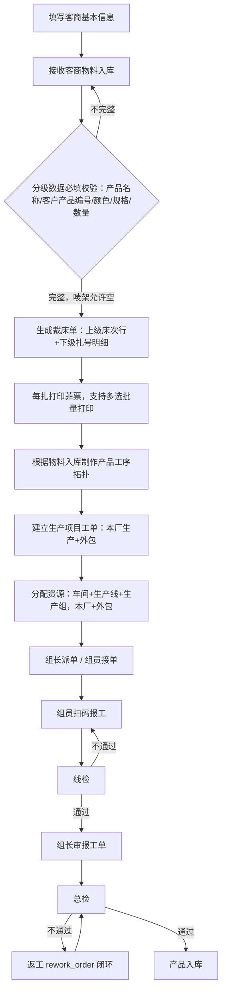
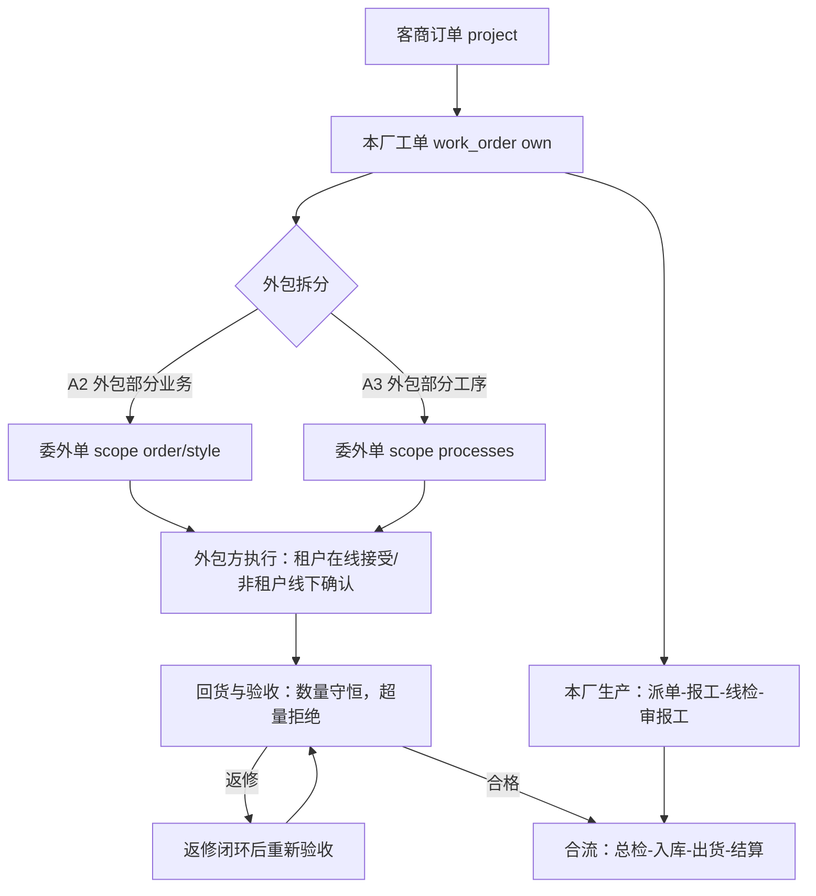
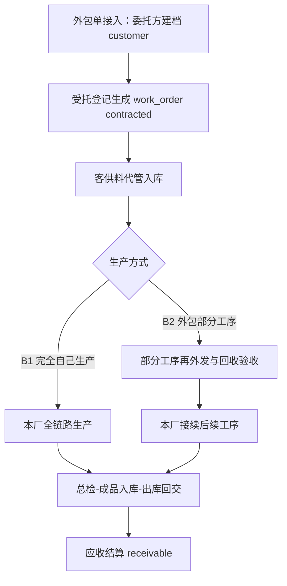
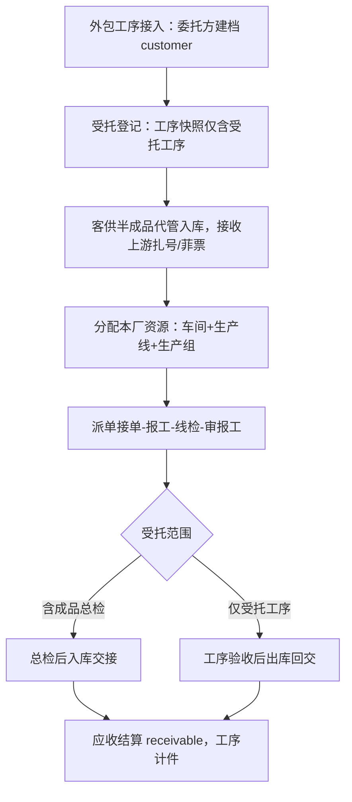

# YZWS-MES 详细设计 v0.02-003

| 项 | 内容 |
|---|---|
| 版本 | v0.02-002（在 v0.02-001 基础上按业务场景分类调整：三类场景流程、裁床单两级录入与菲票打印） |
| 日期 | 2026-11-19 |
| 需求依据 | 2026-11-07 数据库业务讨论、2026-11-07 讨论记录、2026-11-09 日开发功能需求、2026-11-19 业务场景分类与裁床单两级表格录入需求 |
| 代码基线 | `src/` Go 后端 + `src/web/` Vue3 前端；现有迁移至 `074` |
| 设计范围 | 多租户平台运营、制衣厂注册审批、体验与游客、组织人员、权限认证、门户、客户订单、生产工序、报工工资、质量仓储、附件同步、审计；双数据库与字段级加密 |
| 实现口径 | 文中标注“已实现”的是截至迁移 074 的代码能力；标注“目标/规划”的是尚未开发的设计，二者不得混淆 |

> 本文件包含系统完整设计，不依赖其他设计文档。车间/产线/人员、三种登录、门户和双库加密采用本版目标规则；其余既有业务域也在本文给出数据模型、接口和状态约定。

---

## 0. 特别说明（2026-11-12 增补，作为长期设计原则）

以下两条为全系统强制设计原则，后续所有设计与代码编写必须遵守；既有模块在新需求触及或出现故障时应按本原则改造。

### 0.1 租户事务隔离原则

每一个租户的事务必须隔离在该租户的业务和数据范围内，不得影响其他租户的业务和数据访问与操作：

1. **禁止跨租户共享锁**：任何事务不得锁定多租户共享行/表（如全局计数器行、全表锁、无条件全表 UPDATE）；序号、短码、工号等分配必须按租户维度进行，跨租户只读探测不得升级为写锁。
2. **禁止长事务**：多步写入一律拆分为可独立提交的小事务（Saga），配合 `lock_timeout`（当前 5s）与请求级超时（当前 60s）兜底；任何锁等待必须快速失败，严禁无限阻塞——一个租户撞锁时，故障半径限于该租户该请求，不得拖垮连接池或波及其他租户。
3. **连接资源隔离**：连接池获取、事务持有、后台任务（恢复/对账/备份）均不得因单一租户的异常而长期占用共享资源；备份/导出使用 MVCC 快照（REPEATABLE READ 只读），对在线业务零阻塞。
4. **回滚以日志为准**：小事务失败按逆序补偿，补偿现场持久化（`dual_write_saga`/`dual_write_saga_step`），进程崩溃由恢复循环继续补偿或标记人工核对，绝不静默留下半成品数据。

### 0.2 租户事务锁定处置与快照恢复原则

租户因事务锁住（锁等待超限、悬挂事务、补偿失败等）时，按以下处置链路设计：

1. **锁定日志**：锁冲突、锁等待超时（SQLSTATE 55P03）、悬挂 2PC 事务、Saga 补偿失败等事件必须结构化记录（租户、聚合、事务/ Saga ID、阻塞源、发生时刻），可供检索定位。
2. **问题反馈页面（规划新建，含紧急程序）**：平台管理员通过该页面按租户/时间/事务查找锁定事件，查看阻塞链与被阻塞语句，可执行**强制解锁**（终止阻塞源 backend / 处置悬挂 prepared 事务）；页面提供紧急程序入口，操作全程审计。
3. **强制暂停与快照恢复**：无论解锁成功与否，平台管理员可**强制暂停该租户全部业务**（租户级熔断：拒绝该租户新的写请求并撤销活动会话），将该租户数据**恢复到执行事务前的快照点**（以备份/快照为准的定点恢复，恢复前自动留存现状备份），恢复完成核对无误后解除暂停继续服务。
4. **状态可观测**：锁定、解锁、暂停、恢复各阶段状态与结果对平台管理员可见，失败原因如实呈现，不允许以"成功"掩盖部分失败。

---

## 1. 需求解释与总体规则

### 1.1 业务对象

- 一个制衣厂即一个租户，`tenant.id` 是所有租户业务数据的隔离根。
- 组织层级固定为：制衣厂 → 车间 → 生产线 → 班组 → 员工。
- 管理人员和工人共用 `employee` 人员档案与 `user_account` 登录账号，不另建一套重复用户表。
- 人员类型、角色、数据范围是三个不同概念：
  - `person_type`：管理人员或工人，决定建档表单及默认终端；
  - 角色/权限点：决定能执行什么操作、看见什么菜单；
  - 组织归属 + 管理级别 + `user_scope`：决定能看哪些数据。
- 每条启用的生产线必须且只能属于一个车间，并至少有一名有效管理人员担任线长。
- 每名在职人员必须有有效的主归属。换线采用“先建立新归属，再结束旧归属”，同一事务内切换主归属，禁止中间出现无归属状态。

### 1.2 新需求追踪矩阵

| 新需求 | 设计落点 |
|---|---|
| 车间新增、编辑、停用、编码唯一、统计产线与人员 | 4.3 `org_unit`；5.2；6.2 |
| 产线归属车间、线长、默认工序段、车间内编码唯一 | 4.3、4.4；5.3 |
| 管理人员/工人完整建档、工号与手机号租户内唯一 | 4.5～4.8；5.4 |
| 工序专长多选 | 复用 `employee_skill`，见 4.8 |
| 换线同事务先解旧归属再绑新线、活跃人员不得无归属 | `employee_org_binding`，见 4.6、5.4 |
| 工号+密码、手机号+密码、手机号+短信 | 5.6；密文手机号通过 HMAC 盲索引查询 |
| 四类登录失败提示 | 5.6.3，后端返回稳定错误码与中文提示 |
| 工人禁止 PC、组长限本线、跨租户不可见 | 4.7、5.7、7.2；全部由后端强制 |
| 登录与越权审计 | 4.9 `auth_login_log` + 既有 `audit_log` |
| 厂长门户可选风格/板块/文字，员工门户固定 | 4.11、5.8、6.5 |
| 明文/密文双库、默认密文读取、可切换、可单写、互转 | 第 3 章及 4.12～4.14 |
| 每厂独立非对称密钥 | 3.4 信封加密；非对称密钥保护 DEK，业务字段由 AES-256-GCM 加密 |
| 外协管理（委外加工+受托加工）：双方是/非系统租户、整单/分单/工序外发与承接、客供料、回货入库、跨租户进度 | 4.25；5.14；6.8；7.4；8 章相关条目；11 章业务场景分类流程 |
| 生产现场摄像跟踪与证据保存：实时巡厂、事件联动、证据封存导出、外协远程监督 | 4.26；5.15；6.9；7.5；8 章相关条目 |
| 简单考勤：扫描 PC/平板/手机展示的二维码登记上下班，先刷新后扫、一码一次 | 4.27；5.16；6.10；7.6；8 章相关条目 |
| 业务场景三大类六子类型（接服贸客商单/接外包单/接外包工序）与分场景处理流程 | 第 11 章（2026-11-19 调整） |
| 客商物料入库分级数据必填（产品名称+客户产品编号+颜色+规格+数量）、唛架非必填 | 4.19.1；11.2.1 |
| 裁床单两级表格录入（上级床次行+下级扎号明细）、自动生成与回写、每分钟自动保存 | 4.19.1；5.17；6.11 |
| 裁床单每扎打印菲票、多选批量打印菲票 | 4.19.1；6.11 |
| 产品工序拓扑、生产项目工单（本厂+外包）、资源分配（本厂资源+外包资源） | 4.18；4.19；11.2.1 |
| 派单/接单/报工/线检/审报工单/总检/产品入库（本厂+外包统一链路） | 4.19；4.20；11.1；11.2.1 |
| 场景化菜单（工作台/生产管理/基本资料/分析中心/系统管理）与角色入口 | 6.12；6.1；4.19 场景字段 |
| 三态操作面（新建向导/进行时/历史台账）与逐级弹窗界面模式 | 6.12.4；6.12.5；6.12.6 |
| 外协标识体系（委托方本厂/外协分组、标题[外协]前缀、受托方外协标注）与外协类型数据规则（自动填写/允许无记录） | 6.12.7；4.19 场景字段 |
| 取证嵌入线检/总检等环节、直播取证 | 6.12.8；4.26；6.9 |
| 分析中心员工薪水分析（薪水情况、工作量情况） | 6.12.2；6.12.9 |

### 1.3 对需求中“五张前置表”的落地调整

需求说明书允许评审后调整字段。为避免重复与数据分叉，采用以下映射并回写本设计：

| 需求建议表 | 实际设计 |
|---|---|
| 车间表 | 复用并扩展 `org_unit`，`org_type='workshop'` |
| 生产线表 | 复用并扩展 `org_unit`，`org_type='line'`；资源配置仍用 `line_resource` |
| 用户表 | `employee` 保存人事与归属，`user_account` 保存登录凭证，二者一对一 |
| 角色权限表 | 复用 `role`、`role_permission`、`user_role`、`mgmt_level`、`user_scope` |
| 登录日志表 | 新增 `auth_login_log`；越权详情同时写既有 `audit_log` |

### 1.4 身份、客户转化与订阅规则

| 身份 | 载体/存储 | 验证方式 | 登录后主页 | 是否落库 |
|---|---|---|---|---|
| 平台超级管理员 | `platform_admin` + `platform_session` | 账密（Argon2id） | `/platform/tenants` | 是 |
| 平台辅助人员 | `platform_admin(role=assistant)` + `platform_admin_permission` | 账密 + 路由权限点 | 平台控制面授权页签 | 是 |
| 制衣厂注册用户 | `user_account` + `auth_session`（JWT） | 工号/手机号密码、短信、扫码 | 厂长门户、PC 工作台或岗位首页 | 是 |
| 体验用户 | 体验厂 `user_account` + 体验会话/进入令牌 | 手机验证码、账密、扫码 | 体验门户与体验厂工作台 | 是 |
| 游客 | 前端本地会话 `via=guest` | 不验证身份 | 基础演示视图 | 否 |

客户获取漏斗：游客 → `visitor_lead` 潜在客户 → 免费体验厂 → 正式制衣厂。线索状态为 curious（好奇）→ interested（感兴趣）→ engaged（参与）→ promotion（促销）→ won/lost（成功/失败）。

制衣厂从体验转为正式付费的三个前置条件：①存在 signed 订阅协议；②存在 confirmed 订阅付款；③订阅版本、功能清单及确认人/确认时间完整。线上注册审批可先启用账号、后补书面协议，但正式转付费状态必须满足上述三条件。

### 1.5 数据归属与业务范围

- 平台运营数据：系统版本、线索、订阅协议/付款/状态、平台管理员、平台参数、平台模块和角色模板。平台身份默认不能读取制衣厂业务明细，排障须审批并审计。
- 制衣厂业务数据：组织、人员、客户、供应商、产品、订单、工序、工单、报工、工资、质量、仓储、出货、附件、厂内配置等。所有业务表以 tenant_id 隔离。
- 体验数据：存放在独立体验厂内，与正式厂采用同一隔离规则；转正后数据整体保留。
- 边缘/离线数据：只同步本厂数据；节点、同步游标、单号段和聚合所有权均按厂隔离。

系统模块全景：

| 域 | 核心能力 | 主要数据表 |
|---|---|---|
| 平台运营 | 版本、线索、订阅、注册审批、辅助人员、平台参数 | system_release、visitor_lead、subscription_*、platform_* |
| 身份权限 | 员工、账号、角色、权限点、管理级别、数据范围、会话 | employee、user_account、role、permission、user_scope、auth_session |
| 主数据 | 客户、供应商、仓库、物料、产品、公共工序、字典 | customer、supplier、warehouse、material、product、process_definition |
| 订单生产 | 项目订单、工单、工序快照、裁床、扎号、菲票、生产任务 | project、work_order、cutting_*、bundle、ticket、production_task |
| 报工工资 | 报工、审批、任务转移、计件、工资确认 | work_report、report_review、piecework_entry、payment |
| 质量管理 | 来料检、终检、缺陷、返工、复检 | iqc_result、final_inspection、defect_record、rework_order、reinspection |
| 仓储出货 | 入库、领料、库存、成品、出货/退货 | material_receipt、material_issue、finished_receipt、shipment |
| 技术内核 | 生产标准工序表、两确认、查看授权 | process_standard、_line、_confirm、_grant |
| 门户体验 | 体验内容、功能点亮、延期、厂门户、扫码登录 | tenant_subscription、trial_extension、tenant_portal；当前扫码票据在进程内存，生产目标为 Redis |
| 技术支撑 | 附件、审计、通知、幂等、同步、节点与离线 | attachment、audit_log、notification、outbox/inbox、sync_cursor、node |

---

## 2. 总体架构与数据访问边界

### 2.1 逻辑组件

| 组件 | 职责 |
|---|---|
| Web PC / 手机 H5 | 表单、菜单与岗位首页展示；不承担权限安全边界 |
| HTTP API | 参数校验、登录错误码、权限点校验、调用数据范围过滤器 |
| 认证服务 | 账号/手机号定位、Argon2id 校验、短信票据、JWT 与会话、登录日志 |
| 授权服务 | 计算终端范围、角色权限、组织范围、本人范围及字段级权限 |
| 租户加密服务 | DEK/盲索引密钥解包、AES-GCM 加解密、手机号规范化与 HMAC |
| 双库数据访问层 | 同一领域写入生成明文/密文两套参数，控制读来源、双写事务与转换 |
| 一致性恢复任务 | 恢复中断的两阶段事务、重放降级期间变更、执行对账和互转 |

### 2.2 强制数据访问规则

1. 业务代码不得直接使用全局 `*pgxpool.Pool` 拼装 SQL；统一经由支持 `TenantContext` 的 Repository/UnitOfWork。
2. 所有租户业务 SQL 必须带服务端 `Principal.TenantID`，不得信任请求体、路径或前端传入的租户 ID。
3. 跨厂外键使用 `(tenant_id, id)` 复合外键；列表、详情、更新、停用均执行同一数据范围过滤。
4. API 返回领域明文对象。密文格式、DEK、私钥、KMS 引用、HMAC 密钥不得返回前端。
5. 密文库只改变持久化表示，不改变业务 API 契约；读取后由服务端解密、按权限脱敏。
6. 禁止因密文库查询失败而自动改读明文库。读库切换只能由受控配置变更完成并记录审计，防止静默降级和绕过权限。
7. **明文库（plain）是对账库：业务运行中禁止读取明文库进行对比或执行其他业务操作。** 业务读一律走 `Store.ReadPool()`（默认 secure）；业务写经双写事务同时落两库。仅以下两类例外：
   - 管理员运维工具：`-datatool=convert / repair-phone-hash / repair-permission-divergence / align-subscription-keys / rewrap-local-master / verify-backup / restore-plain`、双写对账补偿（catchup/recover），及平台受控的"手机号归属核实"（`/platform/phone-lookup`，限流+全量平台审计+不返回 PII 明文）；
   - 测试程序（含端到端验收脚本）可对两库对账。
   例外工具必须只读不写（除其转换/修复职责内的目标库写入），不得将明文库结果用于在线业务判断；其读取与输出均不进入业务缓存或业务事务。

### 2.3 技术基线、认证与迁移机制

| 端 | 技术 | 设计说明 |
|---|---|---|
| 后端 | Go、pgx/v5、标准库 ServeMux | `internal/httpapi` 提供 Public（公开）、Handle（租户 JWT+权限点）、PlatformHandle（平台权限）三类处理器 |
| 前端 | Vue3、TypeScript、Vite，无独立 UI 库 | `src/api.ts` 封装 fetch，baseURL=`/api/v1`；路由守卫只负责交互，不替代后端鉴权 |
| 数据库 | PostgreSQL | 已接入 yzws-v1（plain）与 yzws-v1-sec（secure）双库；默认 `write_mode=both`、`read_source=secure` |
| 认证 | JWT HS256 + refresh rotation | claims 含 tenant_id、user_id、session_id、platform、client_type、client_scope；每个业务请求重新加载账号并按 client_scope 校验当前终端 |
| 密码 | Argon2id | 登录、注册、改密、重置密码共用验证器实现 |
| 附件 | 本地/受控对象存储 + attachment 元数据 | 业务通过 attachment_link 关联，不直接把文件路径当权限依据 |

迁移机制：后端启动时通过 `//go:embed migrations/*.sql` 按文件名字典序执行迁移，每个迁移在事务中运行，`schema_migration` 保存 version/checksum；`Reconcile` 对缺失表、列、索引、约束和触发器做幂等补全。双库目标架构下，两库分别执行并校验版本，不允许仅启动一库迁移后另一库长期缺结构。

会话存储：租户和平台分别保存 `clothp_access_token`、`clothp_platform_access_token`；体验会话使用 `clothp_trial_session` 保存 access_token、tenant_id、factory_name、expires_at、via；游客会话无 token 且 via=guest。refresh token 只保存哈希，停用账号、重置密码、退出登录时撤销对应会话。

---

## 3. 双数据库与加密详细设计

### 3.1 物理数据库与存储口径

| 数据库 | 角色 | 敏感字段 | 非敏感字段 |
|---|---|---|---|
| `yzws-v1` | 明文数据库（plain）——**对账库**，业务运行中不读取（例外见 2.2 第 7 条） | 按业务类型保存明文 | 正常保存 |
| `yzws-v1-sec` | 密文数据库（secure），默认读取来源 | 保存带版本密文信封；手机号等另存 HMAC 盲索引 | 与明文库相同 |

- 两库保存相同的租户、业务主键、公共列和记录版本，以便对账与互转。
- 默认 `write_mode=both`、`read_source=secure`：每次数据落地同时写两库，从密文库读取后在服务端解密。
- 可以配置为 `read_source=plain`，从明文库读取；此切换不停止双写。
- 可以配置 `write_mode=plain_only` 或 `secure_only` 仅写一库。这是显式降级模式，系统健康状态必须显示 `degraded`，并记录未同步起点；恢复双写前必须完成补数与对账。
- 两库均不保存明文 DEK、明文盲索引密钥或可直接用数据库备份还原的租户私钥。

### 3.2 配置设计

以下为结构示例，密码和 KMS 密钥只从环境变量或密钥服务注入，不写入文档或代码仓库：

```yaml
databases:
  plain:
    host: 127.0.0.1
    port: 5432
    name: yzws-v1
    user: postgres
    password_env: CLOTHP_DB_PLAIN_PASSWORD
    sslmode: require
    max_conns: 20
  secure:
    host: 127.0.0.1
    port: 5432
    name: yzws-v1-sec
    user: postgres
    password_env: CLOTHP_DB_SECURE_PASSWORD
    sslmode: require
    max_conns: 20

data_store:
  read_source: secure       # secure（默认）| plain
  write_mode: both          # both（默认）| plain_only | secure_only
  allow_degraded_read: false
  reconcile_interval_seconds: 60

crypto:
  envelope_version: v1
  data_algorithm: AES-256-GCM
  wrap_algorithm: RSA-PKCS1v15        # 测试环境取值（原因见 3.2.2：SoftHSM2 Botan2 后端 OAEP 解密不可用）；生产 OpenSSL 后端/云 KMS 应切回 RSA-OAEP-SHA256
  kms_provider: softhsm2     # 测试环境 SoftHSM2；cloud_kms 为预留
  softhsm2:
    # 远程模式（server_url 非空即生效）：主服务经 HTTP 调用多租户 hsm-sign-service 完成包装/解包，
    # 无需本机 PKCS#11 库，Windows 开发机经 SSH 隧道（http://127.0.0.1:8443）即可使用。
    server_url: "http://127.0.0.1:8443"   # 也可用环境变量 CLOTHP_HSM_SERVER_URL 覆盖
    api_key_env: CLOTHP_HSM_API_KEY       # X-API-Key 只从环境注入
    ca_cert_file: ""                      # HTTPS 自签证书时指向服务端 CA 证书
    timeout_ms: 10000
    # 租户密钥自动开通（可选）：新租户首次用加密时若服务端未开通（404），自动经 SSH 执行
    # add-tenant.sh（密钥生成只允许运维脚本，HTTP 无此接口）；留空则未开通租户报 KEY_UNAVAILABLE。
    ssh_target: ""                        # 如 root@服务器IP（需免密）；生产同机可用 root@127.0.0.1；也可 CLOTHP_HSM_SSH_TARGET 覆盖
    # provision_script: /app/HSM/softhsm2/scripts/add-tenant.sh   # 默认值
    token_label: yzws-mes-test            # 落库 KeyWrapRef 的 token 标识
    key_label_prefix: yzws-tenant-        # 本地 PKCS#11 模式使用
    # 本地 PKCS#11 模式备用字段（server_url 留空时生效，需 -tags softhsm2 构建的 Linux 环境）：
    # pkcs11_module_env: CLOTHP_SOFTHSM2_MODULE
    # pin_env: CLOTHP_SOFTHSM2_PIN
  cloud_kms:                 # 预留，不在测试环境启用
    provider: ""
    region: ""
    key_id_prefix: ""
```

启动校验：

- `both` 模式必须能连接两库，且两库迁移版本、字段映射版本兼容，否则拒绝提供业务写服务。
- `plain_only + read_source=secure` 或 `secure_only + read_source=plain` 会产生旧数据读取；只有 `allow_degraded_read=true` 才允许启动，并持续告警。
- 单写模式不影响所选库自身事务完整性；恢复 `both` 前先执行 3.8 的增量补偿。
- `kms_provider=softhsm2` 远程模式必须配置 `api_key_env`；启动时执行一次 `/healthz` 自检，**自检失败直接拒绝启动**（`log.Fatalf`），避免以不可用密钥对外提供密文服务。本地 `kms_provider=local` 保留为迁移/开发兼容模式，不做强制自检。本地 PKCS#11 模式必须能够加载模块、定位 token、登录会话并执行一次包装/解包自检。
- SoftHSM2/HSM 服务不可用不得自动回退本地明文私钥或 JWTSecret 派生密钥；涉及密文的写入与解密读取应返回 `KEY_UNAVAILABLE`。
- HSM 服务所有接口要求 `X-API-Key`；网络抖动/5xx 自动重试（最多 3 次指数退避），4xx 立即失败。
- 配置切换写入平台审计，记录操作者、旧值、新值、时间和原因，不记录密码、PIN、API Key 或密钥。

#### 3.2.1 SoftHSM2 与云端 KMS 适配边界

统一 `KeyProvider` 接口，业务加密服务不直接依赖 SoftHSM2 或云厂商 SDK：

| 接口能力 | 说明 |
|---|---|
| GenerateTenantKeyPair | 为本厂生成 RSA-3072 密钥对，返回公钥和不可导出私钥引用 |
| Wrap / Unwrap | 使用本厂公钥包装 DEK/盲索引密钥，使用私钥引用解包 |
| GetPublicKey / GetKeyMetadata | 获取公钥、算法、提供方、版本与状态 |
| Rotate | 创建新密钥对和引用，不删除仍承担历史解密的旧版本 |
| HealthCheck | 检查模块/token/云凭据及一次实际加解包能力 |

| 环境 | 提供方 | 私钥位置 | 说明 |
|---|---|---|---|
| 测试版 | SoftHSM2，经 PKCS#11 | SoftHSM2 token 内，不可导出 | 验证真实 HSM 调用、权限、轮换、故障与恢复；token 数据目录须持久化并纳入安全备份 |
| 生产预留 | cloud_kms | 云端 KMS 内，不可导出 | 通过同一 KeyProvider 接入，数据库只保存云 key_id/版本引用；厂商、区域和凭据后续配置 |
| 旧数据迁移 | local 兼容适配器 | 旧包装私钥/主密钥的受控存储 | 仅用于读取既有数据并迁移，不再用于新密钥 |

SoftHSM2 的 token_label+key_label+key_version 组成 `key_wrap_ref`；云端使用 provider+key_id+version。远程多租户模式下 `key_wrap_ref` 形如 `softhsm2:<token_label>:<tenantID>:<version>`，第三段为服务端租户路由 ID。数据库不保存 PKCS#11 PIN、API Key、云 Secret 或明文私钥。SoftHSM2 token 丢失与云 KMS 密钥被提前删除都会导致历史密文无法恢复，因此离线备份与密钥灾难恢复必须分别演练。

#### 3.2.2 远程多租户 HSM 服务形态（hsm-sign-service，测试环境落地口径）

密钥生成/删除是最高危操作，**不进 HTTP 接口**：服务端只暴露签名与包装类接口，租户密钥由运维脚本在 HSM 容器内开通：

| 接口 | 说明 |
|---|---|
| `POST /sign` | `X-Tenant-ID` 路由；请求体原始字节做 SHA256-RSA 签名，返回 base64（`X-Tenant-ID` 缺省走默认密钥） |
| `GET /pubkey?tenant=<id>` | 返回租户公钥 PEM（包装在调用方本地完成，公钥公开） |
| `GET /tenants` | 注册表（运维用） |
| `POST /wrap` / `POST /unwrap` | `X-Tenant-ID` 路由，RSA 包装/解包（DEK/盲索引密钥解包） |
| `GET /healthz` | 健康检查 |

- 租户→密钥映射为服务端 `tenants.json` 注册表，按 mtime 热加载（原地重写保持 inode，bind mount 单文件场景禁止 `mv` 替换）；密钥句柄进程内缓存。
- 开通/删除租户：`scripts/add-tenant.sh <tenantID>` / `del-tenant.sh <tenantID>`（幂等；CKA_ID 取租户 ID 逐字节 hex 编码，兼容任意字符集；`del-tenant.sh` 原地重写注册表）。脚本执行后循环验证 `GET /pubkey?tenant=` 可取才算完成（SoftHSM 新对象对 sign-svc 进程可见有秒级延迟）；仍失败时重启 sign-svc 刷新对象缓存。
- 主服务侧 `GenerateTenantKeyPair` = 探测该租户密钥是否已开通（`GET /pubkey?tenant=`）；**Wrap（包装 DEK）在调用方本地用租户公钥完成**（公钥公开，密钥材料不经网络）；Unwrap（解包）走服务端 `/unwrap` 私钥解密。
- 配置了 `ssh_target` 且探测返回 404 时，自动经 SSH 执行 add-tenant.sh 并轮询生效（生产同机 `root@127.0.0.1` 亦可）。
- **包装算法**：Debian SoftHSM 2.6.1 为 Botan2 后端，其 `CKM_RSA_PKCS_OAEP` 解密 DecryptInit 恒报 `CKR_ARGUMENTS_BAD`（与参数编码无关，实测全变体）；`CKM_RSA_PKCS`（v1.5）正常。测试环境两端统一用 RSA PKCS#1 v1.5 包装，v1.5 的 padding-oracle 风险由 API Key + 内网/SSH 隧道缓解；生产切换 OpenSSL 后端 SoftHSM 或云 KMS 时，`wrap_algorithm` 改回 `RSA-OAEP-SHA256` 并同步两端机制。
- 部署：sign-svc 与 SoftHSM 同机 compose（后端与 HSM 同机时 `server_url=http://hsm-sign:8443`）；Windows 开发机经 `ssh -N -L 8443:127.0.0.1:8443` 隧道访问 `http://127.0.0.1:8443`。审计只记哈希与长度，绝不记密钥材料。

### 3.3 双写事务与一致性

普通两个数据库连接依次 `COMMIT` 不能保证原子性。本版默认双写采用 PostgreSQL 两阶段提交（2PC），并以 `dual_write_journal` 支持崩溃恢复：

1. API 完成权限、归属、唯一性预校验，生成全局 `tx_id`、统一记录 ID、时间戳和版本。
2. 在两个连接的固定会话上分别开启事务；明文库写业务明文，密文库写同一主键及密文信封，两库均写 `dual_write_journal`。
3. 两库分别执行 `PREPARE TRANSACTION`。任一准备失败则回滚两个事务，业务请求失败。
4. 两个事务均准备成功后提交。只有两库均提交成功才向客户端返回业务成功。
5. 若提交阶段进程崩溃或连接中断，恢复任务依据 `tx_id` 与 `pg_prepared_xacts` 判断状态：已准备未提交者继续提交；未准备者回滚；不允许把“只写成功一库”直接报告为正常。
6. 定时对账比较主键、版本、更新时间和记录摘要；差异进入补偿队列，自动修复失败时告警，禁止静默覆盖较新版本。

部署要求：`max_prepared_transactions>0`，应用账号具有准备/提交自身事务权限；2PC 期间必须固定数据库连接，不得将同一事务切到连接池另一连接。

单写模式使用普通本地事务，并写 `state='pending'` 的日志。单写期间的记录不视为双库一致，恢复时按日志与版本做增量补偿。

### 3.4 每厂独立密钥：合理性与正确用法

**“每厂独立密钥”合理，但直接使用非对称算法加密全部业务字段不合理。** 非对称加密适合保护少量密钥材料，不适合大量、定长不一且高频读写的业务数据。本版采用信封加密：

- 每厂生成独立的 RSA-3072 非对称密钥对；公钥用于包装本厂数据密钥，私钥仅用于解包。
- 每厂每个密钥版本生成随机 32 字节 DEK 和独立 32 字节盲索引密钥。
- 业务字段由 DEK 使用 AES-256-GCM 加密；公钥使用 RSA-OAEP-SHA256 包装 DEK/盲索引密钥。
- 测试版私钥由 SoftHSM2 生成并保存在 token 内，生产预留云端 KMS；两者均使用不可导出私钥引用。新密钥不得落库保存私钥，旧开发数据只允许通过受控 local 适配器迁移，禁止继续从 JWTSecret 派生新主密钥。
- 一条密文记录密钥版本，解密时选择本厂对应版本；禁止跨厂解包或用他厂 DEK 加密。
- 平台级且无租户归属的敏感数据使用独立的 `platform` 密钥主体，不借用任意制衣厂密钥。

该方案的边界：每厂密钥能限制跨厂误用、缩小单厂密钥泄露影响并支持独立轮换；如果应用服务器和私钥同时被攻陷，攻击者仍可能解密。因此生产环境必须结合 KMS/HSM、最小权限、短期解包缓存和审计，不能把“使用非对称密钥”理解为系统天然免于内部越权。

### 3.5 字段加密格式与类型

AES-256-GCM 参数：12 字节随机 nonce、16 字节认证标签；AAD 固定包含 `tenant_id + table_name + primary_key + column_name + envelope_version`，防止密文被复制到其他厂、行或字段后仍能通过认证。

密文统一编码：

```text
enc:v1:<key_version>:<base64url(nonce || ciphertext || tag)>
```

- NULL 不加密，仍保存 NULL；空字符串与 NULL 必须区分。
- NUMERIC/DATE 等先按固定规则序列化为 UTF-8 字符串，解密后做严格类型转换；NUMERIC 使用非科学计数法的规范化十进制，日期使用 `yyyy-MM-dd`。
- 密文不按明文排序、不做模糊查询；需要检索的字段必须显式设计盲索引。
- 明文与密文不允许在同一物理库同列混存作为最终状态。迁移过渡期仅允许转换程序识别，业务 DAO 必须按当前库类型处理。

密文库字段类型调整：

| 原类型 | 密文库类型 | 说明 |
|---|---|---|
| TEXT / VARCHAR | TEXT | 保存 `enc:` 信封 |
| NUMERIC | TEXT | 解密并严格转回 NUMERIC；密文列不参与求和/比较 |
| BIGINT | TEXT | 仅对列入加密范围的字段调整；主键、时间公共列不加密 |
| JSONB 中敏感成员 | JSONB | 非敏感结构保留，敏感成员值替换为密文 TEXT |
| BYTEA | BYTEA | 仅确有保密要求的二进制另加密，并保存 nonce/tag 封装 |

### 3.6 手机号盲索引与唯一性

AES-GCM 每次密文不同，不能用于手机号等值登录。新增 `employee.phone_hash` 与 `tenant.contact_phone_hash`：

1. 手机号去空格、统一国家码后得到规范化值；本版中国大陆手机号为 11 位数字。
2. 计算 `base64url(HMAC-SHA256(tenant_index_key, "employee.phone\0" + normalized_phone))`，不同用途使用不同域分隔字符串。
3. 两库保存相同 HMAC 值；明文库仍存手机号明文，密文库手机号存密文。
4. 登录、唯一性校验、多厂手机号匹配只查 `phone_hash`，不对密文解密扫描。
5. 建立 `(tenant_id,phone_hash)` 部分唯一索引。工号同样只在租户内唯一。
6. 不使用无密钥 SHA-256 代替 HMAC，避免对低熵手机号进行字典枚举。
7. `phone_hash` 按租户密钥 HMAC，跨租户无法用单条 SQL 匹配；登录选厂（`/auth/trial/verify`、`/auth/my-factories`）、短信进厂（`/auth/phone-login`）、切换厂（`/auth/switch-tenant`）与体验厂进入（`LoginTrialAdmin`）在密文库读模式下按"候选租户 × 手机号逐厂计算哈希"匹配（租户数量级小、仅登录时触发）；指定厂内的账号定位直接按本厂哈希查 `phone_hash`。明文库读模式（`read_source=plain`）仍用明文等值比较。

身份证、银行卡等本版不提供等值查询，不建立盲索引；列表仅脱敏展示。

### 3.7 密钥轮换

1. 通过当前 KeyProvider（测试为 SoftHSM2，生产预留 cloud_kms）创建本厂新密钥对及新版本 DEK/盲索引密钥，旧版本置 `rotated`，新版本为唯一 `active`。
2. 新写入使用新版本；旧密文仍可按信封内版本解密。
3. 后台逐批重加密历史数据，AAD 保持不变，密文版本更新；每批复核后提交。
4. 盲索引密钥轮换必须同事务更新对应行全部 hash，并暂停该厂手机号登录/绑定写入，或采用双索引过渡期，避免登录中断。
5. 全部重加密及验证完成前不得销毁旧私钥；吊销密钥只阻止新加密，不得让历史数据不可恢复。

### 3.8 双向转换与补数

不单独提供 `cmd/datatool` 二进制，运维命令统一为 `cmd/server` 的 `-datatool=` 子命令，执行后退出、不启动 HTTP 服务：

```bash
# 仅检查，不写目标库（-dry-run 默认 true）
mes server -datatool=convert -direction=plain2secure
mes server -datatool=convert -direction=secure2plain

# 全库转换（逐表、逐行，幂等可重跑）
mes server -datatool=convert -direction=plain2secure -dry-run=false

# 结构性修复（均支持 -dry-run=false）
mes server -datatool=repair-phone-hash -dry-run=false
mes server -datatool=repair-permission-divergence -dry-run=false
mes server -datatool=align-subscription-keys -dry-run=false
mes server -datatool=rewrap-local-master -dry-run=false   # 新口令从 CLOTHP_NEW_JWT_SECRET 读取
```

- 转换按库内表清单整库执行，不提供 `-tenant`/`-table`/`-batch-size` 参数；单租户补数由后台 catchup/verify 循环负责，不通过转换命令指定。
- 转换任务写 `data_transfer_job`/`data_transfer_item`，中断后可重跑；按主键与版本幂等判断，已转换行跳过。

转换规则：

- plain→secure：读取明文，按本厂 active 密钥加密并计算盲索引；已有合法密文且版本相同可跳过，明文输入须校验格式。
- secure→plain：按密文版本解包并解密，校验 AAD、字段类型与业务约束；盲索引原样保留。
- 保留原主键、tenant_id、created_at/by、updated_at/by、version，不因转换伪造业务变更。
- 逐表按主键稳定读取（`tenant` 等无 tenant_id 表按 `id`）；每行先比较目标版本，目标更新则停止并报告冲突，禁止旧数据覆盖新数据。
- 转换使用专用内部执行器，不再次触发普通业务双写；逐表写 `data_transfer_job/item` 进度，失败重跑时已处理行按版本幂等跳过。
- 完成标准为：行数一致、逐行版本一致、非敏感字段一致、敏感字段解密后一致、盲索引一致、外键/唯一约束通过。
- 日志只记录表、主键、字段名、错误分类，不记录明文、密文、密码、DEK 或私钥。
- 从单写恢复 `both` 时先暂停该租户写流量或使用租户级写栅栏，执行 catch-up + verify，再开放双写；否则无法保证转换期间新写不丢失。

后台补偿（dualwrite catchup）逐表结构感知：按 `information_schema`/`pg_index` 探测各表真实列与主键/唯一键，无 `version` 列的表用 `updated_at` 比较新旧、两者都没有的表只补缺失行；冲突键不一定是 `(tenant_id,id)`（如 `inbox_event` 主键为 `(tenant_id,event_id)`），`ON CONFLICT` 与更新守卫按实际约束构造。密文库独有行只告警不自动删除。

### 3.9 密文库解密导出与用户离线明文备份

系统支持从 `yzws-v1-sec` 读取密文，经本厂有效密钥在服务端解密后，导出**明文离线备份包**。该能力面向用户自行保管和灾难恢复，不等于把系统读库永久切换为 plain，也不直接复制密文数据库文件。

#### 3.9.1 权限与导出边界

- 默认以单个 tenant 为导出单位；具有 `backup:export` 权限的角色可发起，租户与操作者取自当前登录态，不接受客户端传入他厂 ID。平台辅助排障若需导出，须由平台侧另行审批并记录审计。
- tenant_admin 的身份管理权限不自动包含明文备份权限；工人、普通员工和无该权限角色不得导出。
- 导出该厂全部含 `tenant_id` 的业务表及 `tenant` 记录，覆盖组织人员、账号角色、订单生产、报工工资、质量仓储、门户配置等；**不包含审计/登录日志**。账号密码仅保留 Argon2id 验证器，不存在可导出的密码明文。
- 不导出 `tenant_crypto_key`、`auth_session`、`platform_session`、`auth_login_log`、`audit_log`、`platform_audit_log`、`deletion_log`、`outbox_event`、`command_request`、`sync_queue`、`print_job` 及 `dual_write_*`/`data_transfer_*` 控制表，也不导出 refresh token、短信验证码、扫码票据、DEK、盲索引密钥、RSA 私钥、PKCS#11 PIN、云 KMS 凭据。
- 本版**不打包附件二进制**（`backup_job.includes_attachments=false`），仅导出 `attachment` 等表的元数据行；附件文件的离线备份需按 3.9.5 单独保管。
- 每个包只能包含一个厂的数据，导出查询强制 `WHERE tenant_id=$1`；不存在跨厂或通配符导出参数。

#### 3.9.2 备份包格式

服务端在 `<backup-dir>/<job-id>/` 下生成目录包，下载时在响应流内打包为 ZIP；数据文件本身为明文，不伪装成加密备份：

```text
<backup-dir>/<job-id>/
├── manifest.json              # 格式版本、租户、快照时间、操作者、表清单与校验值
├── tenant.jsonl               # 每行一个完整 JSON 对象，保留字段类型与主外键
├── employee.jsonl
├── project.jsonl
└── <table>.jsonl              # 其余含 tenant_id 的业务表
```

`manifest.json` 字段：

```json
{
  "format_version": "v1",
  "tenant_id": "<tenant-id>",
  "snapshot_at": 1780000000000000,
  "created_by": "<user-id>",
  "total_rows": 12345,
  "tables": [
    {"name": "employee", "rows": 120, "sha256": "<hex>", "columns": 28}
  ]
}
```

- 每个表文件独立计算 SHA-256 与行数，写入 `tables[]`；包级校验值为 `sha256(manifest.json)`，落在 `backup_job.manifest_sha256`，**不再生成单独的 `checksums.sha256`**。
- 表清单来自 `pg_class/pg_attribute`（含 `tenant_id` 的表 + `tenant` 自身）减去排除清单，不依赖手写白名单；新增业务表自动纳入。
- 不生成 `attachments/`、`attachment-manifest.json`；如需人工阅读副本可另存 CSV，但 JSONL 才是可恢复的标准数据源。

#### 3.9.3 一致性与导出流程

1. 校验操作者、租户、`backup:export` 权限、secure 库连接和输出目录；不新增写栅栏，导出事务为只读。
2. 在 secure 库开启 **REPEATABLE READ READ ONLY** 事务获得一致快照，记录 `snapshot_at`。
3. 按表独立执行 `SELECT * FROM <table> WHERE tenant_id=$1`（`tenant` 表按 `id=$1`）；行序由数据库返回决定，恢复不依赖行序。遇 `enc:` 字段按信封版本取 DEK、校验 AAD 并解密，恢复 TEXT/NUMERIC/BIGINT/JSONB 原始类型。
4. 非敏感字段原样写入；敏感字段按需求写明文，不走列表脱敏。密钥不可用、AAD 失败或类型转换失败立即终止，不输出“部分成功”的完整备份。
5. 逐表写 `"<table>.jsonl"`（文件 0600，目录私有）并计算行数与 SHA-256；全部成功后生成 `manifest.json`，包级校验值为 manifest 自身的 SHA-256。
6. 在 secure 与 plain 两库写 `backup_job(backup_type='plaintext_export',source_db='secure',status='succeeded',manifest_sha256=…)` 与审计，记录操作者、租户、表数、行数、校验值和输出路径，不记录业务值。导出同步完成，接口直接返回 `job_id`，无异步轮询。
7. 任一步失败删除整个任务目录，不留部分明文包；不得把目录放在 Web 静态目录或公开附件目录。

#### 3.9.4 命令、下载与恢复

导出通过 Web/API 发起；校验与恢复使用 `cmd/server` 的运维子命令：

```bash
# 发起导出（同步）：返回 job_id / tables / total_rows / manifest_sha256
curl -X POST /api/v1/tenant/plain-backups -d '{"reason":"年度离线备份"}'

# 历史任务 / 校验 / 一次性下载凭证 / 下载
GET  /api/v1/tenant/plain-backups
POST /api/v1/tenant/plain-backups/{id}/verify
POST /api/v1/tenant/plain-backups/{id}/download-ticket
GET  /api/v1/tenant/plain-backups/{id}/download?token=<ticket>

# 离线目录校验：校验 manifest.json 与每个 <table>.jsonl 的行数、SHA-256，输出 JSON
mes server -datatool=verify-backup -backup-dir <dir>

# 恢复预检（默认 dry-run，只报告将导入的行数）
mes server -datatool=restore-plain -backup-dir <dir> -backup-tenant <tenant-id>

# 正式恢复
mes server -datatool=restore-plain -backup-dir <dir> -backup-tenant <tenant-id> -dry-run=false
```

- 下载凭证一次性、短有效期、绑定操作者与 `backup_job`，取包即作废；ZIP 在响应流内打包，不在公开目录落临时文件。
- 离线目录由用户选择并负责保管。程序不得自动上传、同步到平台或另一租户。
- 恢复前先整包校验 manifest、行数与 SHA-256；导入事务 `SET CONSTRAINTS ALL DEFERRED`，逐行 `jsonb_populate_record` + `ON CONFLICT DO NOTHING`，只导入备份包所属租户（可用 `-backup-tenant` 指定），**可重复执行**。
- 本版恢复目标为 **plain 库**；如需写回 secure，先在 plain 完成恢复，再执行 `convert -direction=plain2secure` 用目标厂当前 active 密钥重新加密并重建盲索引，备份包不包含原密钥。
- 恢复使用专用执行器，不触发普通业务双写；恢复后按目标模式执行对账。

#### 3.9.5 明文备份安全要求

明文包包含完整敏感信息，其风险等同于明文数据库。页面和 CLI 必须在导出前显示明确警告；输出目录权限建议为仅当前用户可读写（目录 0700、文件 0600），用户应使用受控离线介质并自行制定保留与销毁周期。系统日志、审计和错误堆栈不得记录包内明文。该明文备份是 3.1 数据库密文存储规则的显式例外，不影响密文库默认读取和双写策略。

---

## 4. 数据库详细设计（PostgreSQL）

### 4.1 通用约定

| 项 | 约定 |
|---|---|
| 主键 | TEXT，UUIDv7，由应用生成 |
| 时间 | BIGINT，UTC 微秒；页面按租户时区显示 |
| 金额/评分 | NUMERIC(20,6)；密文库按 3.5 转换 |
| 租户隔离 | 业务表均含 tenant_id；主键/外键/唯一约束含 tenant_id |
| 公共列 | 可变业务表含 created_at/by/node、updated_at/by/node、version |
| 删除 | 主数据以停用为主；有业务引用时禁止物理删除 |
| 乐观锁 | 编辑携带 version；更新成功 version+1，冲突返回 409 |
| 自动编码 | 设计未特别规定编码格式的实体（车间/产线/班组、客户/供应商/仓库/物料/产品/工序、字典项），新建时编码留空即自动生成 `{类型名拼音首字母}-{5位流水}`（如车间 `CJ-00032`）；前缀在 `code_prefix` 表平台级注册（先到先得），同首字母类型冲突时追加数字后缀（厂检与车间同为 CJ → `CJ1-00020`）；流水按前缀各自连续、按租户隔离；编码填了仍用手填值。工号（`{租户标识}-{5位流水}`）、业务单号（GZB 等）、租户编码/短码有专门规则，不适用本条 |
| 迁移 | 两库分别执行同版本迁移并记录 `schema_migration.version/checksum`；密文库含 3.5 类型差异 |

现有平台表 `system_release`、`visitor_lead`、`subscription_agreement`、`subscription_payment`、`tenant_subscription`、`tenant` 及体验、审批、短信、扫码登录等设计继续有效。本版重点扩展以下表组：

| 表 | 性质 | 用途 |
|---|---|---|
| `org_unit` | 扩展 | 车间、生产线、班组统一组织树 |
| `employee` | 扩展 | 管理人员/工人档案、当前主归属、手机号盲索引 |
| `employee_org_binding` | 新增 | 人员组织归属历史与换线过程 |
| `user_account` | 扩展 | 登录账号、终端范围、管理级别 |
| `role` / `user_role` / `role_permission` / `user_scope` | 扩展/复用 | 功能权限与数据范围 |
| `employee_skill` | 复用 | 工人工序专长多选 |
| `auth_login_log` | 新增 | 三种登录结果与失败原因审计 |
| `tenant_crypto_key` | 扩展 | 每厂非对称密钥对引用、包装后的 DEK 与盲索引密钥 |
| `tenant_portal` | 扩展 | 厂长门户风格、板块与文字 |
| `dual_write_journal` | 新增 | 双写 2PC、单写降级与恢复日志 |
| `dual_write_saga` / `dual_write_saga_step` | 新增 | 多步写入 Saga 与逆序补偿现场 |
| `data_transfer_job` / `data_transfer_item` | 新增 | 双库互转、对账、断点续跑 |

### 4.2 组织编码与公共约束调整

现有 `org_unit UNIQUE(tenant_id,code)` 比新需求严格，新需求允许不同车间的产线编码重复。本版迁移时删除原组织全厂统一编码约束，改为按类型部分唯一索引：

```sql
CREATE UNIQUE INDEX uk_org_workshop_code
  ON org_unit(tenant_id,code) WHERE org_type='workshop';
CREATE UNIQUE INDEX uk_org_line_code
  ON org_unit(tenant_id,parent_id,code) WHERE org_type='line';
CREATE UNIQUE INDEX uk_org_team_code
  ON org_unit(tenant_id,parent_id,code) WHERE org_type='team';
CREATE UNIQUE INDEX uk_org_department_code
  ON org_unit(tenant_id,code) WHERE org_type='department';
```

因此：车间编码全厂唯一；产线编码同一车间唯一、跨车间可重复；页面和 API 使用不可重复的 `id`，不得只用产线编码定位记录。

### 4.3 org_unit — 车间/生产线/班组组织表

| 字段 | 类型 | 约束 | 说明 |
|---|---|---|---|
| tenant_id | TEXT | NOT NULL, FK→tenant.id | 制衣厂隔离键 |
| id | TEXT | PK(tenant_id,id) | 组织 ID |
| parent_id | TEXT | 同厂复合 FK→org_unit | 产线父级必须为车间；班组父级必须为产线 |
| org_type | TEXT | NOT NULL, CHECK(department/workshop/line/team) | 组织类型 |
| code | TEXT | NOT NULL | 按 4.2 分类型唯一 |
| name | TEXT | NOT NULL | 车间/产线/班组名称 |
| manager_employee_id | TEXT | 同厂复合 FK→employee，可空 | 车间负责人、线长或组长；启用产线时必填 |
| path | TEXT | NOT NULL | 物化路径，仅组织事务维护，如 `/workshopId/lineId/` |
| workshop_nature | TEXT | NOT NULL DEFAULT own | own/outsourced，仅车间有效 |
| outsourced_partner | TEXT | 外包时必填 | 外包方名称 |
| line_nature | TEXT | NOT NULL DEFAULT fixed | fixed/dynamic，仅产线有效 |
| default_process_segment | TEXT |  | 默认工序段，如车缝/后整；引用工序大类字典 |
| established_at | BIGINT |  | 设立时间 |
| capacity_note | TEXT |  | 产能说明 |
| status | TEXT | NOT NULL DEFAULT active | active/disabled |
| remark | TEXT |  | 备注，本版新增 |
| 公共列 |  | NOT NULL | created/updated/version |

约束与索引：

- `ix_org_parent(tenant_id,parent_id,org_type,status,id)`、`ix_org_path(tenant_id,path)`。
- `CHECK`：line 的 workshop_nature 不适用、workshop 的 default_process_segment 不适用等由应用事务校验；不能仅靠前端置灰。
- 新增/编辑车间：负责人若填写，必须是本厂 active 的管理人员。
- 新增产线可暂存为 disabled 且线长为空，以兼容“先建产线、后建管理人员”的操作顺序；**产线转为 active 前必须指定有效线长**。启用后不得清空线长。
- 车间停用前须停用或迁出全部产线；有启用产线时返回 `ORG_HAS_ACTIVE_CHILDREN`。
- 产线停用前须迁移在职人员，或明确停用关联账号；不得留下指向 disabled 产线的有效主归属。
- 车间/产线列表的人数来自当前有效 `employee_org_binding`，产线数来自直接子组织，不在 org_unit 冗余计数。

### 4.4 line_resource — 生产线资源配置表（沿用）

| 字段 | 类型 | 约束 | 说明 |
|---|---|---|---|
| tenant_id / id | TEXT | PK(tenant_id,id) | 隔离键/配置 ID |
| line_org_id | TEXT | NOT NULL，同厂 FK→org_unit | 必须指向 line |
| config_type | TEXT | fixed/dynamic | 固定或按工单动态配置 |
| work_order_id | TEXT | dynamic 时必填 | 关联工单 |
| manager_employee_id | TEXT | 同厂员工 | 当次配置管理人员 |
| member_employee_ids | JSONB | NOT NULL DEFAULT [] | 生产人员 ID 数组 |
| equipment_ids | JSONB | NOT NULL DEFAULT [] | 设备编号数组 |
| process_standard_id | TEXT | 同厂引用 | 标准工序表 |
| quality_ref / delivery_ref | JSONB |  | 质量/货期取数快照 |
| valid_from / valid_to | BIGINT |  | 生效区间 |
| status | TEXT | active/expired | 配置状态 |
| remark + 公共列 |  |  | 沿用既有定义 |

同一产线同一时间只能有一个 active 配置，由事务和 `valid_from/valid_to` 区间校验保证。

### 4.5 employee — 管理人员与工人档案表

| 字段 | 类型 | 约束/加密 | 说明 |
|---|---|---|---|
| tenant_id / id | TEXT | PK(tenant_id,id) | 隔离键/人员 ID |
| employee_no | TEXT | NOT NULL | 工号；租户内唯一，登录名默认等于工号 |
| name / gender | TEXT | name NOT NULL；明文 | 姓名/性别 |
| person_type | TEXT | NOT NULL，CHECK(manager/worker) | 本版新增：管理人员/工人 |
| phone | TEXT | 密文库加密 | 手机号；API 输入明文，DAO 转换 |
| phone_hash | TEXT | 可空；租户内部分唯一 | 本版新增：规范化手机号 HMAC 盲索引 |
| birth_date | TEXT | 加密 | 出生日期 |
| id_card_no | TEXT | 加密、脱敏 | 身份证号 |
| address | TEXT | 加密 | 现住址 |
| nation / native_place | TEXT | 加密 | 民族/籍贯 |
| hire_date | TEXT |  | 入职日期 |
| status | TEXT | NOT NULL DEFAULT active | active 在职/leave 休假/terminated 离职 |
| workshop_org_id | TEXT | NOT NULL（在职人员），同厂 FK | 当前主归属车间，本版新增 |
| line_org_id | TEXT | NOT NULL（在职人员），同厂 FK | 当前主归属产线，本版新增 |
| team_org_id | TEXT | 可空，同厂 FK | 当前班组；工人按班组选择本线组长 |
| org_unit_id | TEXT | 同厂 FK | 兼容旧接口：等于 team_org_id，未分组时等于 line_org_id |
| manager_employee_id | TEXT | 同厂 FK | 直属上级/班组长 |
| position | TEXT |  | 岗位 |
| workshop / production_line | TEXT | 兼容旧数据 | 旧文本快照；新功能不再以其判断权限 |
| skill_grade / pay_mode / base_salary / rate_level |  | 沿用 | 技能与工资属性；工资字段按权限可见 |
| bank_card / bank_name | TEXT | 加密、脱敏 | 银行卡/开户行 |
| emergency_contact / emergency_phone | TEXT | 加密 | 紧急联系人/电话 |
| remark | TEXT |  | 备注 |
| 公共列 |  | NOT NULL | created/updated/version |

索引与约束：

- `uk_employee_no(tenant_id,employee_no)`；本版取消“工号全库唯一”的业务要求，登录必须带租户上下文。
- `uk_employee_phone(tenant_id,phone_hash) WHERE phone_hash IS NOT NULL`。
- `ix_employee_org(tenant_id,workshop_org_id,line_org_id,team_org_id,person_type,status,id)`。
- `ix_employee_phone_hash(tenant_id,phone_hash)` 供登录定位。
- 车间/产线/班组 ID 不得跨厂；line 必须是 workshop 的直接子级，team 必须是该 line 的直接子级。
- 活跃人员的当前归属必须与一条有效 `employee_org_binding.is_primary=true` 完全一致。
- 修改手机号时，同一数据库事务内重算 phone_hash；双写模式则两库使用同一 hash。
- 旧 `workshop`、`production_line` 文本仅用于迁移展示，迁移完成后由结构化 ID 回填并停止写入。

### 4.6 employee_org_binding — 人员组织归属历史表（新增）

| 字段 | 类型 | 约束 | 说明 |
|---|---|---|---|
| tenant_id / id | TEXT | PK(tenant_id,id) | 隔离键/归属记录 ID |
| employee_id | TEXT | NOT NULL，同厂 FK→employee | 人员 |
| workshop_org_id | TEXT | NOT NULL，同厂 FK→org_unit | 车间 |
| line_org_id | TEXT | NOT NULL，同厂 FK→org_unit | 产线 |
| team_org_id | TEXT | 可空，同厂 FK→org_unit | 班组 |
| is_primary | BOOLEAN | NOT NULL DEFAULT TRUE | 是否当前主归属 |
| valid_from | BIGINT | NOT NULL | 生效时间 |
| valid_to | BIGINT |  | 失效时间；当前归属为空 |
| change_reason | TEXT |  | 新建/换线/调岗原因 |
| created_at / created_by / created_node |  | NOT NULL | 审计公共列 |

约束与索引：

- `ix_binding_employee_current(tenant_id,employee_id,is_primary,valid_to)`。
- `ix_binding_line_current(tenant_id,line_org_id,is_primary,valid_to,employee_id)`。
- 通过排除约束或等效事务锁保证：同一 employee 同时最多一条 `is_primary=true AND valid_to IS NULL`。
- 历史区间不得重叠主归属；换线事务依次锁定 employee、插入新 primary、结束旧 primary、更新 employee 当前归属，再校验线长约束。
- 不允许单独 DELETE 当前归属；离职通过结束归属并更新 employee.status 完成。

### 4.7 user_account — 登录账号表（扩展）

| 字段 | 类型 | 约束 | 说明 |
|---|---|---|---|
| tenant_id / id | TEXT | PK(tenant_id,id) | 隔离键/账号 ID |
| employee_id | TEXT | NOT NULL，同厂 FK，UNIQUE(tenant_id,employee_id) | 一名人员一个账号 |
| login_name | TEXT | NOT NULL，UNIQUE(tenant_id,login_name) | 默认等于工号 |
| password_verifier | TEXT | NOT NULL | Argon2id 验证器，不作为可解密字段 |
| client_scope | TEXT | NOT NULL DEFAULT all | all/pc/mobile；工人默认 mobile，本版新增 |
| wechat_unionid | TEXT |  | 微信标识 |
| status | TEXT | NOT NULL | active/disabled/locked |
| mgmt_level_id | TEXT | 同厂 FK→mgmt_level | L1～L4 数据范围 |
| password_change_required | BOOLEAN | NOT NULL | 首登/重置后是否强改密 |
| offline_policy | JSONB | NOT NULL DEFAULT {} | 离线策略 |
| last_login_at | BIGINT |  | 最近成功登录 |
| 公共列 |  | NOT NULL | created/updated/version |

- 管理人员可配置 all/pc/mobile；工人保存时强制 `client_scope=mobile`，且不得授予 PC 菜单权限。
- 停用工号时同时撤销该账号全部未注销会话。
- 登录成功签发 JWT 时增加 `client_type`；刷新令牌沿用原会话终端，不得拿手机会话访问 PC API。
- 密码不出现在 employee、登录日志、审计 before/after 值或接口响应中；初始密码仅在创建/重置成功时显示一次。

### 4.8 角色、权限、管理级别与工序专长

#### role / user_role / role_permission / user_scope

| 表/字段 | 设计 |
|---|---|
| role | 沿用 tenant_id、id、code、name、description、is_system、source、version；新增 `default_data_scope`：factory/workshop/line/team/self/warehouse/custom |
| role_permission | 角色到权限点多对多，菜单与操作按钮都由权限点决定 |
| user_role | 用户角色及 valid_from/valid_to；仅有效期内角色参与鉴权 |
| mgmt_level | L1_FACTORY/L2_WORKSHOP/L3_LINE/L4_SELF，与 default_data_scope 映射 |
| user_scope | 记录 org/warehouse/self/field 的 allow/deny 补充范围，deny 优先 |

`default_data_scope` 是默认策略，实际可见范围取“角色默认范围、用户管理级别、用户有效组织归属、user_scope”的交集；不得取并集扩大权限。

#### employee_skill（复用）

| 字段 | 类型/约束 | 说明 |
|---|---|---|
| tenant_id / id | PK(tenant_id,id) | 隔离键/记录 ID |
| employee_id | 同厂 FK→employee | 工人档案 |
| process_id | 同厂 FK→process_definition | 工序专长，多选即多行 |
| skill_level | TEXT | skilled 等熟练度 |
| certified_at / remark |  | 认证时间/备注 |

`UNIQUE(tenant_id,employee_id,process_id)`。仅 person_type=worker 时前端展示；后端若管理人员携带该字段可忽略或拒绝，口径固定为拒绝 `FIELD_NOT_APPLICABLE`，避免隐藏脏数据。

### 4.9 auth_login_log — 登录日志表（新增）

| 字段 | 类型 | 约束 | 说明 |
|---|---|---|---|
| id | TEXT | PK | 全局日志 ID |
| tenant_id | TEXT | 可空，FK→tenant.id | 能确定租户时填写；未知租户/未知账号可为空 |
| user_id | TEXT | 可空 | 命中的账号；仅作逻辑引用，账号删除后日志仍保留 |
| login_identifier_masked | TEXT |  | 工号或脱敏手机号快照，不存完整手机号 |
| login_identifier_hash | TEXT |  | 按登录域计算的 HMAC，供安全统计；明文库存同值 |
| login_method | TEXT | NOT NULL | employee_no_password/phone_password/phone_sms |
| client_type | TEXT | NOT NULL | pc/mobile |
| device_info | JSONB | NOT NULL DEFAULT {} | 设备 ID、User-Agent 摘要等，不存 token |
| ip | TEXT | 密文库加密 | 客户端 IP，经可信代理解析 |
| result | TEXT | NOT NULL | success/failure/denied |
| failure_code | TEXT |  | ACCOUNT_NOT_FOUND/NO_TENANT_ACCESS/INVALID_PASSWORD/ACCOUNT_DISABLED 等 |
| failure_reason | TEXT |  | 与错误码一致的内部说明，不含密码/验证码 |
| request_id | TEXT | NOT NULL | 请求关联 ID |
| session_id | TEXT | 可空 | 成功登录产生的会话 |
| occurred_at | BIGINT | NOT NULL | 登录时间 |

索引：`ix_login_log_tenant_time(tenant_id,occurred_at,id)`、`ix_login_log_user(user_id,occurred_at)`、`ix_login_log_failure(failure_code,occurred_at)`。

本表只允许 INSERT，不允许 UPDATE/DELETE，使用触发器强制；保留期由平台安全参数控制。越权访问另写 `audit_log(action='access_denied')`，包含 owner_type/owner_id、request_id、角色、被请求资源、拒绝原因、IP 和设备摘要；双库均写，密文库加密敏感快照。

### 4.10 tenant_crypto_key — 制衣厂密钥表（扩展）

| 字段 | 类型 | 约束 | 说明 |
|---|---|---|---|
| id | TEXT | PK | 密钥版本记录 ID |
| tenant_id | TEXT | NOT NULL，FK→tenant.id | 密钥所属厂；平台密钥使用独立平台密钥表或保留主体映射 |
| key_version | BIGINT | NOT NULL | 每厂递增，UNIQUE(tenant_id,key_version) |
| algorithm | TEXT | NOT NULL DEFAULT AES-256-GCM | 数据加密算法 |
| wrap_algorithm | TEXT | NOT NULL DEFAULT RSA-3072-OAEP-SHA256 | 本版新增：密钥包装算法 |
| public_key | TEXT | NOT NULL | 本厂公钥 PEM/DER Base64，可公开但须防篡改 |
| wrapped_key | TEXT | NOT NULL | 公钥包装后的 DEK；沿用现有列名，语义升级为 wrapped DEK |
| wrapped_index_key | TEXT | NOT NULL | 公钥包装后的盲索引密钥，本版新增 |
| wrapped_private_key | TEXT | 可空 | 仅旧 local 数据兼容；SoftHSM2/cloud_kms 必须为空，新私钥不落库 |
| key_wrap_ref | TEXT | NOT NULL | SoftHSM2 token/key label/version 或云端 KMS key_id/version 引用 |
| key_provider | TEXT | NOT NULL DEFAULT softhsm2 | 本版新增：softhsm2/cloud_kms/local(仅旧数据) |
| status | TEXT | NOT NULL | active/rotated/revoked |
| activated_at / rotated_at | BIGINT |  | 生效/轮换时间 |
| created_by / created_at |  | NOT NULL | 创建人/时间 |

每厂最多一个 active，使用部分唯一索引或事务锁保证。`wrapped_key` 不允许返回 API、不进入普通业务审计快照。现有由 JWTSecret 派生本地主密钥的方式只用于旧版本解密迁移，新版本通过 SoftHSM2 或预留云端 KMS 管理私钥。

### 4.11 tenant_portal — 制衣厂门户表（扩展）

| 字段 | 类型 | 约束 | 说明 |
|---|---|---|---|
| tenant_id | TEXT | PK，FK→tenant.id | 一厂一行 |
| logo_url / logo_data / logo_content_type |  | 沿用 | logo 外链或 PNG/GIF ≤500KB 存库 |
| system_name | TEXT |  | 工作页系统名称，≤30 字 |
| style_code | TEXT | NOT NULL DEFAULT classic | classic/dark/fresh；仅厂长门户，本版新增 |
| welcome_title / welcome_text | TEXT |  | 厂长门户文字，长度沿用 60/400 限制 |
| sections | JSONB | NOT NULL DEFAULT 平台默认 | 厂长门户板块选择、顺序与文案，本版新增 |
| updated_at / updated_by / version |  | NOT NULL | 乐观锁与审计 |

`sections` 结构：

```jsonc
[
  {"code":"welcome","enabled":true,"sort_no":10,"title":"欢迎","text":"…"},
  {"code":"stats","enabled":true,"sort_no":20,"title":"生产概览","text":""},
  {"code":"workbench_entry","enabled":true,"sort_no":30,"title":"进入工作","text":"…"},
  {"code":"trial_progress","enabled":false,"sort_no":40,"title":"体验进度","text":""}
]
```

- 板块 code 只能来自服务端白名单；未知板块、重复 sort_no、非法风格返回 400。
- `welcome`、`workbench_entry` 为不可删除的安全/导航板块，可改文字但不能全部关闭。
- 厂长/本厂管理员可修改风格、板块、文字；员工门户不读取这些自定义值，使用服务端固定风格、固定板块和固定文字。
- 员工只能看到本人权限对应的工作入口，门户固定不等于放开业务数据权限。

### 4.12 dual_write_journal — 双写事务日志（新增，两库同结构）

| 字段 | 类型 | 约束 | 说明 |
|---|---|---|---|
| tx_id | TEXT | PK | 全局事务 ID |
| tenant_id | TEXT | 可空 | 租户；平台事务可空 |
| write_mode | TEXT | NOT NULL | both/plain_only/secure_only |
| state | TEXT | NOT NULL | prepared/committed/aborted/pending/recovering |
| source_db | TEXT |  | plain/secure；单写补偿来源 |
| aggregate_type / aggregate_id | TEXT |  | 业务对象类型/主键，便于补偿 |
| operation_count | INTEGER | NOT NULL | 本事务写操作数 |
| request_id | TEXT |  | 请求关联 |
| created_at / updated_at | BIGINT | NOT NULL | 创建/状态更新时间 |
| completed_at | BIGINT |  | 双库提交/补偿完成时间 |
| last_error | TEXT |  | 脱敏错误信息 |

索引：`ix_dual_journal_state(state,created_at)`、`ix_dual_journal_tenant(tenant_id,created_at)`。日志不包含业务明文/密文 payload，补偿通过主键与版本读取源库当前记录，避免日志本身成为敏感数据副本。

#### 4.12.1 dual_write_saga / dual_write_saga_step — 多步写入 Saga（新增，两库同结构）

禁止长事务；跨多张表、需要跨库提交的业务动作拆成独立短事务，失败按逆序补偿，补偿现场持久化，进程崩溃后由恢复循环继续补偿或标记人工核对。

| 表 | 字段 | 说明 |
|---|---|---|
| `dual_write_saga` | `saga_id` PK、`tenant_id`、`name`、`state`（running/compensating/done/aborted/failed）、`current_step`、`payload` JSONB、`last_error`、`created_at/updated_at` | 一次 Saga 主记录；`payload` 只存主键/参数等恢复所需数据，不存密码等秘密 |
| `dual_write_saga_step` | `saga_id`+`step_no` PK、`step_name`、`state`（done/compensated/compensation_failed）、`updated_at` | 每个已执行步骤；补偿按逆序推进 |

- 索引：`idx_dual_write_saga_state(state,updated_at)`。
- 租户审批建账使用 Saga：小事务第一步 CAS 认领 `tenant.registration_status='approving'` 防并发重复审批，再依次落种子数据；任一步失败进入 `compensating` 逆序补偿，最终 `aborted`。
- 控制表不参与 catchup 业务对账，也不进入明文备份包。

### 4.13 data_transfer_job — 数据互转/对账任务表（新增）

| 字段 | 类型 | 约束 | 说明 |
|---|---|---|---|
| id | TEXT | PK | 任务 ID |
| job_type | TEXT | NOT NULL | convert/verify/catch_up/reencrypt |
| source_db / target_db | TEXT | NOT NULL | plain/secure |
| tenant_id | TEXT | 可空 | 空表示全平台批任务 |
| table_names | JSONB | NOT NULL | 表白名单数组 |
| status | TEXT | NOT NULL | pending/running/paused/succeeded/failed/cancelled |
| dry_run | BOOLEAN | NOT NULL DEFAULT TRUE | 默认仅预检 |
| total_rows / processed_rows / failed_rows | BIGINT | NOT NULL DEFAULT 0 | 进度 |
| cursor | JSONB |  | 最后完整提交批次游标 |
| requested_by / request_reason | TEXT | NOT NULL | 操作者/原因 |
| started_at / finished_at | BIGINT |  | 起止时间 |
| created_at / updated_at | BIGINT | NOT NULL | 公共时间 |

索引：`ix_transfer_job_status(status,created_at)`。同一租户同一目标库仅允许一个 running 写转换任务，由事务锁保证。

### 4.14 data_transfer_item — 转换批次/错误明细表（新增）

| 字段 | 类型 | 约束 | 说明 |
|---|---|---|---|
| id | TEXT | PK | 明细 ID |
| job_id | TEXT | NOT NULL，FK→data_transfer_job.id | 所属任务 |
| table_name | TEXT | NOT NULL | 表名，必须经白名单映射 |
| tenant_id | TEXT | 可空 | 租户 |
| batch_start / batch_end | JSONB |  | 批次主键游标 |
| row_count / success_count / failed_count | BIGINT | NOT NULL | 批次统计 |
| status | TEXT | NOT NULL | running/succeeded/failed/skipped |
| source_version / target_version | BIGINT |  | 冲突诊断，可空 |
| error_code / error_detail | TEXT |  | 不含敏感值的错误摘要 |
| started_at / finished_at | BIGINT |  | 批次时间 |

`UNIQUE(job_id,table_name,batch_start,batch_end)` 防止断点续跑重复处理。任务明细和任务状态在同一目标库事务更新；双写模式下控制表也双写。

### 4.15 既有敏感表加密映射

| 表 | 密文字段 | 明文检索/关联字段 |
|---|---|---|
| tenant | contact_name、contact_phone、contact_wechat/qq/alipay、address | code/name/short_code/status；contact_phone_hash 供管理员登录 |
| visitor_lead | contact_name、contact_phone、address、wechat_unionid | lead_no/source/intent_status；手机号不做明文索引 |
| employee | phone、id_card_no、address、birth_date、nation、native_place、bank_card、bank_name、emergency_contact、emergency_phone | employee_no/name/gender/person_type/组织 ID/status；phone_hash |
| customer | contact_name、phone、address | code/name/status |
| project | customer_unit_price、external_unit_price 等商务字段 | project_code/customer_id/product_id/数量/状态 |
| process_standard_line | process_code、process_name、category、work_seconds、unit_price、equipment、instruction、remark | tenant_id/id/sheet_id/seq_no/process_id |
| auth_login_log | ip | tenant_id/user_id/result/failure_code/occurred_at |
| user_account / tenant | password_verifier 仍为 Argon2id | 不属于可解密数据，双库保存同一验证器 |

字段级展示仍执行“默认脱敏、按权限查看完整值、完整值查看写审计”，不能因为配置读取明文库就跳过脱敏。

### 4.16 制衣厂、平台运营与订阅域

#### 4.16.1 tenant — 制衣厂主表

| 字段 | 类型 | 约束 | 说明 |
|---|---|---|---|
| id | TEXT | PK | 制衣厂 ID，全部业务数据隔离根 |
| code / short_code | TEXT | NOT NULL，全平台 UNIQUE | 厂编码/5 位短码，短码用于二维码与工号前缀 |
| name | TEXT | NOT NULL，全平台 UNIQUE | 制衣厂名称 |
| timezone | TEXT | NOT NULL DEFAULT Asia/Shanghai | 租户时区 |
| customer_type | TEXT | NOT NULL | trial/paid，与订阅状态同步 |
| status | TEXT | NOT NULL | active/disabled |
| registration_status | TEXT | NOT NULL DEFAULT approved | pending/approved/rejected |
| qr_code_content | TEXT | 部分 UNIQUE | `YZWS:<租户码>:<随机串>`，可重置；生成/重置/校验接口已实现 |
| admin_login_name | TEXT | 部分 UNIQUE，可空 | 厂管理账户快照，认证仍以 user_account 为准 |
| admin_password_verifier | TEXT | 可空 | Argon2id 快照，绝不明文 |
| admin_employee_id | TEXT | 可空 | 管理员员工档案 |
| approved_at / approved_by | BIGINT / TEXT |  | 审批时间/平台管理员 |
| expedite_requested_at | BIGINT |  | 体验注册加急时间，审批/驳回后清除 |
| registered_at | BIGINT |  | 注册时间 |
| contact_name / contact_phone | TEXT | 加密 | 联系人/注册联系电话 |
| contact_phone_hash | TEXT | 本版新增 | 管理员手机号登录盲索引 |
| contact_wechat / contact_qq / contact_alipay | TEXT | 加密 | 辅助联系方式 |
| address / region | TEXT | address 加密 | 地址/国家地区 |
| scale | TEXT |  | micro/small/medium/large |
| settings | JSONB | NOT NULL DEFAULT {} | 编号、精度、离线等非敏感参数 |
| remark | TEXT |  | 备注 |
| created_at / updated_at / version |  |  | 创建、更新与乐观锁 |

索引：code、short_code、name、qr_code_content、admin_login_name 唯一索引；`ix_tenant_registration(registration_status,customer_type,created_at)`；contact_phone_hash 用于登录，不做全平台唯一。

#### 4.16.2 system_release — 系统版本发布表

| 字段 | 类型 | 约束 | 说明 |
|---|---|---|---|
| id | TEXT | PK | 版本记录 ID |
| system_name / version_no | TEXT | NOT NULL；version_no UNIQUE | 系统名/语义化版本号 |
| channel | TEXT | NOT NULL | stable/beta |
| release_notes | TEXT |  | 面向订阅客户的功能、修复与升级说明 |
| download_link / apk_link | TEXT |  | 安装包/APK 地址 |
| doc_link / publish_link | TEXT |  | 手册/对外发布页 |
| status | TEXT |  | draft/published/deprecated |
| published_at / remark | BIGINT / TEXT |  | 发布时间/内部备注 |
| created_at / created_by / version |  | NOT NULL | 公共列 |

订阅协议与订阅状态通过 version_no 逻辑引用，不做物理外键，保证版本废弃后历史仍可追溯。

#### 4.16.3 visitor_lead — 访客/潜在客户表

| 字段 | 类型 | 约束 | 说明 |
|---|---|---|---|
| id / lead_no | TEXT | PK；lead_no UNIQUE | 线索 ID/XK+日期+流水 |
| factory_name | TEXT | NOT NULL | 潜在厂名 |
| contact_name / contact_phone / address | TEXT | 加密 | 联系方式与地址 |
| source | TEXT | NOT NULL DEFAULT online | visit/phone/referral/fission/online |
| referrer_lead_id | TEXT | FK→visitor_lead.id | 推荐线索 |
| referrer_tenant_id | TEXT | FK→tenant.id | 推荐老厂 |
| wechat_unionid | TEXT | 加密 | 微信开放标识 |
| intent_status | TEXT | NOT NULL DEFAULT curious | 六态转化漏斗 |
| lost_reason | TEXT | lost 时必填 | 失败原因 |
| trial_tenant_id | TEXT | FK→tenant.id | 关联体验厂 |
| trial_started_at / trial_expires_at | BIGINT |  | 体验起止 |
| assigned_admin_id / last_follow_at | TEXT / BIGINT |  | 跟进人/最近跟进 |
| follow_remark / remark | TEXT |  | 跟进摘要/备注 |
| converted_tenant_id | TEXT | FK→tenant.id | 正式厂 ID |
| 公共列 |  |  | created/updated/version |

索引：`ix_lead_status(intent_status,last_follow_at)`、`ix_lead_source(source,created_at)`、`ix_lead_referrer(referrer_tenant_id)`。状态只能前进或进入终态；won/lost 后不得重新打开。

#### 4.16.4 subscription_agreement — 订阅协议表

| 字段 | 类型 | 约束 | 说明 |
|---|---|---|---|
| id / tenant_id | TEXT | PK；tenant FK | 协议 ID/制衣厂引用 |
| agreement_no | TEXT | NOT NULL UNIQUE | XY+年月+流水 |
| version_no / channel | TEXT | NOT NULL | 版本/trial 或 formal |
| signed_at | BIGINT |  | 签订时间 |
| start_date / end_date | TEXT | NOT NULL | yyyy-MM-dd 订阅区间 |
| terms | JSONB |  | 功能、账号数、价格、保密与数据条款快照 |
| attachment_id | TEXT |  | 协议扫描件 |
| status | TEXT |  | draft/signed/expired/terminated |
| terminated_reason / remark | TEXT |  | 终止原因/备注 |
| 公共列 |  |  | created/updated/version |

索引 `ix_agreement_tenant(tenant_id,status,start_date,end_date)`；同厂有效协议区间不得重叠，由事务保证。

#### 4.16.5 subscription_payment — 订阅费交付表

| 字段 | 类型 | 约束 | 说明 |
|---|---|---|---|
| id / tenant_id / agreement_id | TEXT | PK与 FK | 付款记录、厂、协议 |
| amount | NUMERIC(20,6) | NOT NULL CHECK>=0 | 金额 |
| currency | TEXT | NOT NULL DEFAULT CNY | 币种 |
| period_start / period_end | TEXT | NOT NULL | 费用覆盖周期 |
| pay_method | TEXT |  | 对公转账/微信/支付宝/现金 |
| paid_at | BIGINT |  | 到账时间 |
| voucher_attachment_id | TEXT |  | 收款凭证 |
| status | TEXT |  | pending/confirmed/overdue/refunded |
| confirmed_by / confirmed_at | TEXT / BIGINT |  | 确认人/时间 |
| remark + 公共列 |  |  | 备注与版本 |

pending→confirmed 单向流转；confirmed 后禁止修改金额。索引 `(tenant_id,status,paid_at)`、`(agreement_id)`。

#### 4.16.6 tenant_subscription — 制衣厂订阅状态表

| 字段 | 类型 | 约束 | 说明 |
|---|---|---|---|
| id / tenant_id | TEXT | PK；tenant_id UNIQUE FK | 一厂一行 |
| agreement_id | TEXT | 可空 FK | 当前协议；线上审批可后补 |
| edition | TEXT | NOT NULL | basic/standard/pro |
| user_limit | INTEGER | NULL 或 >0 | 启用账号上限 |
| features | JSONB | NOT NULL | 正式版为功能清单；体验版为功能点亮 0/1 |
| customer_type | TEXT | NOT NULL | trial/paid |
| status | TEXT | NOT NULL | trial/active/expired/suspended |
| health_status | TEXT | 可空 | activated/stable/active_user |
| trial_ends_at / expires_at | BIGINT |  | 体验/订阅到期 |
| activated_at | BIGINT |  | 付费激活时间 |
| features_confirmed_by / features_confirmed_at | TEXT / BIGINT |  | 功能确认条件 |
| last_evaluated_at / remark | BIGINT / TEXT |  | 最近评估/备注 |
| 公共列 |  |  | created/updated/version |

索引 `ix_subscription_status(customer_type,status,expires_at)`。trial→active 必须满足协议、付款、功能确认；到期扫描将到期记录置 expired，当前读取链路也会校验体验截止时间。

#### 4.16.7 trial_extension — 体验延期申请表

| 字段 | 类型 | 约束 | 说明 |
|---|---|---|---|
| tenant_id / id | TEXT | PK(tenant_id,id) | 体验厂/申请 ID |
| reason | TEXT |  | 申请原因 |
| status | TEXT | NOT NULL | pending/approved/rejected |
| old_trial_ends_at / new_trial_ends_at | BIGINT |  | 原截止/批准后的新截止 |
| reviewed_by / reviewed_at | TEXT / BIGINT |  | 审批人/时间 |
| review_reason | TEXT |  | 驳回原因 |
| created_at / updated_at / version |  |  | 公共列 |

同一厂同时最多一条 pending；批准的新截止必须晚于原截止，并在事务中同步 tenant_subscription.trial_ends_at。

#### 4.16.8 平台自有表组

| 表 | 关键字段 | 规则 |
|---|---|---|
| platform_admin | id、login_name、password_verifier、name、role(super/assistant)、status | 超管与辅助人员共用账号，辅助人员不能管理平台人员 |
| platform_session | admin_id、refresh_token_hash、expires_at、revoked_at、device_info | 与租户会话完全分离 |
| platform_admin_permission | admin_id、permission_code | registrations/settings/audit/modules/role_templates/tenants/assistants.manage 等 |
| platform_setting | setting_key、setting_value JSONB、version、updated_by/at | 体验页单键 trial_page_content；通用键值配置 |
| platform_audit_log | request_id、actor_id、action、owner_type/id、before/after、created_at | 追加写，不保存密钥与密码 |
| platform_module | module_code、name、parent_code、permission_code、sort_no、status、is_admin_only | 平台菜单和权限目录，也是体验功能清单来源 |
| platform_role_template | code、name、description、permissions、status | 开通租户时复制为厂内角色，不直接跨厂共享业务权限 |

### 4.17 管理级别与用户资料模板

#### 4.17.1 mgmt_level — 管理级别表

| 字段 | 类型 | 约束 | 说明 |
|---|---|---|---|
| tenant_id / id | TEXT | PK(tenant_id,id) | 隔离键/级别 ID |
| level_code | TEXT | UNIQUE(tenant_id,level_code) | L1_FACTORY/L2_WORKSHOP/L3_LINE/L4_SELF |
| level_name / description | TEXT |  | 厂级/车间级/产线级/个人级及说明 |
| sort_no | INTEGER | NOT NULL | 越小级别越高 |
| status | TEXT |  | active/disabled |
| 公共列 |  |  | created/updated/version |

新厂开通时预置 L1～L4。角色决定“能做什么”，管理级别决定“能看多广”；实际计算仍须结合 4.6 组织归属和 user_scope。

#### 4.17.2 user_profile_template — 用户资料模板表

| 字段 | 类型 | 约束 | 说明 |
|---|---|---|---|
| tenant_id / id | TEXT | PK(tenant_id,id) | 隔离键/模板 ID |
| template_type | TEXT | UNIQUE(tenant_id,template_type) | standard/custom |
| name | TEXT | NOT NULL | 模板名称 |
| fields | JSONB | NOT NULL | `[{field_code,field_name,required,encrypted,visible_level,dict_type,sort_no,remark}]` |
| is_active | BOOLEAN | NOT NULL DEFAULT TRUE | 是否生效 |
| applied_count | INTEGER | NOT NULL DEFAULT 0 | 已应用人数 |
| remark + 公共列 |  |  | 备注与版本 |

standard 在新厂开通时生成；厂管理员保存 custom 后，新建/编辑员工按 custom 渲染。encrypted=true 的字段必须进入 3.5 加密流程；visible_level 只控制展示，不替代字段权限点。

### 4.18 公共工序与生产标准工序表域

#### 4.18.1 process_definition — 公共工序库

| 字段 | 类型 | 约束/加密 | 说明 |
|---|---|---|---|
| tenant_id / id / process_code | TEXT | PK(tenant_id,id)；code 同厂唯一 | 工序主键与编码 |
| name / process_category | TEXT | 名称与车缝/锁钉/后整/包装分类 | 标准名称与工序段 |
| default_unit_price / default_report_ratio | NUMERIC(20,6) | >=0 / >0 | 默认单价/报工换算比 |
| default_department_id | TEXT | 同厂 FK→org_unit | 默认部门 |
| standard_work_seconds | BIGINT | >=0 | 标准工时秒 |
| defect_config / equipment / work_instruction / remark | JSONB/TEXT |  | 缺陷配置、设备、作业说明、备注 |
| status | TEXT |  | active/disabled |
| 公共列 |  |  | created/updated/version |

生产标准工序表引用本表并保存快照；停用工序不删除历史引用。

#### 4.18.2 process_standard — 生产标准工序表主表

| 字段 | 类型 | 约束 | 说明 |
|---|---|---|---|
| tenant_id / id / sheet_no | TEXT | PK(tenant_id,id)；sheet_no 同厂唯一 | GZB+年月+流水 |
| product_ref / project_ref | TEXT |  | 款式/项目引用快照 |
| version_no / revision | BIGINT | NOT NULL | 款式版本/标准后修订次 |
| status | TEXT | NOT NULL | draft/pending_confirm/standard/revising/superseded |
| created_by | TEXT | NOT NULL | 工艺员 user_account.id |
| copied_from_id | TEXT | 同厂自引用 | 模板来源；只能另存新草稿 |
| confirmed_round | INTEGER | NOT NULL DEFAULT 0 | 已完成两确认轮次 |
| effective_at / superseded_by | BIGINT / TEXT |  | 生效时间/替代新表 |
| remark + 公共列 |  |  | 备注与版本 |

同厂同款式/项目同时最多一张 standard。standard 不可直接改，修改须 revising、整体升版并重新两确认。

#### 4.18.3 process_standard_line — 标准工序明细

| 字段 | 类型 | 约束/加密 | 说明 |
|---|---|---|---|
| tenant_id / id / sheet_id | TEXT | PK；同厂 FK→process_standard | 明细及所属表 |
| seq_no | INTEGER | UNIQUE(tenant_id,sheet_id,seq_no) | 连续工序序号 |
| process_id | TEXT | 同厂 FK→process_definition | 公共工序引用 |
| process_code / process_name | TEXT | NOT NULL，加密 | 编码/名称快照 |
| category | TEXT | 加密 | 工序大类 |
| work_seconds / unit_price | NUMERIC(20,6) | 加密；secure 物理类型 TEXT | 工时/单价 |
| equipment / instruction / remark | TEXT | 加密 | 设备/作业要求/备注 |
| 公共列 |  |  | created/updated/version |

索引 `ix_sheet_line_process(tenant_id,process_id)`；主键、seq_no 和 process_id 为关联元数据，不加密。

#### 4.18.4 process_standard_confirm — 两确认记录表

| 字段 | 类型 | 约束 | 说明 |
|---|---|---|---|
| tenant_id / id / sheet_id | TEXT | PK；同厂 FK | 确认记录 |
| revision / round_no | BIGINT / INTEGER | NOT NULL | 修订次/确认轮次 |
| confirm_seq | INTEGER | CHECK 1/2 | 1 工艺员提交，2 线长确认 |
| confirmer_id / confirmer_role | TEXT | NOT NULL | user_account.id / process_engineer 或 group_leader |
| action | TEXT | NOT NULL | submit/confirm/reject |
| opinion | TEXT | reject 必填 | 意见/驳回原因 |
| created_at | BIGINT | NOT NULL | 操作时间 |

索引 `(tenant_id,sheet_id,revision,round_no,confirm_seq)`。线长 confirm 后同事务置 standard、effective_at、confirmed_round+1；reject 退回 draft 或 revising。

#### 4.18.5 process_standard_grant — 工序表查看授权表

| 字段 | 类型 | 约束 | 说明 |
|---|---|---|---|
| tenant_id / id / sheet_id | TEXT | PK；同厂 FK | 授权记录/工序表 |
| grantee_user_id / grantee_role | TEXT | 同厂账号 FK | 被授权人/角色快照 |
| granted_by | TEXT | 同厂账号 FK | 仅厂长/经理可授权 |
| scope | TEXT | CHECK view | 本版仅只读 |
| valid_from / valid_to | BIGINT |  | 有效期，空为长期 |
| reason | TEXT |  | 授权事由 |
| revoked_at / revoked_by | BIGINT / TEXT |  | 撤销时间/人 |
| created_at | BIGINT | NOT NULL | 授权时间 |

访问顺序：本人制订/确认 → 有效授权 → 拒绝。索引 `(tenant_id,sheet_id,grantee_user_id)` 与 `(tenant_id,grantee_user_id)`。

### 4.19 主数据、订单与生产执行表组

以下表均含 tenant_id、业务主键及适用的公共列，唯一键均为租户内唯一；这里列出业务字段和不可省略的关联规则。

| 表 | 关键字段字典 | 约束与用途 |
|---|---|---|
| customer | id、code、name、contact_name、phone、address、remark、status | 客户主数据；联系方式与地址加密；code 同厂唯一 |
| supplier | id、code、name、contact_name、phone、address、material_categories JSONB、status | 供应商与可供物料类别；联系方式加密 |
| warehouse | id、code、name、warehouse_type、org_unit_id、manager_employee_id、status | 仓库归属本厂组织；仓管数据范围按 warehouse ID |
| material | id、code、name、category、specification、unit、unit_scale、default_supplier_id、batch_rule JSONB、status | 物料主数据、批次规则与默认供应商 |
| dictionary_item | id、dictionary_type、code、name、parent_id、sort_no、status | `(tenant_id,dictionary_type,code)` 唯一 |
| product | id、product_code、name、spec、unit、category_id、accessory_combination、customer_id、development_date、sale_price、image_attachment_id、drawing_attachment_id、status | 产品/款式主数据与图附件 |
| product_process | id、product_id、product_version、process_id、sequence_no、unit_price、report_ratio、department_id、standard_work_seconds、is_parallel/is_critical/is_required、defect_config | 产品版本工序路线；同版本 process_id 与 sequence_no 分别唯一 |
| project | id、project_code、customer_id、product_id、received_date、order_qty、customer_unit_price、external_unit_price、material_owner、owner_employee_id、qc_employee_id、required_delivery_date、status、**scene_type、scene_sub（目标）** | 订单项目；商务单价加密，生产字段按范围可见；场景字段见下方说明 |
| work_order | id、work_order_code、project_id、product_id、product_version、planned_product_qty、status、priority、planned/actual 起止、release_snapshot_hash、custom_values、work_order_category、packaging/special_requirement、order_source、source_order_ref、**scene_type、scene_sub（目标）** | 状态 draft/pending_release/in_production/paused/completed/cancelled；发布后使用工序快照；场景字段见下方说明 |

**业务场景字段（2026-11-19 增补，目标设计，随后续迁移落地）**：`scene_type`（A 接服贸客商单/B 接外包单/C 接外包工序）与 `scene_sub`（A1/A2/A3、B1/B2、C1）记录业务场景分类，是菜单筛选、看板分 Tab、分析中心场景统计与外协标识渲染（6.12）的依据。与 `order_source` 的关系：scene 是业务视角分类，`order_source` 是数据归属标记（4.25.9）；映射规则 A→own，B/C→contracted；创建时由来源单据自动带入，创建后不可改；同厂索引 `(tenant_id,scene_type,scene_sub)`。允许无记录场景（如 C 无产品信息）时 `product_id` 可空，空值以"—/不适用"呈现（6.12.7）。
| work_order_process_snapshot | id、work_order_id、product_process_id、sequence_no、process_code/name、planned_qty、unit_price、report_ratio、standard_work_seconds、route_flags、defect_config | 发布后不可变，禁止 UPDATE/DELETE |
| cutting_order | id、cutting_no、work_order_id、cutting_date、bed_no、marker_no、fabric_layers、cut_qty、bundle_range、size_ratio、cutter_id、reviewer_id、status | 一工单一张裁床单；数量为正 |
| cutting_detail | id、cutting_order_id、color、size、bundle_count、piece_qty、sort_no | 裁床颜色/尺码/扎数明细 |
| bundle | id、work_order_id、cutting_detail_id、bundle_no、bed_no、color、size、original_qty、current_qty、status | `(tenant_id,work_order_id,bundle_no)` 唯一；current_qty>=0 |
| ticket | id、bundle_id、public_code、signature_key_id、payload_hash、status、printed_at | 菲票公开码、签名键与载荷哈希，公开码唯一 |
| production_task | id、work_order_id、product_process_id、parent/source_task_id、department_id、employee_id、planned_qty、reported_qty、approved_good_qty、pending_qty、unit_price、report_ratio、status、计划/实际时间 | unassigned/assigned/in_progress/paused/completed/cancelled；reported<=planned、approved<=reported |
| task_transfer | id、source_task_id、target_task_id、from/to_employee_id、transfer_qty、reason、operator_id、created_at | 任务转移追加记录，数量为正 |

订单/工单列表、派工、报工审批与进度查询必须接入 5.7 数据范围，不得只用菜单权限过滤。

#### 4.19.1 裁床单两级录入结构（2026-11-19 增补，目标设计）

需求口径：客商物料入库的分级数据（产品名称、客户产品编号、产品颜色、产品规格、数量）必填，唛架非必填；裁床单采用"上级表格（床次行）+ 下级表格（扎号明细）"两级录入，下级由上级行生成，保存后回写上级汇总字段。现有 `cutting_order/cutting_detail/bundle` 为已实现基线（一工单一张裁床单），本目标结构演进为"裁床单主表 → 床次行（`cutting_bed` 目标新增）→ 扎号明细（`cutting_detail`/`bundle` 扩展）"，扩展字段随后续迁移落地。

**上级表格：裁床单/床次行**

| 字段 | 来源 | 规则 |
|---|---|---|
| cutting_no 裁床单号 | 系统按 4.1 自动编码（前缀 CB） | 必填，一单多床次行共用 |
| cutting_date 开裁日期 | 手填 | 必填 |
| work_order_id 工单编号 | 关联工单 | 必填，同裁床单可含多工单行 |
| project_id 项目编号 | 关联项目 | 必填 |
| style_no 款号 / style_name 款式 | 产品档案 | 必填（对应客户产品编号、产品名称） |
| customer_id 客户 | 客商档案 | 必填 |
| color 颜色 | 手填/字典 | 必填 |
| bed_no 床次 | 手填 | 必填，如"第1床" |
| marker_no 唛架编号 | 手填 | **非必填，允许空** |
| fabric_layers 拉布层数 | 手填 | 必填 |
| cut_qty 本床裁片数 | 手填/下级汇总回写 | 必填，与下级件数汇总校验 |
| bundle_range 分配扎号段 | 下级生成/手填 | 可回写，支持连续段与不连续段，如 `1~24`、`1~10,12,15~18` |
| size_ratio 码数明细 | 下级生成/手填 | 可回写，如 `S:24/M:36/L:36/XL:24` |
| cutter_id 裁剪人 / reviewer_id 复核人 | 人员选择 | 建议必填，责任追溯 |
| remark 备注 | 手填 | 非必填，如"客供面料，注意色差" |
| sort_no 行序 | 系统 | 支持调整位置与排序 |

上级行操作：添加、插入、删除行；调整位置、排序；整行复制/粘贴；行操作含详情/复制/粘贴/插入/删除。

**下级表格：扎号明细**

| 字段 | 来源 | 规则 |
|---|---|---|
| 工单编号/款号/颜色/床号 | 来自上级行 | 内容固定，下级不可改 |
| size 码数 | 按上级码数明细生成 | 可修改；排序按 XS→S→M→L→XL→XXL→XXXL 预置尺码序，不按文本序 |
| bundle_no 扎号 | 按分配扎号段生成 | 可修改，`(tenant_id,work_order_id,bundle_no)` 唯一 |
| piece_qty 件数 | 生成/手填 | 可修改，>0 |
| part_1 ~ part_n 部位列 | 部位字典下拉 | 动态列，下拉选择、可按已选值过滤；列数按部位模板配置 |

下级行操作：添加、删除行；复制行后自动插入下面 n 行（n 可输入）；按"颜色+床号+码数+扎号"排序。

**联动与保存规则**

1. 上级行确认后，系统按"工单编号+款号+颜色+床号+码数明细+分配扎号段+本床裁片数"生成下级明细；下级字段允许人工修正。
2. 自动保存：下级表格每 1 分钟自动保存一次草稿，并同步更新上级行"分配扎号段"和"码数明细"的草稿值；自动保存不写正式业务记录，不产生菲票与进度数据。
3. 正式保存：点击保存后同一事务写入下级明细记录（`cutting_detail`/`bundle`），并回写上级行正式的"分配扎号段""码数明细"，同时校验本床裁片数与下级件数汇总一致，不一致返回 `CUTTING_SUMMARY_MISMATCH` 并允许修正后再保存。
4. 编辑约束：已报工、已质检、已入库的扎号禁止直接删除或改数，须走反审核/变更流程，返回 `CUTTING_BUNDLE_LOCKED`。
5. 菲票打印：下级每一扎操作栏提供"打印菲票"；支持勾选多条扎号记录批量打印；上级行支持按床次整床批量打印。菲票内容含客户、款号、颜色、床号、码数、扎号、件数、工单编号、部位信息与二维码，二维码用于扫码接单、报工与审查（见 `ticket` 表与 6.11）。

### 4.20 报工、工资、质量、仓储与出货表组

| 表 | 关键字段字典 | 约束与用途 |
|---|---|---|
| work_report | id、task_id、report_kind、good_qty、defect_qty、defect_items、original_report_id、employee_id、unit_price、coefficient、standard/actual_work_seconds、review_status、idempotency_key、occurred_at | normal/rework/reversal；pending/approved/rejected；幂等键同厂唯一；追加写 |
| report_review | id、report_id、action、actor_type/id、reason、before_values、after_values、rule_version、created_at | approve/reject/correct_approve/withdraw/reverse；不可改删 |
| piecework_entry | id、report_id、employee_id、entry_kind、qty、unit_price、coefficient、amount、payroll_period、source_entry_id | estimated/confirmed/reversal/quality_adjustment/manual_adjustment；追加写 |
| employee_pay_profile | id、employee_id、pay_mode、base_salary、price_tier、coefficient、valid_from/to、version | 员工计件/月薪与生效区间 |
| payroll_sheet | id、employee_id、payroll_period、status、attendance_days、base_salary、gross/net/paid/outstanding_amount、source_snapshot_hash、confirmed_by/at、version | 每人每周期可有多版本；确认保存来源快照哈希 |
| payroll_item | id、payroll_sheet_id、item_type、item_code/name、qty、amount、source_reference | 工资构成；同工资单内类型+项目编码唯一 |
| payroll_adjustment | id、payroll_sheet_id、adjustment_type、amount、reason、source_entry_id、target_period、operator_id、created_at | 工资调整追加写，reason/target_period 必填 |
| payment | id、payroll_sheet_id、amount、paid_at、payment_method、operator_employee_id、external_reference、reversal_of_id、remark | 金额>0；关联工资单；追加写，冲正使用 reversal_of_id |
| material_receipt | id、receipt_no、receipt_date、project_id、warehouse_id、supplier_id、receiver_employee_id、status | 采购/来料入库主表 |
| material_receipt_line | id、receipt_id、material_id、color_no、batch_no、received/pass/reject/concession/pending_qty、accepted_qty、unit_price、amount | 入库数量守恒：received=pass+reject+concession+pending |
| iqc_result | id、receipt_line_id、result、inspector_employee_id、inspected_at、defect_description、attachment_ids | 来料检验结果与证据 |
| material_issue | id、issue_no、issue_date、work_order_id、project_id、warehouse_id、material_id、qty、unit、purpose、operator_employee_id、status、remark | 生产领料单行模型；qty>0；posted/reversed |
| final_inspection | id、inspection_no、work_order_id、bundle_id、inspected/passed/rework/scrapped_qty、inspector_employee_id、inspection_date、handling_result、status | inspected=passed+rework+scrapped；总检记录，禁止删除 |
| defect_record | id、owner_type/id、defect_code、qty、description、responsibility_process_id、attachment_ids | 缺陷所属对象与责任工序 |
| rework_order | id、rework_no、inspection_id、defect_record_id、task_id、employee_id、qty、due_at、status、reason | 返工单，关联原检验与任务 |
| reinspection | id、rework_order_id、inspection_id、inspected/passed/failed/qty、inspector_employee_id、inspected_at | inspected=passed+failed；返工复检 |
| finished_receipt / finished_receipt_line | 主表：receipt_no、work_order_id、warehouse_id、receiver_employee_id、quality_confirmed_by/at、reviewer_id/at、status；明细：receipt_id、bundle_id、final_inspection_id、color、size、qty、available_snapshot | 成品入库须关联质量确认与仓库 |
| shipment / shipment_line | 主表：shipment_no、project_id、customer_id、shipment_date、operator_employee_id、status；明细：shipment_id、work_order_id、bundle_id、color、size、qty | 出货主从表；数量为正；项目/客户同厂 |
| shipment_return | id、return_no、shipment_id、project_id、work_order_id、bundle_id、qty、reason、status、operator_employee_id | 退货关联原出货，posted/reversed |
| inventory_ledger | id、warehouse_id、inventory_type、source_type/id、material_id、bundle_id、qty_delta、occurred_at、reversal_of_id | 库存流水；qty_delta≠0；来源幂等唯一；追加写 |
| progress_projection | id、dimension、dimension_id、planned_qty、approved_good_qty、pending_qty、completed_task_count、task_count、progress_ratio、last_event_id、version | 进度读模型，按维度唯一，由事件更新 |
| daily_statistic_projection | id、statistic_type、business_date、group_type/id、qty、seconds、amount、pending_qty、last_event_id | 日统计读模型，业务日期+分组唯一 |

报工、审批、计件和工资接口须防重复提交；历史追加表由 reject_mutation 触发器禁止 UPDATE/DELETE，更正使用 reversal 或新审批记录。

### 4.21 技术支撑、附件、通知与离线同步表组

| 表 | 关键字段与规则 |
|---|---|
| attachment | id、sha256、mime_type、size_bytes、duration_ms、width/height、storage_key、process_status、sync_status、created_by/node/at；文件本体不入业务表，门户 logo 为例外存 BYTEA |
| attachment_link | id、attachment_id、owner_type、owner_id、usage_type、sort_no、is_deleted；关联对象必须同厂 |
| feature_setting | id、setting_domain、setting_key、setting_value JSONB、version、effective_at、updated_by、change_reason；厂内参数按版本保存 |
| notification | id、user_id、notification_type、owner_type/id、title、body、read_at、created_at；只发本厂用户 |
| audit_log | id、request_id、actor_type/id、action、owner_type/id、before/after、reason、ip、device_info、created_node/at；追加写，敏感快照脱敏 |
| command_request | id、idempotency_key、command_type、aggregate_id、request_hash、status、response_payload、expires_at；同厂幂等键唯一 |
| node | id、node_type(center/edge)、name、certificate_fingerprint、public_key、number_segment、last_seen_at、status |
| ownership_lease | id、aggregate_type/id、owner_node_id、ownership_epoch、valid_from/to、status；防止多节点同时写同一聚合 |
| outbox_event | event_id、origin_node_id、origin_seq、ownership_epoch、aggregate_type/id、event_type、schema_version、occurred_at、payload、payload_sha256、push_status、next_retry_at；本地事务写事件，异步推送 |
| inbox_event | event_id、origin_node_id、origin_seq、process_result、result_payload、received_at；接收端幂等消费 |
| sync_cursor | id、node_id、peer_node_id、direction、subscription、cursor_value、updated_at；同步游标按节点和订阅隔离 |
| sync_conflict | id、event_id、aggregate_type/id、conflict_code、incoming/current_value、status、resolution_type/value、resolved_by/at；同步冲突需人工或策略解决 |
| sync_snapshot | id、node_id、schema_version、center_seq、storage_key、sha256、attachment_manifest_key、status、verified_at；节点快照及完整性校验 |
| number_allocation | id、number_type、node_id、prefix、date_part、segment_start/end、next_value；节点号段隔离，next_value 不得越界 |
| custom_field_definition | id、owner_type、field_key、label、data_type、required、options、display_scope、permission_code、sort_no、status、version；动态字段定义同对象类型内唯一 |
| custom_field_value | id、definition_id、owner_id、value_text/number/date/bool、version；每对象每定义一行，敏感动态字段按定义加密 |
| print_template / printer / print_job | 模板：name、template_type、paper、content、version、status；打印机：name、model、connection_type、address、capabilities、status；任务：template_id、printer_id、owner_type/id、rendered_payload、copies、status、error、retry_count。模板版本化，任务重试且渲染内容按权限保护 |
| export_job | id、job_type、filter_snapshot、requested_by、status、progress、storage_key、expires_at、error、created_at；导出文件限时且按权限下载 |
| import_job / import_job_error | 任务：job_type、source_attachment_id、requested_by、status、total/success/error_rows、result_attachment_id；错误：row_no、field_key、error_code、message、raw_value。raw_value 涉及敏感字段时须脱敏/加密 |
| backup_job | tenant_id、id、node_id、backup_type（含 plaintext_export）、source_db、format_version、snapshot_at、storage_key、manifest_sha256、includes_attachments、status、requested_by、started/finished_at、error；记录明文导出快照与清单，storage_key 不得位于公开目录，不保存业务明文 |
| registration_request（旧表） | id、invite_code_hash、name、phone、requested_org_id、wechat_unionid、status、reviewed_by/at、reason。002 遗留的厂内邀请申请，不承载制衣厂自助注册；当前 Go 无业务引用，新流程直接落 tenant |
| auth_session | id、user_id、node_id、refresh_token_hash、permission_snapshot_version、expires_at、offline_expires_at、revoked_at、reason、device_info、login_phone；login_phone 在密文库加密，按会话主键读取后解密 |

离线节点只保存本厂数据和包装后的密钥；中心端完成解包，边缘端只使用短期内存会话密钥。outbox payload 含敏感字段时，密文库存储/传输必须使用加密载荷，且同步鉴权校验租户与所有权纪元。

### 4.22 预留表设计（仅设计，本期不建表）

#### capacity_profile — 产能评估表

| 字段 | 类型/约束 | 说明 |
|---|---|---|
| tenant_id / id | PK(tenant_id,id) | 隔离键/评估 ID |
| target_type / target_id | factory/workshop/line/employee + 同厂对象 ID | 厂、车间、产线、人员四级评估 |
| period | TEXT NOT NULL | 如 2026Q4、2026-11 |
| production_target | NUMERIC(20,6) | 周期计划/可承接产量 |
| scale_score / quality_score / delivery_credit / flexibility_score | NUMERIC(5,2) | 规模、质量、货期信誉、灵活能力 |
| composite_score | NUMERIC(5,2) | 加权综合分，权重由平台参数维护 |
| data_source | JSONB | 来源表与过滤口径，保证可复核 |
| evaluated_at / evaluator | BIGINT / TEXT | 评估时间/system 或人员 |
| status / remark | draft/published；备注 | 试算/发布 |
| 公共列 |  | created/updated/version |

索引 `(tenant_id,target_type,target_id,period)`；逐级分解与汇总，不直接修改生产业务数据。

#### ai_profile — AI 定制表

| 字段 | 类型/约束 | 说明 |
|---|---|---|
| tenant_id / id | PK(tenant_id,id) | 隔离键/画像 ID |
| subject_type / subject_id | factory/workshop/line/manager + 同厂对象 ID | 画像对象 |
| order_quality_score / delivery_score / cooperation_score | NUMERIC(5,2) | 质量、货期、车工配合度 |
| income_index / growth_index | NUMERIC(10,4) | 收入与成长空间指标 |
| child_summary / prompt_profile | JSONB | 下级汇总/AI 提示词素材 |
| profile_text / interactive_page_ref | TEXT | 简介文案/互动页面引用 |
| generated_by / generated_at | ai/manual；时间 | 生成方式/时间 |
| version / status / remark | 版本；draft/published/offline；备注 | 画像版本与发布状态 |

`UNIQUE(tenant_id,subject_type,subject_id)`。数据来源于产能、质量、货期、工资汇总投影，不是人员考核表。

### 4.23 sensitive_view_grant — 敏感信息查看授权表（新增，两库同结构）

| 字段 | 类型 | 约束 | 说明 |
|---|---|---|---|
| id | TEXT | PK | 授权记录 ID |
| tenant_id | TEXT | NOT NULL | 租户 |
| table_name | TEXT | NOT NULL | 服务端白名单（当前仅 `employee`） |
| row_id | TEXT | NOT NULL DEFAULT '' | 限定行；空串 = 该表全部行 |
| code_hash | TEXT | NOT NULL | sha256hex(授权码明文)；明文仅此一次返回（生成接口） |
| status | TEXT | NOT NULL DEFAULT active | active / revoked |
| expires_at | BIGINT | NOT NULL | 过期时间（微秒时间戳） |
| created_by / created_at |  | NOT NULL | 签发人/时间 |

配套机制（见 5.11、5.12 与 7.3）：加密字段默认以 `***` 占位返回；`POST /employees/{id}/reveal` 验证"租户管理员本人登录密码"或"本表有效授权码"后签发 5 分钟查看票据（HMAC 签名，无服务端状态，到期自动收回恢复 `***`）；查看行为全部写审计且不记录明文。

### 4.24 sensitive_view_request — 敏感信息查看授权申请（新增，两库同结构）

| 字段 | 类型 | 说明 |
|---|---|---|
| id | TEXT PK | 申请 ID |
| tenant_id | TEXT NOT NULL | 租户 |
| requester_user_id / requester_name / requester_phone | TEXT | 申请人账号、姓名、接收授权码短信的手机号（列表输出脱敏） |
| employee_id / employee_name | TEXT | 申请查看的员工档案 |
| field_key / field_label | TEXT | 触发申请的字段与显示名 |
| reason | TEXT | 申请原因 |
| status | TEXT | pending / approved / rejected；pending 超 30 分钟视为失效 |
| grant_id | TEXT | 批准后关联的 `sensitive_view_grant` |
| demo_code / code_expires_at / sms_sent | TEXT/BIGINT/BOOL | 演示模式授权码、有效期、短信是否已发送；真实短信成功后不再回显 |
| reviewed_by / reviewed_at | TEXT/BIGINT | 审批人/时间 |
| created_at / updated_at | BIGINT | 时间 |

索引：`ix_svr_requester(tenant_id,requester_user_id,created_at DESC)`、`ix_svr_status(tenant_id,status,created_at DESC)`。授权码明文只存 `sensitive_view_grant.code_hash`，申请表的 `demo_code` 仅在演示模式用于回显。

### 4.25 外协管理域（委外加工，2026-11-17 增补，本期仅设计不建表）

#### 4.25.1 设计目标、范围与建模原则

覆盖的外协业务场景：

1. 外包方是本系统租户，或不是本系统租户（统一建模，不做两套系统）；
2. 整单外包与部分外包（按款号/按工序段/按工序）；
3. 委托方与外包方各自管理原材料出入库（客供料/受托物资，所有权与保管权分离）；
4. 半成品、成品从外包方出库回流入委托方仓库；
5. 部分工序外发，回货后衔接本厂后续工序；
6. 外包方为系统租户时，双方人员按各自权限查看所委托工单的数据与进度；
7. **反向**：租户自身作为受托方承接外协（整单、分单、部分工序），其委托方可以是本系统租户，也可以不是。

两种外协形态边界：

- **驻厂外包**：外包方人员/设备在本厂内，沿用 4.3 `org_unit` 的 `workshop_nature='outsourced'` 组织节点，人员按本厂 employee 建档、走本厂报工计件，不产生委外单。
- **外发加工**：裁片/半成品离厂加工，一律走本域委外单，不建组织节点。同一外包方可同时存在两种形态（档案 + 车间节点），互不强约束。

建模三原则：

1. **单据单一租户归属**：委外单、结算单、物料流水等所有业务行有且仅有一个 `tenant_id`，不打"委托方+受托方复合租户标识"；RLS、每厂密钥（3.4）、导出（3.9）、审计的隔离根基不变。
2. **跨租户关系显式授权**：跨租户可见性唯一依据是 `tenant_collaboration` 授权关系表，可建立、可暂停、可终止、全程审计。
3. **对方可见数据只走白名单投影**：受托方进度以只读投影副本同步到委托方侧（`outsourcing_progress_projection`），白名单只含进度/数量/质量结果，不含工价、成本、人员。

角色双向性：每个租户可同时扮演委托方与受托方。委托侧对象（委外单、物料流水、应付结算）归属本厂；受托侧**不新建"受托单"表**，受托生产复用本厂 `work_order` 体系，以来源标记与链接关联对方委外单（见 4.25.9）。同一协作关系中双方互为镜像：一方的委外单对应另一方的受托工单。

#### 4.25.2 outsourcing_partner — 外协厂商档案表（新增）

| 字段 | 类型 | 约束 | 说明 |
|---|---|---|---|
| tenant_id | TEXT | NOT NULL, FK→tenant.id | 隔离键（委托方租户） |
| id | TEXT | PK(tenant_id,id) | 档案 ID |
| code | TEXT | NOT NULL | 按 4.2 分类型唯一 |
| name | TEXT | NOT NULL | 外协厂商名称 |
| partner_tenant_id | TEXT | FK→tenant.id，可空 | 对方为本系统租户时填其租户 ID；为空表示外部厂商 |
| contact_name / contact_phone | TEXT |  | 联系人/电话；电话按 4.15 敏感映射加密并建盲索引 |
| address | TEXT |  | 地址 |
| capable_segments | JSONB |  | 可承接工序段/工序清单 |
| qualification_note | TEXT |  | 资质说明 |
| quality_rating | NUMERIC(5,2) |  | 质量评级（由验收记录滚动评估） |
| status | TEXT | NOT NULL DEFAULT active | active/disabled |
| remark | TEXT |  | 备注 |
| 公共列 |  | NOT NULL | created/updated/version |

约束与索引：`ix_outpartner_name(tenant_id,name)`；`UNIQUE(tenant_id,partner_tenant_id)`（`partner_tenant_id` 非空时），防止重复关联同一租户厂商；disabled 前须无进行中委外单。

#### 4.25.3 tenant_collaboration — 跨租户协作授权表（新增，平台级链接表）

本表是本版唯一的跨租户数据，不含业务明细，只记录授权关系；落在平台库（无 `tenant_id`），两侧租户 ID 均为普通引用键。

| 字段 | 类型 | 约束 | 说明 |
|---|---|---|---|
| id | TEXT | PK | 协作关系 ID |
| consignor_tenant_id | TEXT | NOT NULL, FK→tenant.id | 委托方租户 |
| contractor_tenant_id | TEXT | NOT NULL, FK→tenant.id | 受托方租户 |
| partner_id | TEXT |  | 委托方侧 `outsourcing_partner` 档案引用（对账便利，可空） |
| status | TEXT | NOT NULL DEFAULT pending | pending/active/suspended/terminated |
| proposed_by / proposed_at | TEXT/BIGINT | NOT NULL | 发起人/时间 |
| confirmed_by / confirmed_at | TEXT/BIGINT |  | 受托方确认人/时间；确认后转 active |
| effective_at / expires_at | BIGINT |  | 生效/到期时间 |
| scope_note | TEXT |  | 协作范围说明（工序段、品类） |
| terminated_reason | TEXT |  | 终止原因 |
| 公共列 |  | NOT NULL | created/updated/version |

约束与规则：`CHECK(consignor_tenant_id<>contractor_tenant_id)`；同一对租户同时最多一条 active/suspended 记录；terminated 不可逆，再次合作须新建；**终止或暂停后历史委外数据保留，但跨租户投影可见性立即切断**。建立流程：任一方发起 pending → 对方确认 active；仅 active 状态允许发出委外单与同步投影。

#### 4.25.4 outsourcing_order — 委外单主表（新增，归属委托方租户）

| 字段 | 类型 | 约束 | 说明 |
|---|---|---|---|
| tenant_id | TEXT | NOT NULL | 隔离键（委托方） |
| id | TEXT | PK(tenant_id,id) | 委外单 ID |
| order_no | TEXT | NOT NULL | 按 4.1 自动编码（建议前缀 WW） |
| partner_id | TEXT | 同厂复合 FK→outsourcing_partner | 受托方档案 |
| collaboration_id | TEXT | FK→tenant_collaboration，可空 | 受托方为系统租户时必填，且发出时须为 active |
| project_id / work_order_id | TEXT | 同厂复合 FK→project/work_order | 来源订单/工单 |
| scope_type | TEXT | NOT NULL | order/style/processes：整单/款号/工序外发 |
| pricing_type | TEXT | NOT NULL | piece 计件 / lump 整单包价 |
| total_qty | NUMERIC(20,6) | NOT NULL, >0 | 委外总数量 |
| agreed_due_date | TEXT |  | 约定回货日期（yyyy-MM-dd） |
| status | TEXT | NOT NULL DEFAULT draft | 见 8.1 状态机 |
| issued_at / closed_at | BIGINT |  | 发出/完成时间 |
| remark | TEXT |  | 备注 |
| 公共列 |  | NOT NULL | created/updated/version |

索引：`ix_outorder_partner(tenant_id,partner_id,status)`、`ix_outorder_wo(tenant_id,work_order_id)`。`scope_type=processes` 时明细（4.25.5）必须至少一行且工序属于来源工单工序快照；`pricing_type=piece` 时明细须填单价。受托方为非租户时，委外单支持打印/导出作为线下确认单据，对方回签的扫描件登记为附件（attachment）并与委外单关联。

#### 4.25.5 outsourcing_order_item — 委外明细表（新增）

| 字段 | 类型 | 约束 | 说明 |
|---|---|---|---|
| tenant_id / id | TEXT | PK(tenant_id,id) | 隔离键/明细 ID |
| outsourcing_order_id | TEXT | 同厂复合 FK | 所属委外单 |
| process_id / segment | TEXT | 同厂复合 FK→process_definition / 工序段 | 工序外发时必填 process_id |
| bundle_range | TEXT |  | 扎号范围（可空） |
| qty | NUMERIC(20,6) | NOT NULL, >0 | 委外数量 |
| unit_price | NUMERIC(20,6) |  | 单价；**仅委托方可见，不进任何投影白名单** |
| returned_qty / rework_qty / defect_qty | NUMERIC(20,6) | NOT NULL DEFAULT 0 | 回货/返修/次品滚动数量 |
| 公共列 |  | NOT NULL | created/updated/version |

约束：`returned_qty + rework_qty + defect_qty ≤ qty`，超量回货拒绝（`OUTSOURCE_QTY_EXCEEDED`）。

#### 4.25.6 outsourcing_material_flow — 委外物料流水表（新增，双方各自记账）

客供料/受托物资：所有权始终属委托方，保管权在外协方；双方各自记账、按单号对账。

| 字段 | 类型 | 约束 | 说明 |
|---|---|---|---|
| tenant_id / id | TEXT | PK(tenant_id,id) | 隔离键/流水 ID |
| outsourcing_order_id | TEXT | 同厂复合 FK | 所属委外单 |
| flow_type | TEXT | NOT NULL | issue 发料 / return 回货 |
| material_id | TEXT | 同厂复合 FK→material | 物料 |
| qty | NUMERIC(20,6) | NOT NULL, >0 | 数量 |
| from_warehouse_id / to_warehouse_id | TEXT | 同厂复合 FK→warehouse | issue：出委托方仓；return：入委托方仓 |
| flow_date | TEXT | NOT NULL | 发生日期 |
| voucher_no | TEXT |  | 单据号 |
| linked_ref | TEXT |  | 对侧单据号（对账匹配键） |
| status | TEXT | NOT NULL DEFAULT posted | posted/cancelled |
| 公共列 |  | NOT NULL | created/updated/version |

规则：issue 扣委托方库存并记"在外协"数量；受托方为系统租户时，经 active 协作在对方库同步生成**受托入库草稿**（归属对方租户，带 `owner_tenant_id`=委托方），非租户时仅本侧记账加手工回报。对账：受托方为租户时以 `linked_ref` 匹配双方单据；为非租户时以本侧流水计算在外结存（**在外结存 = 累计发出 − 累计回货 − 登记损耗**），与手工回报数核对。两种形态的差异均走差异处理流程（超耗索赔/损耗登记），并留审计。本厂作为受托方时对称成立：收到系统租户委托方发料时，本侧自动生成受托入库（`owner_tenant_id`=委托方）；委托方非租户时手工登记代管入库，所有权标记为对应客户；完工成品出库回交委托方（见 4.25.9）。

#### 4.25.7 outsourcing_progress_projection — 委外进度投影表（新增，委托方侧只读副本）

本表是受托方进度在委托方侧的**只读投影**，不是业务事实源；事实源始终在受托方自己的工单/报工数据中。

| 字段 | 类型 | 约束 | 说明 |
|---|---|---|---|
| tenant_id / id | TEXT | PK(tenant_id,id) | 隔离键（委托方）/投影 ID |
| outsourcing_order_id | TEXT | 同厂复合 FK | 所属委外单 |
| contractor_tenant_id | TEXT | NOT NULL | 数据来源租户（手工填报时为空） |
| reported_at | BIGINT | NOT NULL | 数据时间 |
| completed_qty / in_process_qty / quality_pass_qty | NUMERIC(20,6) | NOT NULL DEFAULT 0 | 完成/在制/质检合格数量 |
| stage_note | TEXT |  | 阶段说明 |
| snapshot | JSONB |  | 白名单字段快照（进度/数量/质量结果，禁止工价、成本、人员） |
| source_ref | TEXT |  | 受托方侧单据引用（对账追溯） |
| reported_by | TEXT |  | 手工填报时的本厂填报人 |
| 公共列 |  | NOT NULL | created/updated |

规则：受托方为系统租户时，由投影同步任务按 active 协作关系增量写入；为非租户时由委托方人员手工填报（`reported_by` 必填）；协作 suspended/terminated 后停止写入，历史行保留可查。投影管道对每条 active 协作**双向运行**：本厂作为受托方时，本厂受托工单（4.25.9）进度按同一白名单写入对方租户的投影表，无需人工操作。产品进度展示 = 本方工单进度 + 本投影，可切换"综合/本方/外包方"三种视图（见 6.8）。

#### 4.25.8 outsourcing_settlement — 委外结算单（新增，归属委托方租户）

| 字段 | 类型 | 约束 | 说明 |
|---|---|---|---|
| tenant_id / id | TEXT | PK(tenant_id,id) | 隔离键/结算单 ID |
| settlement_no | TEXT | NOT NULL | 按 4.1 自动编码（建议前缀 JS） |
| outsourcing_order_id | TEXT | 同厂复合 FK | 结算对象 |
| partner_id | TEXT | 同厂复合 FK→outsourcing_partner | 受托方 |
| direction | TEXT | NOT NULL DEFAULT payable | payable 应付（本厂委托）/ receivable 应收（本厂受托） |
| period_start / period_end | TEXT |  | 结算周期 |
| qualified_qty | NUMERIC(20,6) | NOT NULL | 验收合格数量（来源于回货验收） |
| unit_price / amount | NUMERIC(20,6) | NOT NULL, ≥0 | 单价/应付金额 |
| deduction_amount | NUMERIC(20,6) | NOT NULL DEFAULT 0 | 超耗/质量扣款 |
| status | TEXT | NOT NULL DEFAULT draft | draft→confirmed→invoiced→paid |
| confirmed_by / confirmed_at | TEXT/BIGINT |  | 确认人/时间 |
| paid_at | BIGINT |  | 付款时间 |
| remark | TEXT |  | 备注 |
| 公共列 |  | NOT NULL | created/updated/version |

规则：confirmed 后禁改金额与数量（与订阅付款同口径）；金额、单价属于委托方商业敏感数据，**不进入任何跨租户投影**；payable 方向结算依据为验收合格数 × 单价，验收记录引用质检域单据；receivable 方向用于本厂受托加工（4.25.9），关联 `order_source=contracted` 的受托工单与收款登记。

#### 4.25.9 受托侧：本厂承接外协（整单/分单/工序受托）

本厂作为受托方时，受托生产就是本厂的一张生产工单，不新建"受托单"表，复用生产体系并以来源标记关联：

1. **委托方档案**：
   - 委托方为系统租户：以 `tenant_collaboration` 关联（本厂为 contractor 角色），无需另建档案；
   - 委托方为非租户：复用主数据 `customer`（来料/来单加工客户），受托订单按常规客户订单登记，与内销订单同流程。
2. **work_order 扩展（实施时随 075+ 一并加列）**：

   | 字段 | 类型 | 约束 | 说明 |
   |---|---|---|---|
   | order_source | TEXT | NOT NULL DEFAULT own | own 自有订单 / contracted 受托加工 |
   | source_collaboration_id | TEXT | FK→tenant_collaboration，可空 | 委托方为系统租户时必填且须 active |
   | source_order_ref | TEXT |  | 对方委外单号（对账与追溯；租户委托方自动带入，非租户手工录入） |

   `order_source`、`source_order_ref` 创建后不可改；同厂索引 `ix_wo_source(tenant_id,order_source,source_order_ref)`。
3. **承接范围**：
   - 整单受托：工单工序快照含全部工序，与常规订单一致；
   - 分单受托：对方订单的部分数量，按数量建本厂工单，允许同一 `source_order_ref` 对应多张工单；
   - 工序受托：工单工序快照只含受托工序（段），上/下游工序由委托方自行衔接，本厂完工即交付。
4. **客供料**：委托方为租户时按 4.25.6 自动生成本侧受托入库；非租户时手工登记代管入库（`owner_tenant_id` 标记为该客户）；完工成品出库回交委托方，数量守恒与差异处理同样适用。
5. **进度回传**：委托方为租户时，本厂工单进度经投影管道按白名单自动写入对方 `outsourcing_progress_projection`（4.25.7），无需人工操作；非租户时由本厂人员线下回报，系统支持按工单导出进度单。
6. **结算**：`outsourcing_settlement.direction=receivable`（4.25.8），关联受托工单与收款登记。
7. **状态与权限**：受托工单沿用 8.1 工单状态机；本厂人员按既有数据范围查看，对方委托方人员不可直接访问本厂工单，只能看到投影白名单内容。

#### 4.25.10 实施口径

已实现（迁移 `076_outsource_domain.sql`，2026-11-18 落地）：平台级 `tenant_collaboration`、厂商档案、委外单/明细、物料流水、进度投影、结算全部建表；`work_order` 已扩展 `order_source/source_collaboration_id/source_order_ref`；后端 `internal/outsource` 提供 5.14 全部接口；权限点（`outsource:read/write/settle`）已注册进平台权限目录与角色模板。跨租户进度自动同步管道、受托入库草稿为后续迭代项（当前由手工填报/本侧记账承载）。

### 4.26 生产现场摄像跟踪与证据存证域（2026-11-17 增补，本期仅设计不建表）

#### 4.26.1 需求场景

| # | 场景 | 说明 |
|---|---|---|
| S1 | 外协回货质量争议举证 | 验收现场与装箱时段影像作为扣款/索赔依据（呼应 4.25） |
| S2 | 计件工资争议复核 | 工人对报工数量异议时调阅工位时段录像 |
| S3 | 质检留证与返工追责 | 缺陷拍照/时段录像绑定缺陷记录，追溯责任工序 |
| S4 | 装箱出货证据 | 客户索赔短少/破损时提供装箱全程片段（含箱号特写） |
| S5 | 厂长远程巡厂 | PC/H5 实时查看车间生产状态 |
| S6 | 外协过程远程监督 | 委托方对外包方受托工位远程抽查，仅经协作授权（4.25.3） |
| S7 | 安全与纠纷追溯 | 工伤、失窃、劳资纠纷的录像调阅与证据封存导出 |
| S8 | 隐私合规 | 更衣/休息区禁拍、员工告知公示、访问留痕 |

#### 4.26.2 功能设计

1. **设备管理**：摄像头建档，绑定车间/产线/工位；支持 RTSP/GB28181/ONVIF 接入；在线状态心跳监测。
2. **实时查看**：PC/H5 分屏巡厂，按既有数据范围过滤（厂长全厂、车间主管本车间、组长本线，见 5.7）。
3. **事件联动**：报工、质检、出货、返工等业务事件在录像时间轴自动打标记（写业务事件时同事务写标记，失败不阻塞业务）；支持手动标记。
4. **证据封存**：选定时段截取片段 → 计算 SHA-256 → 生成封存编号 → 绑定业务单据（质检/出货/返工/工资争议单）；封存后只读，禁止覆盖与删除（`EVIDENCE_LOCKED`）。
5. **证据导出**：导出片段 + 证据清单（哈希、时间、摄像头、操作人、关联单据）；视频叠加水印（厂名、时间、导出人）；一次性限时下载（沿用 3.9 下载票据口径）。
6. **存储策略**：原始录像存 NVR/对象存储，**数据库只存元数据与哈希**；按摄像头配置保留天数（默认 30 天），封存证据转长期存储或按案卷管理，到期自动清理。
7. **外协远程监督**：委托方对系统租户外包方的受托工位实时查看，须 `tenant_collaboration` 的 scope 显式包含视频范围；只看元数据与实时流，不留存对方录像；每次访问写双方审计。
8. **隐私合规**：禁拍区域配置；视频不作为计件/考勤唯一依据；访问全程留痕（7.5）。
9. **手机拍摄（摄影/拍照）**：管理人员与工人在 H5/手机端直接拍照或录像，作为证据或业务附件上传：
   - **双通道**：普通记录（如进度随手拍、沟通留底）走既有 `attachment` 附件通道，轻量可删；需要存证的（质检、验收、争议、出货）走 `evidence_clip`，与固定摄像头证据同一模型、同一封存流程（`source_type=mobile`）；
   - **现场实拍防伪**：存证类拍摄强制 App/H5 内调起相机实时拍摄，**禁止从相册选择**；拍摄瞬间叠加不可移除水印（厂名、时间、拍摄人、单据号），服务端接收后记录服务端时间并即算 SHA-256，时间以服务端为准；
   - **元数据**：记录拍摄人、终端信息、拍摄时间；GPS 定位为可选项，启用前须告知并在隐私政策中说明；
   - 手机拍摄的证据同样受封存只读、哈希复核、水印导出、审计留痕约束。

#### 4.26.3 camera_device — 摄像设备表（新增）

| 字段 | 类型 | 约束 | 说明 |
|---|---|---|---|
| tenant_id | TEXT | NOT NULL, FK→tenant.id | 隔离键 |
| id | TEXT | PK(tenant_id,id) | 设备 ID |
| code | TEXT | NOT NULL | 按 4.2 分类型唯一 |
| name | TEXT | NOT NULL | 设备名称 |
| protocol | TEXT | NOT NULL | rtsp/gb28181/onvif |
| channel_no | TEXT |  | NVR 通道号 |
| stream_ref | TEXT |  | 流地址与凭据引用；**凭据按 4.15 敏感映射加密，不明文落库** |
| bind_org_id | TEXT | 同厂复合 FK→org_unit | 绑定车间/产线 |
| bind_workstation | TEXT |  | 绑定工位（可空） |
| location_desc | TEXT |  | 位置说明 |
| no_recording_zone | BOOL | NOT NULL DEFAULT false | 禁拍区域标记（休息/更衣区，true 时不允许录像与查看） |
| retention_days | INTEGER | NOT NULL DEFAULT 30 | 原始录像保留天数 |
| status | TEXT | NOT NULL DEFAULT active | active/offline/disabled |
| last_heartbeat_at | BIGINT |  | 最近心跳 |
| remark | TEXT |  | 备注 |
| 公共列 |  | NOT NULL | created/updated/version |

索引：`ix_camera_org(tenant_id,bind_org_id,status)`。disabled 前须无未到期封存证据引用。

#### 4.26.4 evidence_clip — 证据片段表（新增）

| 字段 | 类型 | 约束 | 说明 |
|---|---|---|---|
| tenant_id | TEXT | NOT NULL | 隔离键 |
| id | TEXT | PK(tenant_id,id) | 证据 ID |
| seal_no | TEXT |  | 封存编号，按 4.1 自动编码（建议前缀 ZJ），sealed 时生成 |
| source_type | TEXT | NOT NULL DEFAULT camera | camera 固定摄像头 / mobile 手机拍摄 |
| camera_id | TEXT | 同厂复合 FK→camera_device，可空 | 来源摄像头（source_type=camera 必填） |
| captured_by | TEXT | 同厂复合 FK→employee，可空 | 手机拍摄人（source_type=mobile 必填） |
| capture_at | BIGINT |  | 拍摄时间（服务端接收时间为准） |
| device_info | TEXT |  | 手机终端信息（型号/系统，仅 mobile） |
| gps_location | TEXT |  | 拍摄定位（可选，启用须告知，仅 mobile） |
| biz_type | TEXT | NOT NULL | quality/shipment/rework/payroll_dispute/security/outsourcing |
| biz_id | TEXT |  | 关联业务单据 ID（按 biz_type 解释，同厂校验） |
| start_at / end_at | BIGINT | NOT NULL | 片段起止时间 |
| capture_mode | TEXT | NOT NULL | manual 手动 / event 事件联动 / scheduled 定时 |
| storage_key | TEXT | NOT NULL | 对象存储键；不得位于公开目录 |
| duration_sec / file_size | INTEGER/BIGINT |  | 时长/大小 |
| sha256 | TEXT |  | 片段哈希，sealed 时写入并锁定 |
| watermark_text | TEXT |  | 水印内容（厂名/时间/操作人） |
| status | TEXT | NOT NULL DEFAULT capturing | capturing→sealed→archived/expired |
| sealed_by / sealed_at | TEXT/BIGINT |  | 封存人/时间 |
| retention_until | BIGINT |  | 保留截止时间，到期自动清理 |
| remark | TEXT |  | 备注 |
| 公共列 |  | NOT NULL | created/updated/version |

规则：`CHECK((source_type='camera' AND camera_id IS NOT NULL) OR (source_type='mobile' AND captured_by IS NOT NULL))`；手机拍摄上传时服务端即算 SHA-256 并锁定，`capture_at` 以服务端接收时间为准，防止改机造假；sealed 后除 status/retention_until 外全部只读；导出行为单独记 `evidence_export_log`（导出人、时间、下载票据 ID），不存视频内容；跨租户远程监督（S6）不产生本表记录，只写审计。

#### 4.26.5 实施口径

已实现（迁移 `077_camera_evidence.sql`，2026-11-18 落地）：`camera_device`/`evidence_clip`/`evidence_export_log` 已建表，后端 `internal/camera` 提供设备管理、时间轴标记、手机拍摄存证、封存与一次性导出（5.15）；权限点（`video:view/manage`、`evidence:seal/export`）已注册。摄像头实时流媒体接入层（NVR/流媒体网关对接）独立部署，当前 live-ticket 仅校验设备状态并签发短时票据。

### 4.27 简单考勤域（二维码签到，2026-11-17 增补，本期仅设计不建表）

#### 4.27.1 需求与规则

- 考勤方式：员工用手机扫描 PC、平板或手机（考勤屏）上展示的二维码，完成**上班/下班**两类考勤登记；
- **先刷新后扫**：扫码前必须在考勤屏上点击"刷新二维码"生成新码，旧码立即失效；防止拍照/截屏转发后远程代打卡；
- **一码一次**：每个二维码只允许一次成功登记，重复扫描返回"已被使用"；
- 考勤时间以**服务端时间**为准，客户端时间不可信；
- 定位"简单考勤"：只记录上下班时间，不内置班次、排班、请假与工时核算（考勤统计与班次管理为后续扩展预留）。

#### 4.27.2 attendance_qr_ticket — 考勤二维码票据表（新增）

| 字段 | 类型 | 约束 | 说明 |
|---|---|---|---|
| tenant_id | TEXT | NOT NULL, FK→tenant.id | 隔离键 |
| id | TEXT | PK(tenant_id,id) | 票据 ID |
| ticket_hash | TEXT | NOT NULL | 票据内容哈希（HMAC，不存明文，防枚举） |
| att_point | TEXT | NOT NULL | 考勤点标识（如厂门口/车间入口） |
| display_label | TEXT |  | 考勤屏设备备注 |
| created_at | BIGINT | NOT NULL | 签发时间 |
| expires_at | BIGINT | NOT NULL | 过期时间（签发后 60 秒） |
| status | TEXT | NOT NULL DEFAULT active | active/consumed/expired/superseded |
| consumed_by | TEXT | 同厂复合 FK→employee，可空 | 使用人 |
| consumed_at | BIGINT |  | 使用时间 |
| 公共列 |  | NOT NULL | created/updated |

规则：刷新操作在**同一事务**内将本考勤点旧 active 票据置 superseded 并签发新票据，任何时刻每考勤点最多一张 active 票据；TTL 60 秒，到期定时或惰性置 expired；`UNIQUE(tenant_id, ticket_hash)`。

#### 4.27.3 attendance_record — 考勤记录表（新增）

| 字段 | 类型 | 约束 | 说明 |
|---|---|---|---|
| tenant_id | TEXT | NOT NULL | 隔离键 |
| id | TEXT | PK(tenant_id,id) | 记录 ID |
| employee_id | TEXT | 同厂复合 FK→employee | 考勤人 |
| att_type | TEXT | NOT NULL, CHECK(in/out) | 上班/下班 |
| att_at | BIGINT | NOT NULL | 考勤时间（服务端） |
| ticket_id | TEXT | 同厂复合 FK→attendance_qr_ticket | 消费的票据 |
| att_point | TEXT | NOT NULL | 考勤点 |
| device_info | TEXT |  | 扫码终端信息 |
| status | TEXT | NOT NULL DEFAULT normal | normal/void（作废须填原因） |
| remark | TEXT |  | 备注 |
| 公共列 |  | NOT NULL | created/updated/version |

规则：`UNIQUE(tenant_id, ticket_id)` 从数据库层保证一码一次；同一员工 2 分钟内同类型重复扫码不重复写记录，返回 `ATTENDANCE_DUPLICATE` 并提示首次登记时间；记录**不可物理删除**，纠错走 void（作废原因必填并审计）+ 重新扫码补登；索引 `ix_att_emp(tenant_id,employee_id,att_at)`、`ix_att_point(tenant_id,att_point,att_at)`。

#### 4.27.4 实施口径

已实现（迁移 `078_attendance.sql`，2026-11-18 落地）：票据与记录表已建库，后端 `internal/attendance` 提供刷新/扫码/查询/作废全链路（5.16），前端含考勤屏、扫码登记、记录管理三页面（6.10）；票据落库（哈希存储），"一码一次"由事务 + `UNIQUE(tenant_id,ticket_id)` 双重保证；权限点（`attendance:record/screen/manage`）已注册。

---

## 5. 后端接口与事务设计

### 5.1 通用约定

- 基础路径 `/api/v1`；除登录、短信等公开接口外均使用 Bearer JWT。
- 写接口接收 `version` 做乐观锁；新增返回 201，查询/更新成功返回 200。
- 唯一冲突返回 409；无功能权限/数据范围返回 403；目标不存在或不可见统一返回 404，避免泄露他厂记录。
- 所有新增/编辑/停用/换线/重置密码写 `audit_log`；登录无论成功失败写 `auth_login_log`。
- 下列接口均通过双库 UnitOfWork，不得直接调用单库 `api.DB.Exec`。

### 5.2 车间管理 API

| 方法 | 路径 | 权限 | 说明 |
|---|---|---|---|
| GET | `/workshops?name=&status=&cursor=` | `workshop:read` | 本厂车间列表，含 line_count、employee_count |
| POST | `/workshops` | `workshop:write` | 新增车间 |
| GET | `/workshops/{id}` | `workshop:read` | 详情及直接产线 |
| PATCH | `/workshops/{id}` | `workshop:write` | 编辑名称/负责人/备注，乐观锁 |
| POST | `/workshops/{id}/disable` | `workshop:write` | 停用；有启用产线时拒绝 |

新增请求：

```json
{"code":"WS01","name":"一车间","manager_employee_id":null,"status":"active","remark":""}
```

事务：校验负责人为本厂管理人员 → 写入 org_type=workshop、path → 双库提交 → 审计。编码冲突：`409 DUPLICATE_WORKSHOP_CODE`，提示“车间编码已存在，请更换”。

### 5.3 生产线管理 API

| 方法 | 路径 | 权限 | 说明 |
|---|---|---|---|
| GET | `/lines?workshop_id=&name=&status=` | `line:read` | 列表始终返回所属车间编码/名称及人数 |
| POST | `/lines` | `line:write` | 新增产线 |
| PATCH | `/lines/{id}` | `line:write` | 编辑；不允许直接改 parent_id 绕过组织移动事务 |
| POST | `/lines/{id}/disable` | `line:write` | 停用，先校验人员归属与业务占用 |
| GET | `/lines/{id}/members` | `line:read` + 数据范围 | 当前人员，组长只能本线 |

```json
{
  "workshop_id":"…","code":"L01","name":"1线",
  "manager_employee_id":"…","default_process_segment":"sewing",
  "status":"active","remark":""
}
```

事务校验：车间存在且 active → 线长是本厂 active 管理人员并已归属该线，或在同事务先建立其归属 → 同车间编码唯一 → path=`车间path+lineId/`。同车间重码返回 `DUPLICATE_LINE_CODE`；跨车间允许相同 code。

### 5.4 管理人员与工人建档 API

人员接口以 `/people` 为资源名（不使用 `/users`）；列表返回脱敏字段，敏感字段查看走 5.11 审批与 reveal。

| 方法 | 路径 | 权限/范围 | 说明 |
|---|---|---|---|
| GET | `/people` | `identity:read,team:read` + 数据范围 | 支持车间、产线、班组、人员类型、角色、状态、关键字筛选；分页 |
| POST | `/people` | `identity:write` | 同事务创建人员、账号、角色、归属、工序专长、管理级别 |
| PUT | `/people/{id}/org-binding` | `identity:write,team:write` | 换线/调岗；同事务先结束旧主归属再插入新主归属 |
| PUT | `/people/{id}/mgmt-level` | `identity:write` | 调整管理级别（L1~L4），审计 `change_mgmt_level` |
| POST | `/people/{id}/reset-password` | `identity:write` | 重置密码、撤销会话，临时密码只显示一次 |
| POST | `/people/{id}/disable` | `identity:write` | 停用账号并撤销会话；不等于删除员工档案 |
| GET | `/processes?status=active` | `process:read` | 工人工序专长候选 |

> `/users` 仍保留为账号视图接口（`GET/POST /users`、`PUT /users/{id}/roles`、`DELETE /users/{id}`、`GET/PUT /users/{id}/scopes`），用于不含员工档案的账号与角色/数据范围维护；人员建档与组织归属统一走 `/people`。

创建请求核心字段：

```jsonc
{
  "person_type":"manager",             // manager | worker
  "employee_no":"留空自动生成","name":"张三","phone":"13800000000",
  "password":"至少12位初始密码",
  "role_ids":["…"],
  "mgmt_level_id":"可空",                // L1_FACTORY~L4_SELF；不填则按角色默认数据范围
  "workshop_org_id":"可空","line_org_id":"可空","team_org_id":null,   // 车间/产线非必填：都填或都不填；不填表示暂不分配归属
  "skill_process_ids":[],                // 仅工人
  "id_card_no":"…","bank_name":"…","bank_card":"…",
  "emergency_contact":"…","emergency_phone":"…","address":"…",
  "remark":""
}
```

创建事务顺序：

1. 锁定租户账号配额并校验 user_limit；`employee_no` 为空时自动生成（`{租户标识}-{5 位流水号}`）；校验工号、login_name、phone_hash 唯一。
2. 校验车间/产线/班组层级及状态（车间与产线须成对填写或都不填）、角色均属本厂、`mgmt_level_id` 为有效字典项（非法返回 `MGMT_LEVEL_INVALID`）；工人角色不得包含 PC 权限。
3. 规范化手机号并计算 HMAC；生成 Argon2id 验证器，不保存密码明文。
4. 插入 employee 当前归属、user_account（含 `mgmt_level_id`）、user_role；工人写 employee_skill，client_scope=mobile；**仅当填写了车间/产线归属时**才插入 employee_org_binding 当前主归属（未分配归属的人员之后走换线接口补归属，不进入任何车间/产线数据范围）。
5. 若该人员被指定为线长，校验/更新 org_unit.manager_employee_id；一条产线可有多个管理人员，但只能有一个当前登记线长。
6. 写审计，双库提交；响应不包含完整身份证、银行卡或密码验证器。

换线事务：

- 请求 `{new_workshop_org_id,new_line_org_id,new_team_org_id,effective_at,reason,version}`。
- `SELECT employee FOR UPDATE`，验证操作者能管理原线和新线；无新线管理权限返回 403。
- 同一事务内**先结束旧 primary 归属**（`valid_to=effective_at`），再插入新 primary 归属并更新 employee 当前归属；受“单个有效主归属”唯一约束限制，顺序不能颠倒。整个过程原子提交，对外无“无归属”或“双主归属”中间态。
- 若该员工是原线线长，须先指定继任线长；若是新线线长则同事务更新新线负责人。
- 活跃人员在任一提交点必须恰好一条有效主归属。

### 5.5 角色与权限配置 API

沿用 `/roles`、`/roles/{id}/permissions`，增加 `default_data_scope` 和角色终端校验。保存角色权限时后端按 `platform_module` 目录校验权限点存在、启用且非仅固定管理员（校验通过后自动补齐租户级 `permission` 记录）。

| 方法 | 路径 | 权限 | 说明 |
|---|---|---|---|
| GET | `/permissions` | `identity:read` | 权限点目录 |
| GET | `/roles` | `identity:read` | 角色列表，含 `default_data_scope`、是否系统角色 |
| POST | `/roles` | `identity:write` | 新建自定义角色 |
| PATCH | `/roles/{id}` | `identity:write` | 修改名称/默认数据范围；系统角色返回 `SYSTEM_ROLE_IMMUTABLE`，重名 `DUPLICATE_ROLE_NAME`，版本冲突 409 |
| DELETE | `/roles/{id}` | `identity:write` | 删除未被引用的自定义角色 |
| GET/PUT | `/roles/{id}/permissions` | `identity:read` / `identity:write` | 读取/保存角色权限点 |
| GET | `/mgmt-levels` | `identity:read` | 管理级别字典 `L1_FACTORY/L2_WORKSHOP/L3_LINE/L4_SELF` |
| GET/PUT | `/users/{id}/scopes` | `identity:read` / `identity:write` | 读写 `user_scope` 逐资源 allow/deny；deny 优先 |
| GET/POST | `/users` | `identity:read` / `identity:write` | 账号视图（无员工档案的账号），含角色绑定 |
| PUT | `/users/{id}/roles` | `identity:write` | 重置账号角色 |
| DELETE | `/users/{id}` | `identity:write` | 删除账号（不删除员工档案） |
| POST | `/employees/{id}/account`、`/employees/{id}/account/reset-password` | `identity:write` | 为员工补建/重置账号 |

组织资源模块权限点（`workshop:*`、`line:*`、`team:*`、`equipment:*` 读/写）已注册进平台权限点目录与 `platform_module` 菜单（车间管理、生产线管理；生产组挂在产线下、设备挂在车间下，设备表/API 预留）。角色模板默认：厂长（factory_manager）组织资源读写，生产主管（production_supervisor）车间只读、产线/生产组读写；是否授予其他角色由租户管理员在"用户角色权限"页分配。初始权限模板如下：

| 角色编码 | 名称 | 账号类型 | 菜单/操作权限 | 默认数据范围 |
|---|---|---|---|---|
| workshop_director | 车间主管 | manager | 车间/产线/用户管理、工单、报工审批、进度看板 | 本车间及下属产线 |
| group_leader | 组长 | manager | 派工、报工审批、本组人员、工序进度 | 本生产线及本组 |
| factory_head / manager | 厂长/生产经理 | manager | 全部查询类模块；进度看板只读；厂长另有门户配置 | 全厂 |
| sewer（兼容 worker 显示名） | 车工/工人 | worker | 扫码报工、我的报工、个人工资明细、工序查询 | 仅本人 |
| final_inspector | 总检 | manager | 总检记录 | 本车间 |
| warehouse_keeper | 仓管 | manager | 物料入库、生产领料 | 本仓及所属车间 |

厂长/生产经理的“全部查询”不自动包含修改、审批、工资支付或敏感字段解密权限；每类写操作仍需独立权限点。

完整岗位模板还包括：

| 角色编码 | 名称 | 数据范围 | 主要权限 |
|---|---|---|---|
| tenant_admin | 固定厂管理员 | 不自动获得业务数据 | 用户、角色、权限和厂配置；不参与业务 |
| line_inspector | 线检员 | 本线 | 只读生产信息，填报工序质量与抽查 |
| offline_process_leader | 线外工负责人 | 本线 | 扫粉、定位、熨烫、包夹、开袋、贴袋、锁边等线外工序 |
| finishing_leader | 后整负责人 | 本线 | 剪线、打扣、打钉、穿绳、打枣等后整工序 |
| process_engineer | 工艺员 | 本车间 | 样板、制单、裁床、物料、设备与货期，制订工序表草稿 |
| statistician | 统计员 | 本车间 | 产量、工时、进度统计查询 |

字段级可见性基线：

| 数据项 | 厂长/经理 | 车间主管 | 组长 | 线检/总检/线外/后整 | 仓管 |
|---|---|---|---|---|---|
| 订单客户联系人/电话 | 按权限可见 | 不可见 | 不可见 | 不可见，仅生产字段 | 不可见 |
| 厂家师傅信息 | 可见 | 可见 | 按授权 | 不可见 | 不可见 |
| 订单/产线/人员/设备/进度 | 全厂 | 本车间 | 本线/本组 | 本线只读或填报 | 所属仓储范围 |
| 标准工序表 | 可见并授权 | 按授权 | 本人经手/被授权 | 按授权 | 不可见 |
| 工资 | 按工资权限查询 | 默认无 | 本组按权限 | 不可见 | 不可见 |
| 员工敏感信息 | 按敏感字段权限解密 | 按敏感字段权限解密 | 不可见 | 不可见 | 不可见 |

### 5.6 三种登录设计

#### 5.6.1 工号/手机号 + 密码

扩展现有登录契约为：

```text
POST /api/v1/auth/account-login
```

```json
{"tenant_code":"YZWS001","account":"A0001或13800000000","password":"…","client_type":"pc","node_id":"…"}
```

- `account` 匹配 `user_account.login_name`；若规范化为手机号，则查 `employee.phone_hash` 或本厂管理员 `tenant.contact_phone_hash`。
- 必须带 `tenant_code`，因为工号和手机号均为租户内唯一而非全库唯一。PC 登录页不展示厂编码输入框，自动携带本机上次登录成功记住的厂编码；首次使用本机需先短信登录一次完成记忆，多厂账号通过短信登录选厂。
- 登录成功后管理人员按 client_type 进入 PC 后台或 H5 管理岗位首页；工人只允许 mobile。
- JWT 增加 client_type；`AuthenticateRequest` 每个业务请求重新加载账号与有效期校验，并按 `client_scope`（all/pc/mobile）拒绝不匹配终端，返回 403 `CLIENT_FORBIDDEN` 并记 `access_denied` 审计。

#### 5.6.2 手机号 + 短信验证码

沿用发送验证码能力，并统一登录交换：

```text
POST /api/v1/auth/sms/send-code
POST /api/v1/auth/sms-login
```

```json
{"ticket":"一次性短信票据","tenant_code":"YZWS001","client_type":"mobile","node_id":"…"}
```

短信校验通过后只证明手机号控制权；服务端仍须通过 phone_hash 找本厂账号并校验账号/租户状态。验证码 6 位、3 分钟有效、60 秒重发限制、最多 5 次错误，一次性 ticket 登录成功后立即作废。本版不再要求普通员工首次短信登录额外输入密码，以落实“手机号+短信验证码即可登录”。

验证码校验（`/auth/trial/verify`）同时返回该手机号名下的体验厂与收费制衣厂列表：密文库读模式下全部按 3.6 第 7 条的盲索引口径匹配（`tenant.contact_phone_hash` / `employee.phone_hash` / 管理员 `login_name`），任何环节不得明文等值比较密文列。

#### 5.6.3 校验顺序与错误契约

按需求固定顺序执行，日志记录实际失败点：

| 顺序 | 校验 | HTTP/错误码 | 前端提示 |
|---|---|---|---|
| 1 | 账号或手机号在本系统是否存在 | 401 `ACCOUNT_NOT_FOUND` | 账号或手机号未注册 |
| 2 | 是否属于 tenant_code 指定租户 | 403 `NO_TENANT_ACCESS` | 无本租户访问权限 |
| 3 | 密码是否正确；短信方式校验 ticket | 401 `INVALID_PASSWORD` / `INVALID_SMS_TICKET` | 密码错误 / 验证码无效或已过期 |
| 4 | 账号是否启用、租户是否启用 | 403 `ACCOUNT_DISABLED` | 账号已停用 |
| 5 | 终端是否允许 | 403 `CLIENT_FORBIDDEN` | 工人账号仅允许登录手机端 |

为避免账号枚举被批量利用，在保留上述业务提示的同时，必须按 IP、设备、租户、标识做限流与告警。未知账号不执行真实密码校验时使用固定伪验证器，减小时序差。

#### 5.6.4 登录日志写入

- 覆盖 `employee_no_password`（`/auth/account-login`）、`sms`（`/auth/phone-login`）、`unified`（`/auth/unified-login`）、`token_refresh`（`/auth/refresh`）四类；成功与失败均记录。
- 记录字段：租户、用户（未知时为空）、登录方式、脱敏标识与标识 HMAC、client_type、设备/IP、request_id、结果、失败码与原因；不记录密码、验证码、票据明文。
- 登录日志失败不能改变已确定的认证结果，但写错误日志并随响应返回服务端错误，不静默省略审计。
- 未知租户/未知账号时 tenant_id 为空，平台安全管理员可按时间/IP/失败码审计；租户管理员只能看本厂日志。

### 5.7 数据范围过滤器

所有涉及人员、派工、报工、工序进度、物料与工资的 Repository 必须接收 `AccessPolicy`：

```go
type AccessPolicy struct {
    TenantID    string
    UserID      string
    EmployeeID  string
    ClientType  string
    Permissions map[string]bool
    WorkshopIDs []string
    LineIDs     []string
    TeamIDs     []string
    WarehouseIDs []string
    SelfOnly    bool
    Deny        *DenyScope   // {WorkshopIDs,LineIDs,TeamIDs,WarehouseIDs}，deny 优先
}
```

实际实现为 `orgapp.Access`，并由 `OrgScopeSQL`、`OrgColumnsScopeSQL`、`WarehouseScopeSQL`、`DenyOrgSQL` 生成统一 SQL 谓词；生产域的任务、报工、进度、领料、工资宽表查询已接入。

该结构为设计接口示意，具体代码沿用项目命名。计算顺序：

1. 从会话获取 tenant_id、user_id、employee_id、client_type，重新加载有效账号与权限。
2. 根据角色 default_data_scope 和 mgmt_level 得出初始范围。
3. 用当前 employee_org_binding 把“本车间/本线/本组”解析为组织 ID；不直接使用请求参数。
4. 应用 user_scope allow 收窄、deny 排除；本人范围追加 `employee_id=Principal.EmployeeID`。
5. SQL 始终包含 tenant_id 与范围谓词；详情/更新同样过滤，不能只过滤列表。
6. 无有效归属时范围为空而不是全厂；系统固定管理员仅管理身份，不因此获得业务数据范围。

重点规则：

- 工人调用 PC API 直接 `CLIENT_FORBIDDEN`，即使手工伪造权限参数也无效。
- 组长查询其他线人员/派工/报工返回 403 或对不可见详情返回 404，并写越权审计。
- 任何请求不得通过改 tenant_id、employee_id、line_id、组织 ID 或地址访问他厂数据。

### 5.8 门户 API

| 方法 | 路径 | 鉴权 | 说明 |
|---|---|---|---|
| GET | `/public/tenant-portal?code=` | 公开 | 既有公开品牌信息，不返回敏感配置 |
| GET | `/tenant-portal/view?audience=manager` | 本厂账号 | 厂长门户：返回 style、启用 sections、自定义文字及权限内统计 |
| GET | `/tenant-portal/view?audience=employee` | 本厂账号 | 员工门户：固定模板、固定文字，仅返回本人岗位入口 |
| GET | `/tenant-portal/content` | 厂长/tenant_admin/settings:read | 门户编辑初始值 |
| PUT | `/tenant-portal/content` | 厂长/settings:write | 保存 logo、系统名、style_code、sections、欢迎文字 |
| POST/DELETE | `/tenant-portal/logo` | 同上 | 上传/移除 logo，沿用现有限制 |

员工即使传 `audience=manager` 也只影响页面模板，不提升接口权限；非厂长/无 settings:write 账号不能修改门户。门户统计仍按访问者数据范围计算，厂长门户的全厂统计不能通过员工接口获得。

### 5.9 制衣厂注册、审批与订阅 API

流程：自助注册 → registration_status=pending → 平台审批/驳回 → 审批通过后落种子数据与密钥 → 管理员登录。注册阶段不创建可登录账号。

| 方法 | 路径 | 鉴权 | 说明 |
|---|---|---|---|
| POST | `/public/tenant-register/send-code` | 公开+限流 | 6 位验证码，3 分钟有效、60 秒重发、最多 5 次错误；未配置服务商时演示响应含 demo_code |
| POST | `/public/tenant-register` | 公开 | 正式制衣厂注册；sms_code 必须与 contact_phone 匹配；创建 pending tenant 与 promotion lead |
| POST | `/public/trial-register` | 公开 | 体验注册；phone+sms_code 即可，厂名/联系人自动生成；创建 pending 体验厂、trial 订阅和 lead，签发 30 天 entry_token |
| GET | `/public/trial-info` | entry_token | 查询待审体验注册信息 |
| POST | `/public/trial-update` | entry_token | 仅 pending 可改名称/地区/规模/联系人/地址/备注，联系电话锁定 |
| POST | `/public/trial-expedite` | entry_token | 同一待审厂一次加急，写 expedite_requested_at |
| GET | `/platform/tenant-registrations?status=` | registrations | 注册列表，含用户类型、加急标识和最新注册资料 |
| POST | `/platform/tenant-registrations/{id}/approve` | registrations | 审批启用，分配 edition、user_limit、管理员账户与初始密码 |
| POST | `/platform/tenant-registrations/{id}/reject` | registrations | 必填原因；tenant=rejected、lead=lost |
| GET | `/tenant/profile` | 租户 token | 本厂资料、订阅、版本、到期和账号 used/limit |
| PUT | `/tenant/profile` | identity:write | 修改联系人/电话/地址/地区/备注，乐观锁 |
| GET | `/tenant/qr-code` | 租户 token | 本厂二维码内容 `YZWS:<租户码>:<随机串>`、租户码与门户路径 `/s/<code>/<code>` |
| POST | `/tenant/qr-code/reset` | 厂管理员/`settings:write` | 重新生成二维码；旧码立即失效，需重新打印张贴 |
| POST | `/public/tenant-qr/verify` | 公开+限流 | 校验扫码内容；仅 `status=active` 且审批通过的厂有效，无效统一 404 `QR_CODE_INVALID`，不泄露租户信息 |
| POST | `/auth/complete-phone` | 厂管理员 | 旧租户补录联系电话；完成后解除 phoneGate |

正式注册请求字段：name、code（可空自动生成）、region、scale、contact_name、contact_phone、contact_wechat/qq/alipay、sms_code、address、remark。名称/编码冲突返回 409，响应只返回 id/code/name/status=pending，不发放租户 token。

审批单事务：

1. 锁定 pending tenant，防重复审批；体验厂保留 customer_type=trial，正式厂转 paid。
2. 在既有 tenant 上落种：默认组织、管理员 employee/user_account、tenant_admin 角色、mgmt_level L1～L4、feature_setting。
3. 更新 approved_at/by、管理员快照并清除加急标记；正式厂订阅为 active，体验厂为 trial 且从审批通过时计算 30 天。
4. 体验管理员以注册手机号为账户，回填员工手机号；生成/初始化本厂密钥版本。
5. 关联 lead 置 won：正式注册按 converted_tenant_id，体验注册按 trial_tenant_id；写平台审计。
6. 返回一次性初始密码。账号创建、启用或员工开账号均检查 user_limit，超限返回 `USER_LIMIT_EXCEEDED`。

### 5.10 体验主页、游客与功能点亮 API

| 方法 | 路径 | 鉴权 | 说明 |
|---|---|---|---|
| GET | `/public/trial-content` | 公开 | 返回平台体验页欢迎词、痛点和解决方案 |
| GET | `/public/trial-features?tenant=` | 公开 | 平台一级模块 + 本厂 features 点亮进度 + 到期状态 |
| POST | `/public/trial-features/light` | 公开+厂校验 | `{tenant,code}` 将 features 对应值置 1，只增不减，仅 trial 可操作 |
| POST | `/public/trial-enter` | entry_token/ticket | 换取体验厂管理员真实 JWT；待审/到期/无厂/令牌失效分别返回明确错误 |
| POST | `/public/trial-extend` | 体验管理员/entry_token | 提交延期申请 |
| GET | `/public/trial-extend/status` | 体验凭证 | 查询最新申请与截止时间 |
| GET/POST | `/platform/trial-extensions*` | 平台 registrations | 延期列表、批准新截止时间、驳回原因 |

体验页动态内容 `platform_setting.trial_page_content`：

```jsonc
{
  "welcome_title":"…","welcome_text":"…",
  "intro_title":"…","pain_points":[{"title":"…","desc":"…"}],
  "solution_title":"…","solution_text":"…"
}
```

未配置时使用服务端默认内容。体验主页提供继续体验、暂停下次继续、退出体验三种选择；点亮进度持久化在 tenant_subscription.features。游客不验证、不落业务库，只看基础演示数据且无统计功能；点击功能时引导注册体验厂。

### 5.11 短信、多厂与扫码登录 API

| 方法 | 路径 | 说明 |
|---|---|---|
| POST | `/auth/trial/send-code` | 体验/员工共用手机号验证码 |
| POST | `/auth/trial/verify` | 校验验证码，返回一次性 ticket、关联体验厂与制衣厂 tenants[]；单厂可直接进入，多厂先选厂 |
| POST | `/auth/phone-login` | ticket+tenant_code（可附密码）换取真实 JWT；未开通密码验证的账号不要求密码 |
| GET | `/auth/my-factories` | 根据会话验证手机号列出名下厂 |
| POST | `/auth/switch-tenant` | 在 PC/管理门户切换到手机号已绑定的另一厂并签发新会话 |
| POST | `/sensitive-view-grants` | `identity:write` 签发敏感信息查看授权码（默认 30 分钟，1-720 可调；表名白名单，可限定行） |
| POST | `/sensitive-view-requests` | 申请人发起敏感字段查看申请（员工/字段/原因），同一人同一员工有 pending 时复用并提醒管理员 |
| GET | `/sensitive-view-requests/mine` | 申请人查看自己的申请与演示模式下的授权码 |
| GET | `/sensitive-view-requests` | `identity:write` 管理员待办/历史列表 |
| GET | `/sensitive-view-requests/{id}` | 申请详情（申请人手机号脱敏） |
| POST | `/sensitive-view-requests/{id}/approve` | 管理员批准：签发 30 分钟授权码并短信下发；演示模式回显 `demo_code` |
| POST | `/sensitive-view-requests/{id}/reject` | 管理员驳回并通知申请人 |
| POST | `/employees/{id}/reveal` | 验证管理员本人密码或授权码，签发 5 分钟查看票据（见 7.3） |
| GET | `/public/login-qr/wechat-status` | 查询本机微信演示身份是否绑定厂账号 |
| POST | `/public/login-qr/wechat-login` | 手机扫码确认，绑定 device_id 并写一次性 login_ticket |
| POST | `/public/login-qr/exchange` | PC 一次性取走扫码登录会话 |
| POST | `/public/login-qr/create` | PC 建票，返回二维码 ticket、过期时间与模块 |
| POST | `/public/login-qr/scan` | 手机标记已扫码 |
| POST | `/public/login-qr/confirm` / `cancel` | 手机确认/取消 |
| GET | `/public/login-qr/status` | PC 轮询 pending/scanned/confirmed/cancelled/expired；exchange 成功后票据被移除 |
| GET | `/auth/trial/sms-mode` / `sms-status` | 登录用户查看演示模式、服务商用量、连续失败和熔断状态 |

`/auth/my-factories`、`/auth/switch-tenant`、`/auth/phone-login` 及体验厂进入的手机号识别统一按 3.6 第 7 条盲索引口径执行；`PrincipalPhones` 在密文库读模式下先解密再返回，不得把 `enc:v1` 密文当作手机号参与匹配。角色权限调整后须重新登录刷新会话权限。

敏感查看完整链路：申请人提交申请 → 管理员待办提醒 → 批准时签发授权码并短信发给申请人（演示模式回显）→ 申请人在详情点眼睛输入授权码 → 换取 5 分钟查看票据 → 到期恢复 `***`。待审批申请 30 分钟未处理自动失效；授权码有效期同为 30 分钟。

一个手机号最多关联一个体验厂，可关联多个正式厂账号。扫码票据一次性、5 分钟有效；exchange 后不得重用。当前票据存进程内存，重启即失效，多实例生产环境应改用 Redis 并绑定真实会话。device_id 是当前演示级微信身份，接入微信开放平台后替换为真实 unionid/openid，接口业务语义不变。

短信支持演示模式和多服务商路由；腾讯云适配通过环境变量配置。发送按权重、健康系数和剩余日配额选路，连续失败熔断，冷却后 half-open 试恢复；密钥不进入前端或日志。

### 5.12 平台控制面与公共业务 API 目录

| 接口组 | 主要路径 | 权限与用途 |
|---|---|---|
| 平台会话 | `/platform/auth/login`、`/platform/auth/refresh`、`/platform/auth/me` | 平台独立会话，自省 role 与 permissions |
| 平台参数 | `GET/PUT /platform/settings/{key}` | settings；版本化与审计，体验内容使用 trial_page_content |
| 平台租户 | `/platform/tenants` | tenants；列表含注册/订阅状态，不默认读取厂业务明细 |
| 辅助人员 | `GET/POST /platform/assistants`、`PATCH /{id}`、`PUT /{id}/permissions`、`POST /{id}/reset-password` | assistants.manage 仅超管；停用即吊销平台会话 |
| 模块与角色模板 | `/platform/modules`、`/platform/role-templates` | modules/role_templates；维护菜单权限目录和开通模板 |
| 平台审计 | `/platform/audit-logs` | audit；按时间、人员、对象查询 |
| 身份权限 | `/permissions`、`/roles`、`/mgmt-levels`、`/users`、`/users/{id}/scopes`、`/employees/{id}/account` | 厂内账号、角色、管理级别与数据范围维护 |
| 登录认证 | `/auth/account-login`、`/auth/phone-login`、`/auth/unified-login`、`/auth/refresh` | 三类登录与刷新；全部写 `auth_login_log`，每请求校验 `client_scope` |
| 人员组织 | `/people`、`/workshops`、`/lines`、`/teams` | 人员建档、组织归属与三级组织 CRUD，均受权限点与数据范围约束 |
| 主数据 | `/org-units`、`/customers`、`/suppliers`、`/warehouses`、`/materials`、`/products`、`/processes`、`/dictionaries` | 通用 CRUD 受 masterdata 等权限点与新数据范围共同约束 |
| 订单生产 | `/projects`、`/work-orders`、`/cutting-orders`、`/bundles`、`/tickets`、`/production-tasks` | 订单、发布、裁床、扎号、菲票、派工和进度 |
| 报工工资 | `/work-reports`、`/report-reviews`、`/piecework-entries`、`/payroll` | 报工幂等、审批、计件与工资确认 |
| 质量仓储 | `/iqc`、`/final-inspections`、`/rework-orders`、`/material-receipts`、`/material-issues`、`/finished-receipts` | 质量、返工、物料与成品 |
| 出货附件 | `/shipments`、`/attachments` | 出货/退货、附件上传下载；均校验 tenant_id 与对象权限 |
| 个人与设置 | `/me`、`/my/profile`、`/features/settings`、`/tenant/branding` | 本人资料、厂内业务参数、工作页品牌 |
| 离线明文备份 | `POST/GET /tenant/plain-backups`、`POST /tenant/plain-backups/{id}/verify`、`POST /tenant/plain-backups/{id}/download-ticket`、`GET /tenant/plain-backups/{id}/download` | backup:export；同步导出、校验、一次性短时令牌下载；离线校验/恢复走 `-datatool=verify-backup/restore-plain`，规则见 3.9 |
| 公开扫菲 | `/public/scan/{tenant}/{code}` 对应前端 `/s/:tenant/:code` | 只返回菲票允许的工序任务信息，不暴露人员敏感字段 |

所有通用 CRUD 均执行统一参数校验、租户隔离、权限点、数据范围、乐观锁和审计；路径中的对象 ID 不能替代所属对象权限校验。

### 5.13 技术内核 API（045 遗留六表）

由 `internal/tech` 注册，覆盖产线资源配置、用户画像模板与标准工序表：

| 方法 | 路径 | 权限 | 说明 |
|---|---|---|---|
| GET | `/lines/{id}/resource` | `line:read` | 产线资源配置（工时、人数、设备/工艺参数），不存在时返回默认空配置 |
| GET | `/lines/{id}/resources` | `line:read` | 产线资源配置列表视图 |
| PUT | `/lines/{id}/resource` | `line:write` | 保存产线资源配置；乐观锁 |
| GET | `/user-profile-templates` | `identity:read` | 画像模板列表 |
| GET/PUT | `/user-profile-templates/{type}` | `identity:read` / `identity:write` | 按画像类型读取/保存字段定义与展示顺序 |
| GET | `/process-standards` | `process:read` | 工序表列表，支持 `status`、产线、产品筛选 |
| POST | `/process-standards` | `process:write` | 新建草稿，生成 `GZB{yyyyMM}{3位流水}` |
| GET/PATCH | `/process-standards/{id}` | `process:read` / `process:write` | 详情/修改草稿；已确认版本不可直接改 |
| POST | `/process-standards/{id}/submit` | `process:write` | 提交第 1 次确认 |
| POST | `/process-standards/{id}/confirm` | `process:write` | 第 2 次确认并生效；同一人不得完成两次确认（`CONFIRM_SAME_USER`），旧生效版本置 superseded |
| POST | `/process-standards/{id}/reject` | `process:write` | 驳回并退回草稿 |
| POST | `/process-standards/{id}/revise` | `process:write` | 基于已生效版本新建修订草稿 |
| GET/POST | `/process-standards/{id}/grants` | `process:write` | 查看/新增授权名单（`process_standard_grant`）；无权查看时写 `access_denied` 审计 |
| DELETE | `/process-standards/{id}/grants/{grantID}` | `process:write` | 撤销授权 |

### 5.14 外协管理 API（本期仅设计，见 4.25）

委托方侧：

| 方法 | 路径 | 权限 | 说明 |
|---|---|---|---|
| GET/POST | `/outsource/partners` | `outsource:read` / `outsource:write` | 外协厂商档案列表/新增；`partner_tenant_id` 填系统租户 ID 时触发协作邀请 |
| GET/PATCH | `/outsource/partners/{id}` | 同上 | 详情/编辑，乐观锁；联系电话默认脱敏 |
| GET/POST | `/outsource/collaborations` | `outsource:read` / `outsource:write` | 协作关系列表/发起（pending） |
| POST | `/outsource/collaborations/{id}/confirm` `/suspend` `/terminate` | `outsource:write` | 对方确认生效/暂停/终止；terminate 必填原因，不可逆 |
| GET/POST | `/outsource/orders` | `outsource:read` / `outsource:write` | 委外单列表/新增草稿 |
| GET/PATCH | `/outsource/orders/{id}` | 同上 | 详情/编辑；仅 draft 可编辑 |
| POST | `/outsource/orders/{id}/issue` `/cancel` | `outsource:write` | 发出/取消；发出事务校验协作 active、明细完整、数量与来源工单一致 |
| GET/POST | `/outsource/orders/{id}/material-flows` | `outsource:write` | 发料/回货流水；回货同事务联动入库与验收，超量拒绝 `OUTSOURCE_QTY_EXCEEDED` |
| POST | `/outsource/orders/{id}/progress-report` | `outsource:write` | 非租户受托方手工进度填报（写投影，`reported_by`=本厂填报人） |
| GET | `/outsource/orders/{id}/progress?view=combined\|own\|contractor` | `outsource:read` | 综合/本方/外包方三视图进度；contractor 视图读投影表 |
| GET/POST | `/outsource/settlements` | `outsource:settle` | 结算单列表/新增（按验收合格数 × 单价） |
| POST | `/outsource/settlements/{id}/confirm` `/pay` | `outsource:settle` | 确认后金额锁定（`SETTLEMENT_LOCKED`）；pay 记录付款时间 |

受托方侧（受托方为本系统租户时）：

| 方法 | 路径 | 权限 | 说明 |
|---|---|---|---|
| GET | `/outsource/assigned` | `outsource:read` | 本厂作为受托方被授权的委外单投影（只含白名单字段） |
| POST | `/outsource/assigned/{id}/accept` `/decline` | `outsource:write` | 接受/婉拒委外；接受后生成 `order_source=contracted` 受托生产草稿单（4.25.9） |
| GET/POST | `/outsource/incoming` | `outsource:read` / `outsource:write` | 非租户委托方的受托订单登记，生成 `order_source=contracted` 工单草稿；委托方复用 `customer` 档案 |
| GET | `/outsource/incoming/{id}/progress-export` | `outsource:read` | 对非租户委托方导出受托工单进度单（线下回报用） |

事务与边界规则：

- 发出委外单事务：校验来源工单状态 → 校验协作 active（`COLLAB_NOT_ACTIVE`）→ 明细工序属于工单工序快照（`OUTSOURCE_SCOPE_INVALID`）→ 写委外单与明细 → 双库提交 → 审计。
- 回货事务：写 material_flow(return) → 委托方仓入库 → 质检/验收 → 明细滚动 returned/rework/defect 数量（数量守恒，超量整事务回滚）→ 达标后委外单转 partially_returned/completed。
- 受托方为租户时，发料 issue 在对方库生成受托入库草稿走独立 Saga（4.12.1），失败补偿不回滚本侧发料，以告警+重试收敛。
- 所有跨租户读取必经 active 协作校验，禁止以地址参数直接访问对方库数据；跨租户读写全部写 `audit_log`。

### 5.15 摄像跟踪与证据 API（本期仅设计，见 4.26）

| 方法 | 路径 | 权限 | 说明 |
|---|---|---|---|
| GET/POST | `/cameras` | `video:manage` / `video:manage` | 摄像头建档/列表（含在线状态） |
| GET/PATCH | `/cameras/{id}` | `video:view` / `video:manage` | 详情/编辑；`stream_ref` 永不回显凭据 |
| GET | `/cameras/{id}/live-ticket` | `video:view` + 数据范围 | 签发短时播放票据（流媒体网关鉴权用），不写库 |
| GET | `/cameras/timeline?camera_id=&from=&to=` | `video:view` + 数据范围 | 时间轴：录像分段 + 业务事件标记 |
| POST | `/evidence/seal` | `evidence:seal` | 选时段封存：算 SHA-256、生成 ZJ 编号、绑定业务单据，同事务完成 |
| GET | `/evidence?biz_type=&biz_id=` | `video:view` + 数据范围 | 证据列表/按单据反查 |
| POST | `/evidence/{id}/export` | `evidence:export` | 生成导出包（片段+清单+水印），返回一次性限时下载票据 |
| GET | `/outsource/remote-supervision/{collaboration_id}/live` | `outsource:read` | 外协远程监督实时流（S6）；校验协作 scope 含视频范围，写双方审计 |
| POST | `/evidence/mobile-capture` | `evidence:seal`（存证）或业务写权限（普通附件） | 手机拍摄上传：直传对象存储后登记元数据；存证类服务端即算哈希、写水印与水印时间 |
| POST | `/evidence/mobile-capture/{id}/bind` | `evidence:seal` | 将已上传手机证据绑定业务单据并封存（source_type=mobile，同一封存流程） |

事务规则：封存事务 = 读片段元数据 → 校验摄像头与时段 → 写哈希与封存编号 → 锁行，任一步失败整事务回滚；`no_recording_zone=true` 的摄像头一律拒绝实时查看与封存（`CAMERA_FORBIDDEN`）；离线摄像头返回 `CAMERA_UNAVAILABLE` 并提示最后心跳时间。

### 5.16 简单考勤 API（本期仅设计，见 4.27）

| 方法 | 路径 | 权限 | 说明 |
|---|---|---|---|
| GET | `/attendance/qr/current?point=` | `attendance:screen`（考勤屏会话） | 查询本考勤点当前有效二维码；无有效码时返回提示刷新 |
| POST | `/attendance/qr/refresh` | `attendance:screen` + 限流 | 刷新：同事务将旧码置 superseded、签发新码（TTL 60 秒），返回二维码内容 |
| POST | `/attendance/scan` | `attendance:record`（员工手机端） | 扫码登记：`{ticket, att_type}`，同事务校验票据并消费、写考勤记录 |
| GET | `/attendance/my` | `attendance:record` | 本人考勤记录 |
| GET | `/attendance/records?employee_id=&date=&type=&point=` | `attendance:manage` + 数据范围 | 管理查询/导出 |
| POST | `/attendance/records/{id}/void` | `attendance:manage` | 作废记录（原因必填，审计），补登须重新扫码 |

扫码登记事务：`SELECT ticket FOR UPDATE` → 校验租户、状态 active、未过期（否则 `ATTENDANCE_TICKET_INVALID`；已消费返回 `ATTENDANCE_TICKET_CONSUMED`）→ 检查 2 分钟内同人同类型重复（`ATTENDANCE_DUPLICATE`）→ 票据置 consumed → 写 attendance_record（服务端时间）→ 提交并审计。整个"一码一次"由事务 + `UNIQUE(tenant_id,ticket_id)` 双重保证，并发扫同一码只有一人成功。

### 5.17 裁床单两级录入与菲票打印 API（本期仅设计，见 4.19.1）

| 方法 | 路径 | 权限 | 说明 |
|---|---|---|---|
| GET/POST | `/cutting-sheets` | `cutting:read` / `cutting:write` | 裁床单主表列表/新增（含床次行） |
| GET/PATCH | `/cutting-sheets/{id}` | 同上 | 上级表格行读写；batch 操作单支持行增删插、排序与整行复制粘贴，乐观锁 |
| POST | `/cutting-sheets/{id}/details/generate` | `cutting:write` | 按上级行生成下级扎号明细草稿（可重复生成，未正式保存前覆盖草稿） |
| GET/PUT | `/cutting-sheets/{id}/details` | `cutting:read` / `cutting:write` | 下级明细查询/正式保存：同事务写明细并回写上级扎号段与码数明细 |
| PUT | `/cutting-sheets/{id}/details/autosave` | `cutting:write` | 每分钟自动保存草稿；只更新草稿区与上级草稿字段，幂等，不写正式业务记录 |
| POST | `/tickets/print` | `cutting:read` + 打印权限 | 按扎号 ID 列表批量打印菲票；单次上限按厂参数（默认 200），走 print_job 可重试 |

事务规则：正式保存事务 = 校验扎号唯一与锁定状态（已报工/质检/入库返回 `CUTTING_BUNDLE_LOCKED`）→ 写下级明细 → 汇总校验（不一致返回 `CUTTING_SUMMARY_MISMATCH`）→ 回写上级行（含 `cut_qty` 汇总）→ 提交；自动保存为独立小事务，失败仅提示不阻塞编辑；草稿生成、自动保存、正式保存、菲票打印均写审计。发布前校验床次 `cut_qty>0`（既有 `cutting_order` 表有该 CHECK），避免出现数据库 500。

**实施口径（2026-11-19 复核）**：本节与 6.12 新增接口当前沿用项目主流写路径 `api.DB` 单库事务（与 `production/orders.go`、`internal/outsource`、`internal/attendance`、`internal/camera` 等既有业务域一致）。3.3 的 2PC 双写与 5.1「不得直接调用单库 `api.DB.Exec`」仍是目标原则，但项目仍有系统性差距，单独改造本包会造成与其余业务域写入口径不一致；统一切换按 `dualwrite.Writer.Begin` + `execBoth`（参照 `orgapp/workshops.go`）在后续专项中实施，见 9.1.2。

---

## 6. 前端页面设计

### 6.1 路由与终端入口

| 路由 | 页面 | 访问规则/状态 |
|---|---|---|
| `/` | 重定向 `/portal` | 已实现 |
| `/portal` | PortalPage | 公开首页：三产品卡、免费体验/客户登录双 Tab，已实现 |
| `/portal-v1` | PortalPageV1 | 另一版公开首页，已实现 |
| `/register` | TenantRegisterPage | 公开；正式/体验双模式，已实现 |
| `/login` | LoginPage | 账号、短信、扫码、游客入口；本版扩展工号/手机号密码与厂编码 |
| `/login/matcher`、`/login/sansheng` | MatcherLoginPage / SanshengLoginPage | 二撮合/三生万产品登录，已实现 |
| `/mobile/login` | 重定向到 `/login?mode=sms` | 手机端复用登录页短信模式，不维护第二套表单 |
| `/trial/home` | TrialHomePage | 体验/游客主页，已实现；无有效会话回 `/portal` |
| `/trial/pending` | TrialPendingPage | 体验审批时间线、修改资料、加急，已实现 |
| `/trial/experience/:module` | TrialModulePage | 规划中的单功能只读/受限写体验页；当前由门户进入真实工作台替代 |
| `/qr-login`、`/q` | QrLoginPage | 手机扫码确认，短链携带 ticket 与模块，已实现 |
| `/s/:tenant/:code` | ScanLandingPage | 公开扫菲/扎号落地，已实现 |
| `/change-password` | ChangePasswordPage | 登录后首改密，已实现 |
| `/complete-phone` | CompletePhonePage | 旧厂管理员补录手机号，phoneGate 守卫，已实现 |
| `/portal/home` | TrialHomePage/ManagerPortalPage | 现有厂门户复用体验布局；本版增加厂长风格、板块和文字 |
| `/portal/employee` | EmployeePortalPage | 本版新增；固定风格、固定文字 |
| `/portal/settings` | PortalSettingsPage | 已有 logo/系统名/欢迎词；本版扩展风格与板块，需 settings 权限 |
| `/workbench/A03` | DashboardPage | 注册用户 MES 工作台，按权限卡片与菜单，已实现 |
| `/tenant/profile` | TenantProfilePage | 本厂资料、订阅、配额与辅助信息，已实现 |
| `/tenant/backups` | TenantBackupPage | 本版新增；backup:export，发起明文导出（同步完成）、校验、一次性下载 |
| `/identity/sensitive-requests` | SensitiveViewRequestsPage | 租户管理员审批敏感信息查看申请；identity:write |
| `/settings/workshops` | WorkshopListPage | 本版新增；PC，workshop:read |
| `/settings/lines` | LineListPage | 本版新增；PC，line:read + 数据范围 |
| `/settings/users` | UserListPage | 人员与组织管理；identity:read + 数据范围 |
| `/settings/teams` | ProductionTeamPage | 生产班组 CRUD；team:read/team:write |
| `/settings/dictionaries` | DictionaryPage | 字典维护（下拉选项数据源）；masterdata:read 查看、masterdata:write 维护；字典写入走双库 2PC |
| `/intake/new` | 业务受理新建向导页 | 规划新建（6.12.6）；场景 A/B/C 分步向导，草稿自动保存；建议模块编码 C14 |
| `/cutting/sheets` | 裁床单两级录入页 | 规划新建（6.11、4.19.1）；建议模块编码 C13，作为裁床子模块主页 |
| `/shipments/E04` | 发货页 | 规划新建（6.12.2）；A 出货客商、B/C 回交委托方 |
| `/analysis/salary` | 员工薪水分析页 | 规划新建（6.12.2）；分析中心，建议模块编码 F02，按 5.7 数据范围过滤 |
| `/process-standards` | 标准工序表维护页 | 规划新建（6.12.2）；建议模块编码 B07，API 已具备（5.13） |
| `/mobile/home` | MobileJobHome | 本版新增；固定岗位入口，不显示切换账号入口 |
| `/platform/login` | PlatformLoginPage | 平台独立登录，已实现 |
| `/platform/tenants` | PlatformAdminPage | 平台租户/注册审批/体验延期/参数/审计/辅助人员页签，按平台权限显示 |
| `/platform/modules`、`/platform/role-templates` | PlatformModulesPage / PlatformRoleTemplatesPage | 平台模块与角色模板，已实现 |

业务工作台内部的订单、工单、裁床、报工、审批、工资、质量、仓储、出货、主数据、功能和权限页面由平台模块/权限目录驱动，不在前端硬编码为全员可见。

已有扫码登录、多厂切换继续保留在适用的 PC/管理门户；手机岗位首页按新需求不提供其他岗位或切换账号入口。

### 6.2 车间管理页

- 顶部：车间名称、状态筛选 +【新增车间】。
- 列：车间编码、名称、负责人、生产线数、人员数、状态、操作（编辑/停用/查看生产线）。
- 新增/编辑弹窗：编码、名称、负责人（本厂管理人员）、状态、备注。
- 保存中防重复点击；409 在编码字段下显示“车间编码已存在，请更换”。
- “查看生产线”带 workshop_id 跳转产线页；统计数字只作展示，不可手工编辑。

### 6.3 生产线管理页

- 顶部：所属车间、产线名称、状态 +【新增生产线】。
- 列：产线编码、名称、所属车间、线长、默认工序段、人员数、状态、操作。
- 新增时先选车间，再加载可归属该车间的管理人员；编码唯一提示明确所属车间。
- 列表以“车间编码/车间名称 + 产线编码”消除跨车间重码歧义。
- 停用时展示后端返回的未迁移人数/业务占用原因，不允许前端强行略过。

### 6.4 用户管理页与共用表单

- 顶部筛选：所属车间、所属生产线、人员类型、角色、状态。
- 列表列：工号、姓名、脱敏手机号、人员类型、角色、车间、产线、班组、在职状态、账号状态、备注、操作。
- 身份证、银行卡、紧急联系人等敏感信息默认不直接进入列表；有权限者通过详情查看，避免批量暴露。
- 管理人员与工人共用表单：
  - 共同字段：工号、姓名、手机号、初始密码、车间、产线、身份证、开户行、银行卡、紧急联系人/电话、现住址、在职状态、备注；
  - 管理人员：角色、终端范围；
  - 工人：角色固定工人模板、工序专长多选、所属班组，终端范围固定手机端且不可修改。
- **下拉选项一律从数据库实际数据获取**（不写死在前端）：民族/岗位/技能评级/单价档位等取本厂字典项（`GET /dictionaries/{type}/options`，任何登录本厂用户可读，服务端 60 秒内存缓存、写字典按租户+类型精确失效，前端另有 60 秒模块级缓存）；责任车间/生产线取 `/workshops`、`/lines` 实时数据并受数据范围约束，切换车间联动刷新产线；编辑回填时当前值不在选项中则注入兜底保证回显。默认字典（nation/position/skill_grade/rate_level）由迁移 066 为存量租户补种、新租户由 tenant seed 落种；业务侧可在字典维护页增改选项（编码留空按 4.1 自动编码规则生成）。性别、工资模式、在职状态等固定枚举域不在此列。
- 车间变化时清空并重新加载产线；产线变化时清空并重新加载班组，防止旧下拉值被误提交。
- 编辑支持换线原因；重置密码/停用需二次确认。前端校验只改善体验，后端校验才是最终约束。

### 6.5 厂长门户与员工门户

厂长门户编辑页提供：

1. 风格选择：classic/dark/fresh 缩略预览；
2. 板块勾选与拖拽排序：欢迎区、生产概览、工作入口、体验进度；
3. 文字编辑：系统名称、欢迎标题、欢迎语、板块标题/说明；
4. 保存前预览，保存携带 version；恢复默认需确认。

员工门户使用服务端固定模板，不提供风格、板块、文字编辑入口。两种门户都按角色显示工作入口；工人点击后进入手机岗位首页，管理人员进入相应 PC/H5 工作台。

### 6.6 手机岗位首页

| 岗位 | 固定入口 |
|---|---|
| 工人 | 扫码报工、我的报工、个人工资明细、工序查询 |
| 组长 | 派工、待审批、本组人员、本线工序进度 |
| 车间主管 | 进度看板、报工审批、人员与产线 |
| 总检 | 总检记录 |
| 仓管 | 物料入库、生产领料 |

岗位模板选择：`GET /me` 返回当前登录人的有效 `role_codes` 与 `person_type`，前端先把新老角色编码归一化（如 `factory_manager`/`tenant_admin` → `factory_head`，`warehouse` → `warehouse_keeper`，`cutting_lead` → `group_leader`），再匹配岗位模板（`group_leader`、`workshop_director`、`warehouse_keeper`、`final_inspector`、`factory_head`）；角色编码都不匹配时按 `person_type` 兜底（`worker` → 工人，其他 → 厂长/管理模板）。`person_type` 只有 manager/worker，不能单独用于区分组长、仓管、总检等岗位。

入口再由后端返回的权限集合驱动过滤；隐藏无权限入口只用于展示，直接请求 API 仍必须被后端拒绝。

### 6.7 首页、注册、体验与平台页面行为

#### 首页与登录

- PortalPage 顶部为产品/免费体验/客户登录导航，中部为一智算、二撮合、三生万产品卡，`#join` 区提供免费体验/客户登录双 Tab。
- enterApp 分流：有效租户 token → 工作台或厂门户；有效体验会话 → 体验主页；无会话 → 登录/注册。
- LoginPage 保留账号、短信、扫码、游客入口；体验注册入口统一 `/register?mode=trial`，正式注册为 `/register`。登录成功按 account_type、client_type、person_type 与权限分流。
- 旧租户厂管理员若缺注册联系电话，phoneGate 在进入业务页面前引导 `/complete-phone`；普通员工不强制补录厂联系电话。

#### 注册与审批中页面

- 同一表单双模式：正式模式厂名/联系人必填、厂编码可自动生成；体验模式隐藏厂编码，厂名和联系人可自动生成，二者均须手机号与短信验证码。
- 演示短信模式在页面显示 demo_code 并执行 60 秒倒计时；真实服务商接入后交互不变，但不再返回演示码。
- 体验提交成功进入 `/trial/pending`；可查看审批时间线、修改非手机号资料、提交一次加急。正式注册显示等待平台审批，不签发业务会话。
- 同手机号重复体验注册幂等返回既有厂（returning=true），待审/已通过均返回并刷新进入令牌，不重复建厂。

#### 体验与厂门户

TrialHomePage/ManagerPortalPage 包含：

1. 本厂 logo、厂名、系统名称和 trial/paid 版本徽标；
2. 平台或本厂配置的欢迎标题、欢迎语；
3. 功能介绍、客户痛点和解决方案；
4. 继续/暂停/退出体验选择；
5. 功能模块点亮、已点亮 n/总数、体验剩余天数和进度条；
6. 今日工单、在制订单、员工总数、累计工单概览；
7. 右侧“开始体验/进入工作”悬浮按钮，凭 entry_token 或真实会话进入 MES 工作台；
8. 体验延期申请与状态、多厂切换（仅适用的管理门户）、员工固定视图。

体验进入令牌失效时，全局提示并带手机号回短信登录；验证后通过 `?enter=1` 自动回到体验主页并进入工作台。体验待审返回明确待审状态，到期引导延期或转正。

#### 体验引导助手

业务外壳挂 GuideAssistant，右下角悬浮开关。用户选择功能后，按 guides.ts 脚本逐步打开页面、高亮目标并显示动画箭头。步骤按 `/me/permissions` 过滤：越权步骤自动跳过，结束时提示添加用户并分配权限或切换账号；整条无权限时进入开通引导。

#### 工作台、厂信息与平台控制面

- DashboardPage 显示权限内模块卡片和订阅横幅；租户停用、到期或首改密按全局守卫处理。
- TenantProfilePage 展示编码/短码、脱敏联系方式、地区/规模、订阅版本、功能、状态、到期倒计时、账号 used/limit，支持有权限者编辑辅助信息。
- TenantBackupPage 显示“包含完整敏感明文”的警告，提供全量表/附件选项、快照导出进度、校验结果和一次性下载；不得在线预览明文包内容，不显示密钥信息，下载完成后提示用户妥善保管。
- PlatformAdminPage 页签：租户、注册审批、体验延期、体验页内容、平台参数、审计、辅助人员。审批弹窗包含版本、规模、管理员账户和初始密码；延期批准须选新截止时间；辅助人员仅超管可管理。
- PortalSettingsPage 支持 PNG/GIF ≤500KB logo 上传/删除、系统名、欢迎词及本版风格/板块；保存后门户重新读取生效。
- ScanLandingPage 只展示公开菲票工序任务；QrLoginPage 完成建票轮询、手机确认/取消和一次性登录交换。

### 6.8 外协管理页（本期仅设计，见 4.25）

- **外协厂商页**：档案列表（编码、名称、是否系统租户、可承接工序段、质量评级、状态）；新增/编辑弹窗中"对方为本系统租户"开关切换 `partner_tenant_id` 输入与手工联系方式；系统租户厂商显示协作状态徽标。
- **协作授权页**：我发起的/待我确认的两个 Tab；确认、暂停、终止操作均二次确认，终止必填原因；终止后列表保留历史记录但置灰。
- **委外单页**：列表含单号、受托方、委外范围（整单/款号/工序）、数量、约定回货日期、状态；明细页四个页签——明细（工序/数量/单价，仅委托方可见单价）、物料（发料/回货流水与在外协数量）、进度、结算。
- **进度页签**：顶部切换"综合进度/本方进度/外包方进度"三视图；外包方视图数据来源为投影表，标注"数据时间"与"来源：对方系统同步/手工填报"；协作暂停或终止时显示"对方数据已停止同步"。
- **发料/回货页**：从委外单进入；回货录入后联动生成入库与验收单，超量时后端拒绝并在数量字段下提示。
- **结算页**：按委外单或周期生成结算草稿，确认后金额只读；付款登记记录时间与方式。
- 受托方（同为系统租户）在本厂工作台看到"受托委外"入口，仅含白名单字段（款号、数量、交期、工艺要求、进度回报），不显示单价与委托方其他订单。
- **受托加工页**（本厂承接外协）：受托工单列表含来源（协作同步/手工登记）、对方单号、承接范围（整单/分单/工序）、客供料代管库存与完工交付状态；非租户委托方的受托订单在此登记；进度回报对租户委托方自动同步、对非租户提供"导出进度单"按钮。

### 6.9 摄像巡厂与证据管理页（本期仅设计，见 4.26）

- **实时巡厂页**：按车间/产线分屏（2×2/3×3）实时画面，离线摄像头置灰并显示最后心跳时间；仅显示数据范围内的摄像头；禁拍区域设备不出现在列表。
- **录像时间轴**：选择摄像头与日期，时间轴显示录像分段与业务事件标记（报工/质检/出货/返工），点击标记跳转对应单据；框选时段发起封存。
- **证据管理页**：按业务类型/单据/封存编号检索；列表含摄像头、时段、封存人、关联单据；详情显示 SHA-256 与证据清单；`evidence:export` 用户可导出，导出弹窗提示"含水印、一次性下载"。
- **外协监督入口**：委外单明细页对系统租户外包方显示"远程查看"按钮（协作 scope 含视频范围时可用），打开对方受托工位实时画面；不显示对方其他区域摄像头。
- **手机拍摄入口**（H5/手机端）：质检记录、回货验收、出货、返工、工资争议等页面内嵌"拍摄存证"按钮，调起相机实时拍摄（存证类不提供相册入口），预览页显示自动叠加的水印（厂名/时间/拍摄人/单据号）后确认上传；上传完成即可在同一页面查看已绑定证据列表。普通记录场景提供"拍照附件"入口，走附件通道。

### 6.10 简单考勤页（本期仅设计，见 4.27）

- **考勤屏页面**（PC/平板常亮，手机可作临时考勤屏）：大号二维码 + 醒目【刷新二维码】按钮 + 60 秒倒计时进度条（到期自动置灰提示刷新）；下方滚动显示最近成功登记（脱敏姓名 + 上班/下班 + 时间），刷新后清空上一码的登记反馈；使用专用最小权限考勤屏账号登录，仅 `attendance:screen` 权限。
- **员工扫码页**（手机 H5）：扫码后确认"上班考勤/下班考勤"，成功页显示登记时间（服务端时间）；票据失效/已用/重复登记分别给出明确中文提示；页面附"我的考勤"入口。
- **考勤管理页**（PC）：按人员/日期/类型/考勤点筛选查询，列表含姓名、类型、服务端时间、考勤点；导出；作废需二次确认并填原因，作废记录标灰保留。

### 6.11 裁床单两级录入页（本期仅设计，见 4.19.1）

- **上级表格**：列含裁床单号、开裁日期、工单编号、项目编号、款号、款式、客户、颜色、床次、唛架编号（允许空）、拉布层数、本床裁片数、分配扎号段、码数明细、裁剪人、复核人、备注、操作（详情/复制/粘贴/插入/删除）；支持添加、插入、删除行，调整位置与排序，整行复制粘贴；下拉选项一律取数据库实际数据（同 6.4 口径）。
- **下级表格**：点"详情"进入；工单编号/款号/颜色/床号来自上级固定显示不可改；码数、扎号、件数可编辑；部位 1~N 为下拉列（部位字典数据源，支持输入过滤，列数按部位模板配置）；支持添加/删除行、复制行后自动插入下 n 行（n 可输入）、按"颜色+床号+码数+扎号"排序，码数按预置尺码序。
- **自动保存**：每 1 分钟自动保存草稿并回显上级行的分配扎号段与码数明细草稿值；页面显式提示"已自动保存 HH:mm"；离开页面存在未正式保存草稿时提示。
- **正式保存**：点击保存写入明细并回写上级；校验失败（扎号重复、件数汇总与本床裁片数不一致、扎号已锁定）在对应字段下显示中文提示，不丢失当前编辑内容。
- **菲票打印**：下级每行操作栏"打印菲票"；勾选多条后"批量打印菲票"；上级行提供整床打印入口；打印任务走 print_job（4.21）可重试，菲票含二维码用于扫码接单/报工/审查。

### 6.12 场景化菜单与角色入口设计（2026-11-19 增补，目标设计）

#### 6.12.1 菜单组织原则

1. 菜单按 5 个一级组组织：工作台、生产管理、基本资料、分析中心、系统管理；业务场景（第 11 章 A/B/C 及子类型）**不单设菜单**，作为 `project/work_order` 的业务来源属性（4.19 场景字段）贯穿筛选、新建向导、看板与分析中心统计。
2. 菜单仍由 `platform_module` 目录 + 权限点驱动，前端不硬编码全员可见；未列入新结构的既有功能保留入口并归入相应子模块（6.12.3）。
3. 生产管理各子模块固定提供"新建/进行时/历史"三态操作面（6.12.4）；多步骤业务按 6.12.5 界面模式逐级展开。
4. 外协不设独立菜单：委托方在项目工单详情内管理委外，受托方在项目工单列表接收受托单（6.12.7）。
5. 取证不设独立菜单：拍摄存证与直播取证入口随线检、总检等业务环节提供（6.12.8）。

#### 6.12.2 菜单总结构与页面映射

| 一级菜单 | 子菜单 | 映射页面/路由 | 模块编码 | 状态 |
|---|---|---|---|---|
| 工作台 | 工作台 | DashboardPage `/workbench/A03` | A03 | 已实现；目标增加场景分 Tab 与"我的待办/草稿" |
| 生产管理 | 物料入库 | MaterialReceiptsPage `/materials/receipts` | C04（新） | 已实现；目标增加三态 Tab 与场景差异（客商物料/客供代管/半成品代管） |
| 生产管理 | 裁床 | 裁床单两级录入页（6.11）+ 唛架 MarkerPage `/markers/C11` + 菲票打印 `/print/C10` + 扎标签 `/labels/C12` | C13（新）/C11/C10/C12 | 唛架/打印/扎标签已实现；两级录入页规划新建，作为裁床子模块主页 |
| 生产管理 | 产品工序 | ProductsPage `/products/B01` | B01 | 已实现；目标增强工序拓扑编辑（节点/前后置/并行/外发标记/标准工时） |
| 生产管理 | 项目工单 | OrdersPage `/orders/C03` + 新建向导页 `/intake/new`（规划） | C03/C14（新） | 列表已实现；场景向导与资源分配（车间-生产线-生产组、设备、辅助生产资源）规划新建 |
| 生产管理 | 派工 | TasksPage `/tasks/D01` | D01 | 已实现；生产组派工**可配置省略**，省略时组员扫码直接接单 |
| 生产管理 | 报工 | 手机端扫码报工（MobileJobHome 入口）；PC 查询并入 `/reports/D06` | — | 已实现 |
| 生产管理 | 审核报工 | ReportsPage `/reports/D06` | D06 | 已实现 |
| 生产管理 | 线检 | ProcessInspectionPage `/quality/process-inspections` | E02（新） | 已实现（原"过程巡检"），菜单更名为线检 |
| 生产管理 | 总检 | QualityPage `/quality/E01` | E01 | 已实现 |
| 生产管理 | 成品入库 | QualityPage `/quality/E01`（库存视图） | E01 | 已实现；目标拆出独立成品入库视图 |
| 生产管理 | 发货 | 发货页 `/shipments/E04` | E04（新） | 规划新建；A 出货客商、B/C 回交委托方 |
| 基本资料 | 客户资料 | CustomersPage `/masterdata/customers` | B02（新） | 已实现；客商/委托方统一档案，以类型字段区分 |
| 基本资料 | 员工信息 | MasterdataPage `/masterdata/B06` | B06 | 已实现 |
| 基本资料 | 车间管理 | WorkshopListPage `/settings/workshops` | B03（新） | 已实现 |
| 基本资料 | 生产线管理 | LineListPage `/settings/lines` + 生产组 ProductionTeamPage `/settings/teams` | B04（新） | 已实现；生产组挂在生产线管理页内 |
| 基本资料 | 仓库信息 | MaterialMasterPage `/materials/master` | B05（新） | 已实现（物料与仓库主数据） |
| 基本资料 | 标准工序 | 标准工序表维护页 | B07（新） | 规划新建；API 已具备（5.13 `/process-standards`，两确认+授权） |
| 基本资料 | 数据字典 | DictionaryPage `/settings/dictionaries` | B08（新） | 已实现 |
| 分析中心 | 工资单管理 | PayrollPage `/payroll/F09` | F09 | 已实现 |
| 分析中心 | 进度与统计 | ProgressPage `/progress/F01` | F01 | 已实现；目标按 scene_type 扩展场景统计视图 |
| 分析中心 | 员工薪水分析 | 员工薪水分析页 `/analysis/salary` | F02（新） | 规划新建；含薪水情况、工作量情况，按 5.7 数据范围过滤 |
| 系统管理 | 子菜单与原来一致 | 本厂信息 `/tenant/profile`、门户内容 `/portal/settings`、用户角色权限 `/identity/G05`、敏感信息授权审批、功能设置 `/settings/G01`、导入导出 `/import-export/G09`、备份与同步 `/backup/G10`、明文备份导出 `/tenant/backups`、审计与字段 `/audit/G08` | 原编码 | 已实现，不调整 |

#### 6.12.3 既有菜单安置说明

新结构未单列的既有功能保留入口：消息与会话 A04 → 工作台顶部入口；返工复检 E03 → 并入线检/总检页签；外协管理 `/outsource/orders` → 保留为委外/受托管理入口，并从项目工单详情委外页签跳转；巡厂与证据 `/evidence` → 工作台快捷入口；考勤屏 `/attendance/screen` 与简单考勤 `/attendance/records` → 保留现状入口，不在本次调整范围；人员与组织 `/settings/users` 即员工信息的组织视图，不再单列。

#### 6.12.4 三态操作面

生产管理每个子模块页面固定提供三个操作面：

| 操作面 | 内容 |
|---|---|
| 新建 | 向导或表单（项目工单走场景向导，6.12.6）；草稿自动保存，可暂存后从工作台"我的待办/草稿"继续 |
| 进行时 | 列表默认显示进行中记录；列含场景徽标、状态、进度条、异常标记（延期/质检不通过/在外协超期）；行内"继续处理"按当前状态跳到对应页面（裁床中→裁床单、生产中→派工/报工） |
| 历史 | 台账视图只读+导出；支持"复制新建"（复制客商、工序拓扑、裁床结构生成新项目）；历史单据不可改，纠错走反审核 |

#### 6.12.5 界面模式规范（Web 与移动端）

1. **Web 端**：多步骤业务每一步用 Tab 分步展示，或通过按钮逐级进入；每级弹出窗口不超过浏览器全屏 90%；可逐级返回，返回时各级已填数据保留。
2. **移动端**：采用相同的逐级进入/逐级返回方式展示，不使用多级悬浮弹窗。
3. 逐级窗口的保存遵循各业务自身规则（如裁床单每分钟自动保存草稿、正式保存回写上级，见 4.19.1）；未正式保存离开当前级时给出提示。

#### 6.12.6 新建场景向导步骤

`/intake/new` 向导第一步选择业务场景，后续步骤按场景分流：

| 步骤 | A 接服贸客商单 | B 接外包单 | C 接外包工序 |
|---|---|---|---|
| 1 | 客商信息（选择/新建 customer） | 委托方与外包单号（source_order_ref） | 委托方与受托工序段 |
| 2 | 物料入库（分级数据必填，唛架选填） | 客供料代管入库 | 半成品代管入库（接收上游扎号/菲票） |
| 3 | 裁床单（两级录入，6.11） | 裁床：对方已裁床则跳过并只读接收 | 跳过裁床（允许无记录） |
| 4 | 产品工序拓扑（工序节点/前后置/并行/外发标记） | 工序确认（可复用对方工艺路线） | 自动生成受托工序快照（仅受托工序） |
| 5 | 生成项目工单 + 资源分配（本厂+外包，A2/A3 拆委外单） | 生成受托工单 + 资源分配（B2 含再外发） | 生成简化工单 |
| 6 | 发布并派工 | 发布并派工 | 发布并派工 |

#### 6.12.7 外协标识体系与操作细节

**双视角标识规则（统一）**：

| 位置 | 标识 |
|---|---|
| 列表行 | 场景徽标（A 蓝/B 橙/C 紫）+ 外协角标（⇄） |
| 窗口/页面标题 | 外协相关单据标题带"[外协]"前缀 |
| 详情页 | 外协横幅：对方名称、协作状态（active/suspended/terminated）、数据同步状态（自动同步/手工填报/已停止同步） |
| 委托方视角 | 项目工单及委外相关列表固定分"本厂/外协"两组（或两页签）展示 |
| 受托方视角 | 管理人员查看受托单相关的工单、任务、报工、质检、进度数据时均显示外协标注 |

**委托方操作流**（项目工单详情页签内逐级完成）：委外拆分（数量型 A2/工序型 A3）→ 发料登记 → 回货验收（数量守恒，超量拒绝 `OUTSOURCE_QTY_EXCEEDED`，返修闭环）→ 进度三视图（综合/本方/外协方）→ 结算 → 对账。

**受托方操作流**：受托登记（对方单号、款号、数量、交期）→ 客供料/半成品代管入库 → 按外协类型自动填写 → 生产执行（复用主链）→ 进度回报（对方为租户自动同步/非租户导出进度单）→ 回交与应收结算。

**外协类型数据规则表**：

| 类型 | 自动填写项 | 必填项 | 允许无记录项 | 空值呈现 |
|---|---|---|---|---|
| A2 整单外发 | 委外数量、款号、交期（来自工单） | 受托方、数量、单价 | 唛架、部位 | "—" |
| A3 工序外发 | 受托工序（来自工序快照）、数量 | 受托方、工序、单价 | 产品图样 | "—" |
| B1/B2 受托单 | 场景属性（contracted）、客户=委托方 | 对方单号、款号、数量、交期 | 对方未提供时产品图、裁床（B1 对方已裁床则裁床环节只读接收） | "—" |
| C 受托工序 | 受托工序快照（仅受托工序段） | 对方单号、工序段、数量 | **产品信息（无记录）**；裁床单仅有部分信息且产品字段为空 | "—/不适用" |

空值规则：允许无记录的字段在表单与列表中以"—/不适用"呈现，不参与必填校验，不阻断流程；接口返回空值而非报错。

#### 6.12.8 取证入口嵌入与直播取证

1. **环节嵌入**：线检、总检、报工审核、成品入库、发货、外协回货验收等环节页面内嵌"拍摄存证/拍照附件"按钮；手机端实时拍摄，存证类禁止相册导入、拍摄瞬间叠加水印（厂名/时间/拍摄人/单据号），证据绑定业务单据并接入 4.26 证据域。
2. **直播取证**：上述环节可发起实时直播（固定摄像头实时流或手机实时画面），授权人员远程观看取证过程；直播中可同步封存片段为证据（复用 4.26 封存与哈希机制）；直播观看按 5.7 数据范围过滤，外协远程观看须协作 scope 含视频范围（4.26 S6）。
3. 菜单不单独设取证项；证据查询与巡厂走既有 `/evidence` 页面（6.9）。

#### 6.12.9 角色×菜单与入口矩阵

| 角色 | 工作台 | 生产管理 | 基本资料 | 分析中心 | 系统管理 | 手机端入口 |
|---|---|---|---|---|---|---|
| 厂长/经理 | 全量 | 全部 11 子菜单（看板类只读为主） | 全部 | 全部（员工薪水全厂） | 全部 | 门户 + 进度看板 |
| 车间主管 | 全量 | 物料入库/裁床/项目工单/派工/报工/审核报工/线检/总检/成品入库（本车间） | 车间/产线只读 | 进度与统计（本车间） | 无 | 进度看板、报工审批 |
| 组长 | 简版 | 派工/报工/审核报工/线检（本线本组） | 无 | 本组工作量 | 无 | 派单、待审批、本组进度 |
| 工艺员 | 简版 | 物料入库/裁床/产品工序/项目工单 | 标准工序 | 进度与统计 | 无 | 工序表查看 |
| 线检 | 简版 | 线检 | 无 | 无 | 无 | 线检填报、拍照存证 |
| 总检 | 简版 | 总检 | 无 | 无 | 无 | 总检填报、拍照存证 |
| 仓管 | 简版 | 物料入库/成品入库/发货 | 仓库信息 | 无 | 无 | 扫码收发料 |
| 车工 | 无 | 无 PC 菜单 | 无 | 无 | 无 | 扫码接单、报工、我的工资 |
| 统计员 | 全量 | 进度看板只读 | 无 | 全部（只读） | 无 | — |

员工本人薪水与工作量经"我的工资 `/mywage/H02`"（手机端）查看，与分析中心的管理者分析视图分开；分析中心各页数据范围按 5.7 执行（厂长/经理全厂、组长本组、统计员按授权）。

#### 6.12.10 扫码落地身份分流

扫菲票/扎号二维码落地 `/s/:tenant/:code` 后按登录身份分流：组长 → 派单页；车工 → 接单/报工页；线检/总检 → 对应检验填报页；未登录 → 公开工序任务信息（既有行为不变）。外协受托单的扫码分流同一规则，页面自动携带外协标注（6.12.7）。

---

## 7. 安全、审计与脱敏设计

### 7.1 密码、密钥与会话

- 密码继续使用 Argon2id；初始密码至少 12 位，重置后撤销已有会话。
- 密文数据库不是密码哈希的替代品：密码验证器仍按原样保存，绝不明文或可逆加密保存密码。
- 短信验证码、refresh token 只保存哈希；登录日志不保存验证码、密码、Bearer token。
- DEK/盲索引密钥只在服务端短期内存缓存，按 tenant_id+key_version 隔离；租户切换、密钥轮换、进程退出时清除。
- 测试版 SoftHSM2 与生产预留云端 KMS 的私钥均不可导出；须持久化并安全备份 SoftHSM2 token、保管 PIN/云凭据，保留密钥版本引用并演练灾难恢复。3.9 明文业务备份包不包含任何私钥或 DEK。

### 7.2 四层权限控制

1. 租户：Principal.TenantID 强制过滤。
2. 终端：client_scope + JWT client_type。
3. 功能：role_permission 权限点。
4. 数据/字段：管理级别、组织归属、user_scope、敏感字段权限。

任一层拒绝即拒绝。前端菜单、路由守卫和按钮隐藏均不是安全依据。

### 7.3 脱敏、加密字段占位查看与审计

- 列表与明细的默认口径：加密敏感字段一律以 `***` 占位返回（本人查看自己档案除外），不返回部分掩码明文（如 `138****5678` 仅用于非敏感场景的手机号展示），绝不把 `enc:v1` 密文交给前端。
- 从明文库读取也必须执行相同占位/脱敏；从密文库读取先解密再按权限返回，不把密文交给前端处理。
- **解锁查看（已实现）**：员工档案编辑页点字段旁眼睛图标 → 租户管理员输入本人登录密码；其他角色先走申请审批：提交 `POST /sensitive-view-requests`，管理员在 `/identity/sensitive-requests` 批准后签发授权码并短信下发（演示模式回显），申请人输入授权码 → 验证通过后签发 **5 分钟查看票据**（HMAC-SHA256 签名，含租户/用户/过期时间，无服务端状态，进程重启即失效），票据有效期内详情/列表接口返回该员工敏感列明文，到期自动收回恢复 `***`；前端展示倒计时并可立即收回。管理员也可直接用 `POST /sensitive-view-grants` 线下签发授权码（4.23 表，默认 30 分钟有效）。解锁值仅用于查看，保存不回写加密字段。每次解锁（含方式与授权码 ID）写审计，绝不记录明文值。
- 查看完整敏感字段、导出人员资料、修改手机号/银行卡、转换数据库、切换读来源/写模式均写审计。
- 审计 before/after 对敏感值保存掩码或“已变更”标记，不把敏感明文再次写入日志。

### 7.4 跨租户协作安全（外协域，见 4.25）

- 业务单据始终单一租户归属，RLS 谓词保持 `tenant_id = current` 不变；**不在任何业务行上存放复合租户标识**。
- 跨租户可见性的唯一依据是 `tenant_collaboration` 的 active 记录；每次跨租户读写在服务端重新校验协作状态，不缓存授权结论于客户端。
- 投影白名单：跨租户同步的进度/物料数据只含款号、数量、交期、工艺要求、进度与质量结果；工价、成本、人员、委托方其他订单字段在同步管道中按字段清单强制剔除，管道单元测试覆盖白名单回归。
- 协作 suspended/terminated 即时切断投影同步与查询可见性；历史投影行保留供审计追溯，但不再更新。
- 委托方单价、各外包方产能与结算数据属商业敏感信息：不进入投影，报表导出按 `outsource:settle` 独立权限控制，外包方 A 的任何账号不可见外包方 B 的数据。
- 非系统租户外包方不发放任何账号与令牌，其业务数据由委托方人员代录，不产生跨租户通道。
- 协作建立、确认、暂停、终止，以及每一次跨租户投影读写，均写审计日志（含双方租户、操作人、对象、结果）。

### 7.5 视频与证据安全（摄像域，见 4.26）

- 摄像头流地址与凭据按 4.15 敏感映射加密存储，任何接口不回显凭据；播放走短时票据，票据不含凭据本体。
- 视频查看权限按既有数据范围（5.7）过滤；`no_recording_zone=true` 的禁拍设备对所有人不可见、不可录像。
- 封存证据只读：sealed 后禁止修改、覆盖、删除（`EVIDENCE_LOCKED`）；SHA-256 在封存时写入，导出时复核，不一致即拒绝导出并告警。
- 导出含水印（厂名/时间/导出人）且一次性限时下载（沿用 3.9 票据口径）；导出行为写 `evidence_export_log`。
- 视频与影像不作为计件工资或考勤的唯一依据，仅作复核参考，避免劳资合规风险。
- 外协远程监督（S6）：仅实时查看，不在本侧留存对方录像；每次访问写双方审计；协作终止即失去入口。
- 隐私合规：上线前完成员工告知与公示；查看、封存、导出全部留痕可供审计。
- 手机拍摄防伪：存证类仅允许 App/H5 内实时拍摄，禁止相册导入；水印在拍摄瞬间叠加、不可后期移除；`capture_at` 与哈希以服务端为准；GPS 定位为可选能力，启用前须明确告知用途并取得同意。

### 7.6 考勤二维码安全（见 4.27）

- 票据内容随机高熵并 HMAC 哈希存储，不落明文，防枚举防伪造；TTL 60 秒、一次性消费、刷新即作废旧码。
- 刷新与扫码接口按考勤点、账号、IP 限流并告警，防止暴力尝试票据。
- 考勤屏使用专用最小权限账号（仅 `attendance:screen`），不具备任何业务数据权限；考勤屏账号被盗无法读取或篡改考勤记录。
- 考勤时间以服务端为准；考勤记录不可物理删除，作废留原因与审计。
- "先刷新后扫"为防代打卡的产品约束：旧码即时失效使截屏转发失效，但无法证明扫码人本人操作，考勤结果仅作参考依据，重大人事决策须结合其他证据。

---

## 8. 状态、事务与错误码汇总

### 8.1 状态机

| 对象 | 状态/规则 |
|---|---|
| 车间 | active ⇄ disabled；停用前无启用产线 |
| 产线 | disabled 可暂存无线长；active 必须有有效线长；停用前处理人员归属 |
| 员工在职状态 | active/leave/terminated；terminated 结束归属并停用账号 |
| 账号 | active/disabled/locked；disabled/locked 不可登录并撤销会话 |
| 人员主归属 | 有效 primary 唯一；换线同事务先旧后新；历史只读 |
| 双写事务 | prepared→committed/aborted；异常进入 recovering |
| 转换任务 | pending→running→succeeded/failed/paused/cancelled |
| 密钥 | active→rotated/revoked；历史解密版本按策略保留 |
| 制衣厂注册 | pending→approved/rejected；pending 无登录账号，审批/驳回清除加急 |
| 访客线索 | curious→interested→engaged→promotion→won/lost；只前进，lost 必填原因 |
| 订阅 | trial→active→expired/suspended；trial→active 须协议+付款+功能确认 |
| 付费健康度 | activated→stable→active_user；按登录、使用深度和报工活跃度评估，当前预留 |
| 体验功能 | features[code] 0→1；只增不减，仅 status=trial |
| 体验延期 | pending→approved/rejected；同厂仅一条 pending，批准同步新截止时间 |
| 标准工序表 | draft→pending_confirm→standard⇄revising→superseded；制订与修改均两确认 |
| 产线资源配置 | active→expired；同产线同时仅一个 active |
| 订阅付款 | pending→confirmed；confirmed 后禁改金额 |
| 工单 | draft→pending_release→in_production⇄paused→completed/cancelled；发布后工序快照不可变 |
| 生产任务 | unassigned→assigned→in_progress⇄paused→completed/cancelled；数量守恒 |
| 报工审批 | pending→approved/rejected；更正通过 reverse/reversal 追加，不改历史 |
| 扫码票据 | pending→scanned→confirmed→一次性 exchange 后移除；可 cancelled/expired；5 分钟有效 |
| 附件 | uploading→ready/failed；同步状态 local/pending/synced/failed |
| 跨租户协作 | pending→active⇄suspended→terminated；terminated 不可逆，终止/暂停即断投影可见性 |
| 委外单 | draft→issued→in_transit→processing→partially_returned→completed→settled；issued 前可 cancelled |
| 委外结算 | draft→confirmed→invoiced→paid；confirmed 后禁改金额 |
| 受托生产 | 沿用工单状态机；order_source/source_order_ref 创建后不可改 |
| 证据片段 | capturing→sealed→archived/expired；sealed 后只读，到期自动清理 |
| 考勤票据 | active→consumed/expired/superseded；每考勤点同时最多一张 active |
| 考勤记录 | normal→void；void 原因必填，记录不可物理删除 |
| 裁床单/扎号明细 | 草稿（每分钟自动保存）→ 已保存（正式保存并回写上级）→ 已发布到工单；已报工/质检/入库扎号锁定只读（4.19.1） |

### 8.2 核心错误码

| 错误码 | HTTP | 含义 |
|---|---:|---|
| DUPLICATE_WORKSHOP_CODE | 409 | 本厂车间编码重复 |
| DUPLICATE_LINE_CODE | 409 | 同车间产线编码重复 |
| DUPLICATE_EMPLOYEE_NO | 409 | 本厂工号重复 |
| DUPLICATE_PHONE | 409 | 本厂手机号重复 |
| INVALID_ORG_HIERARCHY | 400 | 车间/产线/班组层级不匹配 |
| LINE_MANAGER_REQUIRED | 409 | 启用产线缺少有效线长 |
| PRIMARY_BINDING_REQUIRED | 409 | 活跃人员缺少唯一主归属 |
| ACCOUNT_NOT_FOUND | 401 | 账号或手机号未注册 |
| NO_TENANT_ACCESS | 403 | 无本租户访问权限 |
| INVALID_PASSWORD | 401 | 密码错误 |
| ACCOUNT_DISABLED | 403 | 账号已停用 |
| CLIENT_FORBIDDEN | 403 | 当前账号不允许该终端 |
| DATA_SCOPE_FORBIDDEN | 403 | 超出组织/本人数据范围 |
| VERSION_CONFLICT | 409 | 乐观锁冲突 |
| DUAL_WRITE_UNAVAILABLE | 503 | 默认双写无法保证一致，业务未成功 |
| KEY_UNAVAILABLE | 503 | 本厂密钥不可用，密文读写停止而非降级写明文 |
| INVALID_PERMISSION | 400 | 权限点不存在、已停用或仅限固定租户管理员 |
| GRANT_INVALID | 403 | 敏感信息查看授权码无效或已过期 |
| AUTH_REQUIRED | 400 | 解锁敏感信息须提供管理员密码或授权码 |
| TRANSFER_CONFLICT | 409 | 转换目标有更新版本，需人工复核 |
| MGMT_LEVEL_INVALID | 400 | 管理级别不在有效字典中 |
| DUPLICATE_ROLE_NAME / DUPLICATE_ROLE_CODE | 409 | 本厂角色名称/编码重复 |
| SYSTEM_ROLE_IMMUTABLE | 409 | 系统内置角色不可改不可删 |
| ROLE_IN_USE / USER_IN_USE | 409 | 角色/账号仍被引用 |
| CONFIRM_SAME_USER | 409 | 标准工序表两次确认不能为同一人 |
| SHEET_STATUS_INVALID / SHEET_NOT_EDITABLE / SHEET_NOT_SUBMITTED | 409 | 工序表状态不允许该动作 |
| SHEET_NOT_AUTHORIZED | 403 | 无权查看该工序表 |
| QR_CODE_INVALID | 404 | 厂二维码无效、已重置或租户非 active |
| REQUEST_HANDLED | 409 | 敏感查看申请已被处理，不能重复审批/驳回 |
| EMPLOYEE_NOT_ACTIVE | 409 | 目标员工已停用/离职，不能继续该操作 |
| COLLAB_NOT_ACTIVE | 409 | 跨租户协作未生效、已暂停或已终止 |
| CONTRACTOR_LINK_REQUIRED | 400 | 受托方为系统租户但缺少有效协作关联 |
| OUTSOURCE_SCOPE_INVALID | 400 | 委外范围与来源工单工序快照不匹配 |
| OUTSOURCE_QTY_EXCEEDED | 409 | 回货/报数超出委外数量，数量守恒校验失败 |
| SETTLEMENT_LOCKED | 409 | 结算单已确认，金额与数量不可修改 |
| EVIDENCE_LOCKED | 409 | 证据已封存，禁止修改、覆盖或删除 |
| CAMERA_UNAVAILABLE | 503 | 摄像头离线或心跳超时，无法提供画面 |
| CAMERA_FORBIDDEN | 403 | 禁拍区域设备不允许查看或录像 |
| ATTENDANCE_TICKET_INVALID | 400 | 考勤二维码无效或已过期，请刷新后重扫 |
| ATTENDANCE_TICKET_CONSUMED | 409 | 二维码已被使用，请刷新后重扫 |
| ATTENDANCE_DUPLICATE | 409 | 短时间内已登记同类型考勤，请勿重复扫码 |
| CUTTING_BUNDLE_LOCKED | 409 | 扎号已报工/质检/入库，禁止直接删除或修改，须走反审核 |
| CUTTING_SUMMARY_MISMATCH | 409 | 下级件数汇总与本床裁片数不一致，请修正后保存 |

---

## 9. 与现有代码衔接及实施拆分

### 9.1 截至迁移 074 的现状与差距

| 能力 | 当前状态 |
|---|---|
| 数据库 | 已接入 plain+secure 双库、2PC、双库迁移与健康检查（053 起） |
| 字段加密 | `enc:v1` 信封、SoftHSM2/CloudKMS KeyProvider、盲索引均已落地；`PUT /tenant/profile` 等旧写路径仍依赖 catchup 补偿加密 |
| 车间/产线/班组 | 专用 API 与页面、分类型编码唯一、线长强校验、班组 CRUD 已实现 |
| 人员 | `/people` 建档、三级归属、换线、管理级别、手机号盲索引唯一已实现 |
| 角色权限 | `default_data_scope`、`mgmt_level`、`user_scope` allow/deny 与生产域过滤器已接入；其余业务域按模块继续接入 |
| 登录 | 账号密码、短信、统一登录、refresh 全链路写 `auth_login_log`；每请求校验 `client_scope` |
| 门户 | 厂长风格/板块/排序与员工固定门户已实现；厂二维码生成/重置/校验已实现 |
| 互转与对账 | `-datatool=convert/repair-*`、任务表、断点续跑与 catchup 已实现 |
| 明文离线备份 | 3.9 明文备份包、快照、校验、一次性下载及 `verify-backup`/`restore-plain` 已实现 |

#### 9.1.1 已实现能力清单

| 能力 | 代码位置/迁移 | 状态 |
|---|---|---|
| 核心多租户、组织人员、角色权限、会话与审计 | `internal/database/migrations/001_core.sql`、`internal/auth`、`internal/httpapi` | 已实现 |
| 订单、工单、裁床、菲票、任务、报工、工资、质量、仓储等核心表 | 迁移 001/002 及后续业务迁移 | 已实现对应业务链路，具体权限仍需接入统一数据范围 |
| 厂商运营与密钥表 | `043_tenant_commerce.sql` | 已建表 |
| 注册审批、订阅规模、user_limit | `044_tenant_lifecycle.sql`、`internal/tenantreg`、`internal/production/identity.go` | 已实现 |
| 组织扩展、产线资源、管理级别、资料模板、标准工序四表 | `045_org_process_design.sql`、`internal/tech` | 已建表、种子与业务 API（含两确认、授权、撤销） |
| 平台辅助人员与路由权限点 | `046_platform_assistants.sql`、`internal/platformadmin/assistants.go` | 已实现 |
| 体验加急与延期 | `047_trial_expedite_extension.sql`、TrialPendingPage、平台延期页签 | 已实现 |
| 制衣厂门户 logo/欢迎内容 | `048_tenant_portal.sql`、`internal/tenantreg/portal.go` | 已实现 |
| 登录手机号会话与多厂切换 | `049_auth_session_login_phone.sql`、`/auth/my-factories`、`/auth/switch-tenant` | 已实现 |
| logo 图片存库、辅助联系方式、门户系统名 | 迁移 050/051/052 | 已实现 |
| 体验注册待审、审批后落种、30 天体验、功能点亮、动态内容 | `internal/tenantreg`、TrialHomePage、PlatformAdminPage | 已实现 |
| 体验引导助手 | `web/src/guides.ts`、`GuideAssistant.vue` | 已实现 |
| 手机验证码、多服务商路由、腾讯云适配与运维状态 | `internal/sms`、trial/auth routes | 已实现 |
| 扫码登录全链路 | `login_qr_routes.go`、QrLoginPage | 已实现 |
| 多产品首页/登录、扫菲公开落地 | PortalPageV1、Matcher/SanshengLoginPage、ScanLandingPage | 已实现 |
| 启动迁移与 Reconcile 自修复 | `internal/database/database.go`、`reconcile.go` | 已实现 |
| 远程多租户 HSM 包装/解包与自动开通 | `internal/seccrypto/hsmservice.go`、`softhsm-2.6-go/hsm-sign-service`（/wrap /unwrap /sign /pubkey /tenants）、`scripts/add-tenant.sh`、`ssh-tunel.bat` | 已实现（3.2.2） |
| 敏感字段 *** 占位与授权查看 | `internal/masterdata`（reveal + sensitive_view_grant）、`MasterdataPage.vue` 眼睛图标与 5 分钟解锁窗口 | 已实现（4.23、7.3） |
| 手机号登录全链路盲索引化 | `auth.PhoneTenants/LoginByPhone/SwitchTenant/LoginTrialAdmin/PrincipalPhones`、`trial_routes.verify` | 已实现（3.6 第 7 条） |
| 组织资源权限点 | 迁移 063/064、`platform_permission`/`platform_module`、角色模板默认赋权 | 已实现 |
| 默认字典下拉项 | `066_default_dictionary_items.sql`、`/dictionaries/{type}/options` | 已实现 |
| 体验入口吊销、驳回停用、角色重名约束、仓库权限 | 迁移 067-073 | 已实现 |
| 敏感查看申请审批链路 | 迁移 069、`masterdata/sensitive_request.go`、`SensitiveViewRequestsPage.vue` | 已实现 |
| 双写 Saga 与审批认领中间态 | `065_saga_log.sql`、`internal/dualwrite` | 已实现 |
| 用户多种认证方式 | `072_user_auth_methods.sql`、账号登录/短信登录/密码验证开关 | 已实现 |
| 厂二维码生成/重置/校验 | `internal/tenantreg/portal.go`、`GET /tenant/qr-code`、`POST /public/tenant-qr/verify` | 已实现 |
| 明文备份校验/恢复 CLI | `internal/plainbackup/cli.go`、`-datatool=verify-backup/restore-plain` | 已实现 |
| 中立化体验内容与文案 | `074_trial_content_neutral.sql` | 已实现 |

已知实现差异：当前体验注册 lead 以 trial_tenant_id 关联，而审批置 won 仅按 converted_tenant_id 更新，体验厂审批后 lead 可能仍停留 promotion；实现时应按 5.9 同时覆盖两种关联。

#### 9.1.2 既有待实现事项

| 事项 | 当前状态与目标 |
|---|---|
| 到期扫描（唯一未实现项） | main.go 无定时任务；需将 trial/协议到期置 expired；读取时到期校验已保留 |
| 045 业务 API | ✅ 已实现（`internal/tech`），含两确认、授权与撤销；mgmt_level 全量计算已接入 `orgapp.ComputeAccess` |
| 厂二维码 | ✅ 已实现生成/重置/公开校验；扫菲页面仍为独立能力 |
| 字段级加密 | ✅ 已落地（迁移 053-064）：`enc:v1` 信封（AES-256-GCM+AAD）读写、tenant/employee 读接口解密、盲索引登录全链路、远程多租户 HSM 包装/解包（见 3.2.2）；遗留：`PUT /tenant/profile` 等旧写路径暂写明文靠 catchup 补偿加密，逐步改为 ForSecure 直写 |
| 厂内参数扩展 | feature_setting 已有，未覆盖的业务参数按模块逐项补充 |
| 其他业务域数据范围 | 生产域（任务、报工、进度、领料、工资宽表）已接入；质量、仓储、出货等域按同一 `orgapp.Access` 模式继续接入 |
| 外协管理域（委外加工） | ✅ 已实现（迁移 076、`internal/outsource`、OutsourcePage）；跨租户进度自动同步管道与受托入库草稿为后续迭代项 |
| 裁床单两级录入与菲票批量打印 | 目标设计（4.19.1、5.17、6.11），待实施；现有裁床链路保持可用，扩展字段与 `cutting_bed` 随后续迁移落地 |
| 业务场景三大类六子类型流程 | 第 11 章已按场景重构；B2（受托单内再外发工序）为新增组合场景，待实施时验证 `OUTSOURCE_SCOPE_INVALID` 对受托工单工序快照的校验 |
| 场景化菜单与 6.12 配套代码 | ✅ 已落地（菜单/路由/6 个新页面/共用组件/后端 `internal/scenario`/迁移 079）；`orgapp.Access` 已接入员工薪水分析与直播会话观看范围 |
| 双库 2PC 统一改造 | 目标原则见 3.3、5.1；当前含本次新增包在内多数业务域仍走 `api.DB` 单库事务，需按 `dualwrite.Writer.Begin` + `execBoth` 统一切换并在恢复任务启用后开放 |
| `project.customer_unit_price` / `external_unit_price` 字段加密 | 4.15 定义为敏感商务字段，但 `dualwrite/sensitive.go` 的 `SensitiveColumns` 未含 `project`，且列仍为 NUMERIC；需先改列类型与映射，再统一改造读写路径。场景向导已不写入这两列，避免新增明文写入 |

### 9.2 迁移落地顺序（已创建）

原规划的 053-058 已按同一顺序落地，并继续扩展到 074；实际文件与内容见 9.4。加密迁移遵循“先结构、再双写、后回填、再切默认读”，没有用一条 SQL 直接把含明文列改为密文口径。

- `053_dual_store_control.sql`：dual_write_journal、data_transfer_job/item、配置版本。
- `054_tenant_key_envelope.sql`：tenant_crypto_key 非对称包装、盲索引密钥列、key_provider 与 SoftHSM2/KMS 引用。
- `055_org_people_login.sql`：org_unit/employee/user_account/role 扩展、employee_org_binding、auth_login_log、phone_hash 与索引。
- `056_tenant_portal_layout.sql`：style_code、sections 及默认数据。
- `057_sensitive_backfill.sql`：旧数据归属回填、hash 回填与校验标记。
- `058_plaintext_backup_control.sql`：backup_job 增加 source_db、format_version、snapshot_at、requested_by 等导出控制列。

### 9.3 后端实施顺序

1. 建立 DatabaseProvider、库类型感知 Repository 和统一 UnitOfWork；完成两库迁移检查。
2. 实现 KeyProvider、测试版 SoftHSM2 PKCS#11 适配和 cloud_kms 预留接口；完成密钥版本解析、AES-GCM、AAD、手机号 HMAC，旧 local 仅用于迁移。
3. 实现默认双写 2PC 与恢复任务，再开放敏感字段加密读写；完成 plain/secure 互转和验证。
4. 落地组织、人员、归属、角色数据范围及专用 API。
5. 改造三种登录、client_type、登录日志和越权审计。
6. 完成 PC 管理页、H5 岗位首页和两类门户。
7. 实现密文库明文导出、备份校验、一次性下载、恢复预检及 TenantBackupPage。
8. 用第 10 章用例做端到端验收，并随版本提交测试账号清单；账号清单只含工号/角色/所属厂，初始密码通过安全渠道单独交付。

### 9.4 当前迁移全景

| 迁移 | 内容 |
|---|---|
| 001_core | tenant、组织人员账号权限、客户供应商仓库物料、产品工序、项目工单、裁床扎号菲票、任务报工计件、附件、同步、参数、通知、审计、幂等及不可变触发器 |
| 002_extended | 节点与所有权、注册请求旧表、员工技能/工资、物料入库与 IQC、打印、终检、缺陷、返工、复检、成品等扩展 |
| 003/005 | 数据表与字段注释 |
| 004_platform_admin | 平台管理员、平台会话与平台审计 |
| 006_password_reset | 首登改密与重置密码字段 |
| 007_platform_modules | 平台模块目录 |
| 008/009 | 身份权限的管理员限制与权限编码修正 |
| 010_role_templates | 平台角色模板 |
| 011/012/013 | 缺失权限模块、裁床权限、工资导出模块 |
| 014_role_source | 厂内角色来源与平台模板引用 |
| 015/016/017 | 项目工序、主数据、产品工序权限补全 |
| 018_timestamps | 公共时间戳补齐 |
| 019/020 | 平台权限目录、附件读取权限 |
| 021/022 | 产品工序制订人、模板权限修正 |
| 023/024/025 | 厂长工资读取、工资确认权限、工艺员报工权限 |
| 026_employee_extended_fields | 员工旧车间/产线文本、技能、工资模式、底薪、单价档位 |
| 027_new_design_supplement | 工序工作说明、工序类别等补充 |
| 028/029/030/031/032 | 裁床/打印/进度/厂长工序读取等权限 |
| 033_global_employee_no | 历史工号全库去重；本版目标改为租户内唯一并保留历史编码 |
| 034/035 | 租户短码与按名称拼音生成短码 |
| 036/037 | 租户管理员权限演进；当前固定管理员仅身份管理 |
| 038_worker_workorder_read | 工人工单读取权限 |
| 039/040 | 生产领料、物料安全库存 |
| 041_process_inspection_rework | 工序检验与返工扩展 |
| 042_shipment_return | 出货退货 |
| 043_tenant_commerce | tenant 商务扩展、system_release、visitor_lead、订阅协议/付款/状态、tenant_crypto_key |
| 044_tenant_lifecycle | 注册审批、审批时间/人、订阅协议后补与 user_limit |
| 045_org_process_design | org_unit 扩展、line_resource、mgmt_level、user_profile_template、process_standard 四表 |
| 046_platform_assistants | 平台辅助人员角色与权限 |
| 047_trial_expedite_extension | 体验加急与延期 |
| 048_tenant_portal | 厂门户 logo 网址与欢迎内容 |
| 049_auth_session_login_phone | 会话登录手机号与多厂切换支撑 |
| 050_tenant_portal_logo | logo BYTEA 与 content type |
| 051_tenant_contact_social | 微信/QQ/支付宝辅助联系方式 |
| 052_tenant_portal_system_name | 厂门户系统名称 |

053 起均为本版已创建迁移（基线至 074）。迁移文件一旦发布不得原地修改；纠错通过新迁移完成，双库分别记录 checksum。`065_code_prefix.sql` 与 `065_saga_log.sql`、`072_tenant_admin_team_permissions.sql` 与 `072_user_auth_methods.sql` 因并行开发出现同号，按文件名排序执行，互不覆盖。

| 053_dual_store_control | 双库读写开关、双写日志与转换任务表 |
| 054_tenant_key_envelope | tenant_crypto_key 密钥信封列（key_type 等） |
| 055_phone_hash | employee.phone_hash / tenant.contact_phone_hash 盲索引 |
| 056/057 | 租户密钥唯一性与平台主体映射 |
| 058_org_people_login | org_unit/employee/user_account/role 扩展、employee_org_binding、person_type、mgmt_level |
| 059_tenant_portal_layout | 门户风格与板块 |
| 060_plaintext_backup_control | 明文备份导出控制列 |
| 061_platform_phone_lookup | 平台手机号查询支撑 |
| 062_sensitive_view_grant | 敏感信息查看授权码表（见 4.23） |
| 063_org_resource_permissions | 组织资源权限点目录（workshop/line/team/equipment 读/写）、platform_module 菜单与租户权限点补录、角色模板默认赋权 |
| 064_org_resource_module_read_buttons | 063 补漏：team:read / equipment:read 注册 platform_module（保存角色权限按该目录校验） |
| 065_code_prefix | 自动编码前缀注册表与已知类型种子（见 4.1 自动编码；平台级表，无 tenant_id，catchup 不同步） |
| 065_saga_log | 多步写入 Saga 与步骤表（见 4.12.1），租户审批建账防并发与逆序补偿 |
| 066_seed_dictionaries | 下拉选项默认字典（nation/position/skill_grade/rate_level）存量租户补种；新租户由 tenant seed 落同样种子（见 6.4） |
| 067_trial_entry_revocation | 体验入口吊销/失效控制 |
| 068_rejected_tenant_disable | 审批驳回后体验厂停用 |
| 069_sensitive_view_request | 敏感信息查看申请与审批（见 4.24） |
| 070_role_unique_name | 租户内角色名称唯一约束 |
| 071_warehouse_permissions | 仓库资源权限点目录与角色模板赋权 |
| 072_tenant_admin_team_permissions | 厂管理员班组权限补录 |
| 072_user_auth_methods | 用户多种认证方式（密码/短信开关，见 5.6） |
| 073_warehouse_role_project_read | 仓库角色项目只读权限 |
| 074_trial_content_neutral | 体验内容中立化（去厂商品牌文案） |
| 076_outsource_domain | 外协域：tenant_collaboration、厂商/委外单/明细/物料流水/进度投影/结算建表，work_order 受托来源扩展，outsource 权限点与模板赋权 |
| 077_camera_evidence | 摄像证据域：camera_device、evidence_clip（封存/哈希/一次性导出）、evidence_export_log，video/evidence 权限点 |
| 078_attendance | 简单考勤域：attendance_qr_ticket（60 秒一次性票据）、attendance_record（一码一次唯一约束），attendance 权限点 |

加密相关落地补充：平台租户详情/注册列表/本厂资料与员工详情/列表/本人资料读接口已接入 `RowCrypto.FromSecure` 解密；组织资源 CRUD 走 `dualwrite` 2PC；catchup 补偿为结构感知（3.8）；手机号登录选厂/切换厂/体验厂进入全链路盲索引化（3.6 第 7 条、5.11）。

---

## 10. 验收与测试设计

### 10.1 市场按第 1～8 步验收

| 步骤 | 操作 | 预期结果 |
|---|---|---|
| 1 | 新增车间，重复提交同编码 | 首次成功且计数为 0；重复返回明确提示 |
| 2 | 同车间建重码产线、跨车间建同码产线 | 前者拒绝，后者成功且列表显示所属车间；active 产线须有线长 |
| 3 | 创建管理人员并分配角色/车间/产线 | 人员、账号、角色、主归属一次成功；重复工号/手机号拒绝 |
| 4 | 创建工人、选择多个工序专长与班组 | 仅手机端，专长多行保存，无 PC 菜单 |
| 5 | 换线并检查归属 | 同一事务先结束旧主归属再插入新主归属，提交后唯一主归属；筛选结果正确 |
| 6 | 分别执行三种登录并制造四类失败 | 成功进入对应首页；四类提示与 5.6.3 完全一致 |
| 7 | 逐角色检查菜单和数据 | 与 5.5 角色表一致，工人不能进 PC，组长不能跨线 |
| 8 | 改地址、改 tenant/line/user 参数、换账号重放请求 | 后端拒绝并记越权日志，任何账号不能看他厂数据 |

### 10.2 双库与加密验收

| 场景 | 验证方法 | 通过标准 |
|---|---|---|
| 默认双写 | 新增/编辑人员后直接查两库 | 主键/version 一致；plain 为明文，sec 为 `enc:` 密文；hash 一致 |
| 默认密文读取 | read_source=secure 查询列表/详情 | API 返回按权限处理的明文或脱敏值，不返回密文 |
| 切换明文读取 | read_source=plain 重启/受控刷新 | API 结果一致，仍执行权限和脱敏，双写不停止 |
| 密文隔离 | 把 A 厂密文复制到 B 厂记录做转换测试 | AAD 验证失败，不能解密 |
| 密钥独立性 | 检查两厂密钥记录并尝试交叉解包 | 密钥版本/公钥不同，交叉解包失败 |
| 手机号登录 | 密文库禁用手机号明文查询条件下执行三种登录 | HMAC 正确定位，租户内唯一约束有效 |
| 单写降级 | 分别配置 plain_only/secure_only | 仅目标库变化，健康状态 degraded，有补偿日志 |
| 恢复双写 | 单写期间产生变更后 catch-up + verify | 两库补齐且版本一致，无旧值覆盖新值 |
| 双向互转 | dry-run 后执行双向转换并断点续跑 | 行数、版本、解密后字段、约束全部通过，敏感值不进日志 |
| 双写故障 | 在 prepare/commit 阶段注入一库故障 | 不向客户端返回伪成功；恢复任务最终一致或明确失败告警 |
| 无自动降级 | 停止密文库 | 读取明确失败，不自动读取 plain，不泄露明文 |
| SoftHSM2 接入 | 测试版启动并执行包装/解包自检，检查 token 内私钥属性 | PKCS#11 调用成功，私钥不可导出，数据库无私钥/PIN |
| SoftHSM2 持久化与轮换 | 重启服务、轮换密钥并解密旧密文；模拟模块/token 不可用 | 重启后历史可解密，新旧版本正确；故障返回 KEY_UNAVAILABLE 且不回退 local |
| 云 KMS 预留 | 用契约测试替身实现同一 KeyProvider | 业务加密服务无需修改即可替换提供方，数据库仅存 key_id/version |
| 明文导出 | 从 secure 导出含敏感字段和附件的完整备份 | JSON/JSONL 为解密后的原始类型明文；manifest、行数与 SHA-256 完整；不含密钥/会话/票据 |
| 导出权限与隔离 | 普通员工、无 backup:export 用户及跨厂参数尝试导出 | 全部拒绝并审计；每个包仅一个 tenant |
| 导出失败清理 | 在解密、附件校验、打包阶段分别注入故障 | 任务 failed，无部分明文包或公开临时文件，日志无业务明文 |
| 备份校验与恢复 | verify-backup 后 dry-run 恢复，再恢复到隔离环境 | 结构/行数/哈希/外键通过；恢复 secure 时使用目标厂当前密钥重新加密 |

### 10.3 安全回归

- 工人使用手机 token 调 PC API、组长改 line_id、用户改 tenant_id、停用用户刷新 token，均须失败。
- 从 plain 库读取时，身份证、银行卡、手机号仍默认脱敏；查看完整值必须有权限并产生审计。
- 密文库及普通数据库物理备份中不能直接搜索到已加密手机号、身份证、银行卡或工序单价明文；3.9 用户主动申请的明文离线备份包是显式例外，必须按高敏感文件保管。
- 日志、错误响应、前端 localStorage 不包含密码、完整敏感字段、DEK、私钥、SoftHSM2 PIN 或云 KMS 秘密。
- 明文导出下载凭证一次性且短期有效；下载后不能重复取包，公开附件/静态目录不能检索到备份文件。

---

## 11. 业务场景分类与处理流程（2026-11-19 按业务场景调整）

业务场景按"订单/工序来源 × 自产/外包"分为三大类六个子类型，全部复用既有生产执行链与 4.25 外协域同一套对象，不引入新表；差异在来源对象、工单 `order_source`、资源范围与"对方是否系统租户"带来的通道降级（协作+投影 vs 档案+手工回报）。

| 场景 | 来源 | 本厂角色 | 子类型 | 数据落点 | 原五类型对应 |
|---|---|---|---|---|---|
| A 租户接服贸客商的单 | 服贸客商订单 | 生产商 / 委托方 | A1 自己生产 | project → work_order(own) | 类型 1 |
|  |  |  | A2 外包部分业务 | work_order(own) + outsourcing_order(order/style) | 类型 2 |
|  |  |  | A3 外包部分工序 | work_order(own) + outsourcing_order(processes) | 类型 3 |
| B 租户接外包单 | 外部委托方外包单 | 受托方 | B1 完全自己生产 | work_order(contracted) | 类型 4 |
|  |  |  | B2 外包部分工序 | work_order(contracted) + outsourcing_order(processes) | 类型 4 + 类型 3 组合 |
| C 租户接外包工序 | 外部委托方外包工序 | 受托方 | C1 完全自己生产 | work_order(contracted，仅受托工序) | 类型 5 |

术语说明：场景 B/C 即承接外部委托方的外包单/外包工序（受托加工）；场景 A 的客商为服贸客商，走客户主数据 `customer`。类型 B1/C1 的委托方若日后成为系统租户，走"建立协作 → 后续受托单自动同步"的升级路径，历史单据保留原样（4.25.2、4.25.9）。

### 11.1 统一生产执行主链（三类场景共用）

三类场景共用同一条执行主链，差异只在第 1、4 步的来源对象与范围拆分：

`来源建档 → 物料/来料入库 → 裁床单（两级录入）→ 产品工序拓扑 → 生产项目工单 → 资源分配 → 派单/接单 → 报工 → 线检 → 审报工单 → 总检 → 产品入库/交接`

统一状态模型：`来源建档 → 物料入库 → 裁床单已生成 → 工序拓扑已确认 → 工单已建立 → 资源已分配 → 已派单 → 已接单 → 已报工 → 已线检 → 报工已审 → 已总检 → 已入库/已交接`。外包节点走同一状态模型，其报工、质检、回货结果回写主工单；线检、审报工、总检任一节点不通过即阻断后续节点。进度全程按 5.7 数据范围呈现（厂长/经理全厂、车间主管本车间、组长本线本组），视频与图片证据经 4.26 证据域绑定到工序/扎号/质检/验收节点。

**三类场景接入分流图：**



### 11.2 场景 A：租户接服贸客商的单

#### 11.2.1 A1 自己生产：11 步标准流程（2026-11-19 增补）

| 步骤 | 处理动作 | 数据落点 | 关键控制 |
|---|---|---|---|
| 1 | 填写客商基本信息 | `customer` | 客商档案唯一，作为订单、物料、入库、交付的归属主体 |
| 2 | 接收客商物料入库并生成裁床单 | `material_receipt` → `cutting_order`/`cutting_bed`/`bundle`（4.19.1） | 分级数据必填：产品名称、客户产品编号、产品颜色、产品规格、数量；**唛架（marker_no）非必填允许空**；裁床单每一扎操作栏提供"打印菲票"，支持勾选多条记录批量打印 |
| 3 | 根据物料入库制作产品工序（拓扑结构） | `product_process` / `process_standard` | 工序拓扑含节点、前后置与并行关系、质检点、是否外发、标准工时；标准工序表两确认（4.18） |
| 4 | 根据裁床单与产品工序建立生产项目工单（本厂生产+外包） | `project` + `work_order(own)` + `outsourcing_order` | 外包范围拆为委外单（A2/A3），本厂部分为自有工单 |
| 5 | 按项目工单分配资源（车间+生产线+生产组） | `org_unit` / `outsourcing_partner` | 本厂资源与外包资源分开登记，分配粒度到工序/扎号 |
| 6 | 生产组长派单 / 生产组组员接单（本厂+外包） | `production_task` | 本厂扫码派单接单；外包侧按 11.5 通道规则确认 |
| 7 | 生产组组员报工（本厂+外包） | `work_report` | 扫码报工绑定人、工序、扎号、数量；幂等防重 |
| 8 | 线检（本厂+外包） | 工序质检记录 | 不通过回退生产/报工节点 |
| 9 | 生产组长审报工单（本厂+外包） | `report_review` | 未审报工单不进入总检与计件确认 |
| 10 | 总检（本厂+外包） | `final_inspection` | inspected=passed+rework+scrapped；返工走 `rework_order` 闭环 |
| 11 | 产品入库（本厂+外包） | `finished_receipt` | 本厂成品与外包回货合格品统一入库，绑定来源工单与扎号 |

**A1 自己生产 11 步流程图：**



#### 11.2.2 A2 外包部分业务（数量型共同生产，原类型 2）

1. 客商订单登记 → `project`（含订单总量）。
2. 数量拆分：本厂 `work_order(own，数量 N1)`；建 `outsourcing_order(scope_type=order/style，数量 N2，partner_id)` 及明细，N1+N2=订单量。
3. 发出：外包方为**租户**时经 active `tenant_collaboration` 发出（`POST /outsource/orders/{id}/issue`），对方在 `/outsource/assigned` 接受后生成 `work_order(contracted，source_order_ref=本厂委外单号)`；为**非租户**时打印/导出委外单线下确认，回签扫描件挂附件。
4. 发料：`outsourcing_material_flow(issue)` 扣本厂库存并记"在外协"；对方为租户时其库内自动生成受托入库草稿（`owner_tenant_id`=本厂），非租户时对方线下收料。
5. 本厂按 11.2.1 链路生产 N1。
6. 对方进度：租户经投影管道自动同步至 `outsourcing_progress_projection`；非租户由本厂人员手工填报；进度页"综合/本方/外包方"三视图跟踪。
7. 回货：`material_flow(return)` → 委托方仓入库 → 质检验收；明细滚动 returned/rework/defect 数量，超量整事务拒绝（`OUTSOURCE_QTY_EXCEEDED`）；返修闭环后重新验收。
8. 验收合格品与本厂 N1 成品汇合，统一入库并按 `shipment` 出货给客商。
9. 结算：对外包方 `outsourcing_settlement(direction=payable，验收合格数×单价，含超耗/质量扣款)`，confirmed 后锁定；对客商按销售收款。
10. 对账：租户以 `linked_ref` 匹配双方单据；非租户按在外结存（发出−回货−损耗）与手工回报核对；差异走索赔/损耗登记并审计。

#### 11.2.3 A3 外包部分工序（工序型共同生产，原类型 3）

1. 客商订单 → `project` → `work_order(own)`，工序拓扑/快照含全部工序。
2. 本厂执行前段工序（如裁剪、部分车缝）至半成品完成。
3. 建 `outsourcing_order(scope_type=processes)`，明细逐行指定受托 `process_id`（必须属于该工单工序快照，否则 `OUTSOURCE_SCOPE_INVALID`）。
4. 半成品发出：`material_flow(issue，物料=半成品)`，记在外协数量；发出通道同 11.2.2 第 3 步（租户协作/非租户线下）。
5. 外包方执行受托工序（绣花/印花/水洗等）。
6. 回货：`material_flow(return)` → 半成品入库 → 工序验收（合格/返修/次品）；返修品退回外包方或本厂返修，`rework_qty` 滚动直至闭环。
7. 验收合格后本厂接续后续工序（后整、总检）→ 成品入库 → 出货。
8. 进度呈现：工单工序进度中外发工序节点显示"外发中/已回货/验收合格"；对方进度来源同 11.2.2 第 6 步。
9. 结算：按工序计件 `outsourcing_settlement(direction=payable)`；工序单价仅本厂可见。
10. 数量守恒贯穿全程：发出数 = 回货合格 + 返修中 + 次品 + 在外结存，任一环超量即拒绝。

**A2/A3 外包拆分与合流图：**



### 11.3 场景 B：租户接外包单

#### 11.3.1 B1 完全自己生产（数量型受托，原类型 4）

1. 委托方登记为 `customer`（来料/来单加工客户）。
2. `POST /outsource/incoming` 登记受托订单：对方单号 `source_order_ref`、款号、**分单数量**、交期 → 生成 `work_order(order_source=contracted)` 草稿 → 确认发布；同一对方单号可对应多张受托工单。
3. 客供料：对方发来裁片/面辅料 → 手工**代管入库**（`owner_tenant_id` 标记为该 customer），清点差异即时反馈对方。
4. 本厂按 11.2.1 链路生产（对方已完成裁床的跳过裁床环节，直接接收其裁床单/扎号信息）。
5. 进度回报：`GET /outsource/incoming/{id}/progress-export` 导出进度单，按约定周期线下交付对方。
6. 完工成品 → 出库回交委托方（出库单关联 `source_order_ref`）。
7. 对方验收结果由本厂人员录入（合格/次品/返修），返修闭环。
8. 结算：`outsourcing_settlement(direction=receivable，关联受托工单)` → confirmed → 收款登记 paid。
9. 客供料对账：本厂代管库存结存与对方账面核对，差异登记（超耗扣款计入结算 `deduction_amount`）。

#### 11.3.2 B2 外包部分工序（受托单内再外发）

1. 按 11.3.1 完成受托登记与代管入库，生成 `work_order(contracted)`，工序快照含全部受托工序。
2. 本厂执行前段工序至半成品完成。
3. 对其中部分工序按 11.2.3 规则再外发：`outsourcing_order(scope_type=processes)`，工序必须属于受托工单工序快照（否则 `OUTSOURCE_SCOPE_INVALID`）；半成品发出与回货走 4.25.6 物料流水与数量守恒。
4. 回货验收合格后本厂接续后续工序至完工，成品出库回交原委托方。
5. 双向结算并存：对外发工序按 `direction=payable` 结算；对原委托方按 `direction=receivable` 结算，两类结算互不影响、分别锁定。

**场景 B 流程图（B1/B2）：**



### 11.4 场景 C：租户接外包工序（完全自己生产，工序型受托，原类型 5）

1. 委托方登记为 `customer`（同 11.3.1）。
2. 受托登记：明确**受托工序段**（对方前段工序已完成）→ 生成 `work_order(order_source=contracted)`，工序快照**只含受托工序**，数量为对方实际送达数。
3. 客供半成品送达 → 代管入库（半成品，owner=该 customer）→ 清点核对，差异即时反馈；不重复生成裁床单，直接接收上游扎号/菲票信息。
4. 本厂执行受托工序：上线、报工、线检/工序质检，报工计件按本厂工价体系正常核算。
5. 完工 → 工序验收 → 出库回交；对方接续自身后续工序，本厂不再跟踪；若受托范围含成品总检，则按 11.1 主链执行总检后入库交接。
6. 结算：按工序计件 `outsourcing_settlement(direction=receivable)`；次品/损耗扣款计入 `deduction_amount`。
7. 升级路径：该委托方日后注册为系统租户时，建立 `tenant_collaboration` 后其新发委外单自动出现在本厂 `/outsource/assigned`，接受即生成受托工单，进度自动回传；历史手工登记单据保留原样，不做迁移。

**场景 C 流程图（C1）：**



### 11.5 通道降级统一规则

六个子类型的每一步凡涉及"对方"，都按以下统一规则降级，流程主线不变：

| 环节 | 对方是系统租户 | 对方非租户 |
|---|---|---|
| 关系依据 | `tenant_collaboration`（active） | `outsourcing_partner` / `customer` 档案 |
| 单据确认 | 对方在线 accept/confirm | 打印/导出线下确认，回签扫描件挂附件 |
| 物料交接 | 对方库自动生成受托入库草稿，`linked_ref` 对账 | 本侧记账 + 在外结存/代管结存人工核对 |
| 进度 | 投影管道自动同步（双向） | 手工填报 / 导出进度单线下回报 |
| 结算与审计 | 同一套 `outsourcing_settlement` 与审计要求，无差异 |

---

## 附录 A：本版关键决策与边界

1. **双库不是备份替代品**：两库仍需各自备份、恢复演练与访问控制；同步双写会把错误操作同步到两边。
2. **默认强一致双写**：选择 2PC 是为了避免“一库成功、一库失败却返回成功”；其实现有运维成本，必须实现恢复任务后才能启用。
3. **单写是降级而非双库一致状态**：界面与监控必须明确展示，恢复后先补数再切回。
4. **非对称密钥不直接加密业务大数据**：每厂 RSA 密钥对保护随机 DEK，AES-GCM 承担字段加密，兼顾隔离与性能。
5. **密文不能直接支持所有查询**：本版只对登录所需手机号设计 HMAC 盲索引；新的加密字段检索需求必须单独评审。
6. **产线暂存例外**：仅 disabled 产线允许暂无线长，解决需求操作顺序与“每条启用产线至少一名线长”的冲突；active 状态不允许例外。
7. **组织编码规则调整**：不同车间允许同产线编码，API 一律以 ID 定位，不依赖编码全局唯一。
8. **员工门户固定**：厂长自定义只影响厂长门户，不改变员工门户，也不扩大任何业务数据权限。
9. **测试版使用真实 HSM 接口**：SoftHSM2 通过 PKCS#11 提供与硬件/云 KMS 相似的不可导出私钥边界；云端 KMS 仅预留适配器，不在测试版伪装为已接入。
10. **明文离线备份是受控例外**：从密文库解密导出满足用户离线保管需求，但备份包不再受字段级加密保护，必须显式授权、完整校验、一次性下载并由用户安全保管。
11. **外协跨租户不打复合租户标识**：业务单据始终单一租户归属；跨租户关系经 `tenant_collaboration` 显式授权，对方可见数据只走白名单进度投影，协作终止即断，保全租户隔离、每厂密钥与审计边界（见 4.25、7.4）。
12. **唛架非必填与裁床两级录入**：唛架编号允许空，以"分级数据必填"兜底裁床单生成；下级扎号明细的每分钟自动保存仅写草稿，正式保存才落业务表并回写上级汇总字段，避免草稿污染正式进度、菲票打印与后续报工数据（见 4.19.1）。

## 附录 B：术语

| 术语 | 含义 |
|---|---|
| plain / secure | 明文数据库 `yzws-v1` / 密文数据库 `yzws-v1-sec` |
| DEK | 数据加密密钥，用于 AES-256-GCM 字段加密 |
| KEK / KMS / HSM | 密钥加密密钥 / 密钥管理服务 / 硬件安全模块 |
| SoftHSM2 | 测试环境使用的软件 HSM，通过 PKCS#11 提供密钥生成、包装与解包能力 |
| PKCS#11 | 应用与 SoftHSM2/HSM 交互的标准密码令牌接口 |
| KeyProvider | 屏蔽 SoftHSM2 与云端 KMS 差异的统一密钥适配接口 |
| 信封加密 | 用非对称公钥或 KEK 保护 DEK，再用 DEK 加密业务数据 |
| 盲索引 | 对规范化值做带密钥 HMAC 的确定索引，支持等值查询而不保存明文索引 |
| AAD | AES-GCM 附加认证数据，用于绑定租户、表、行、字段和格式版本 |
| 2PC | 两阶段提交，协调两个数据库事务的准备与提交 |
| 明文离线备份包 | 从密文库解密后生成的单租户 JSON/JSONL+附件+清单+校验值备份，不包含密钥与活跃会话 |
| primary binding | 人员当前唯一主归属；历史归属用于审计，不直接决定当前权限 |
| 委外单 / 受托单 | 委托方发出的外发加工单 / 受托方承接的生产单，经协作链接关联 |
| 客供料（受托物资） | 所有权属委托方、保管在外协方的物料；双方各自记账并按单号对账 |
| 进度投影 | 经协作授权同步到委托方侧的只读进度副本，非业务事实源 |
| tenant_collaboration | 跨租户协作授权关系表（平台级），是跨租户数据可见的唯一依据 |
| 受托加工（来料/来单加工） | 本厂承接外部委托的生产形态：整单、分单（部分数量）或部分工序；复用本厂工单体系并以来源标记关联（4.25.9） |
| 证据封存 | 对选定录像时段截取片段、计算 SHA-256 并绑定业务单据的只读化处理；封存后可导出不可篡改（4.26） |
| 考勤票据 | 考勤屏展示的短时一次性二维码凭证，60 秒有效、一码一次、刷新即作废（4.27） |
| 床次 | 一次拉布裁剪的作业单元，裁床单上级表格按床次行组织（4.19.1） |
| 扎号/扎 | 裁片分包的最小标识，是派工、报工、质检与菲票的业务锚点 |
| 菲票 | 绑定扎号的可打印作业票，含二维码，用于扫码接单、报工与审查 |
| 唛架 | 排料图编号，裁床单字段，本版非必填允许空 |
| 码数明细 | 床次行各尺码件数汇总，由下级扎号明细生成并回写（4.19.1） |
| 接外包单/接外包工序 | 承接外部委托方的外包单/外包工序，即受托加工（第 11 章场景 B/C） |
| 场景徽标 | 列表/看板中标识业务场景的彩色标记（A 蓝/B 橙/C 紫），贯穿菜单筛选与统计（6.12.7） |
| 外协标识/外协角标 | 外协相关单据的统一标识体系：列表行角标（⇄）、窗口标题"[外协]"前缀、详情页外协横幅（6.12.7） |
| 三态操作面 | 生产管理子模块固定的"新建（向导）/进行时（工作台）/历史（台账）"三个操作面（6.12.4） |
| 允许无记录 | 按外协类型定义的可为空字段规则：不参与必填校验，以"—/不适用"呈现，不阻断流程（6.12.7） |
| 直播取证 | 检验/验收等环节发起实时画面（摄像头/手机）供授权人员远程观看、可同步封存片段的取证方式（6.12.8） |

---

# 附录 C：v0.02-003 增补与修订（2026-11-21）

## C.1 版本说明

v0.02-003 以 v0.02-002 为基础，补入代码已实现但原设计文档未覆盖或已修订的内容。本版不推翻 v0.02-002 的总体架构、双库事务、字段加密、租户隔离与三态操作面原则；以下章节为增量设计，与正文冲突时以本附录为准。

本版重点：生产工单管理重构、工序拓扑图增强、按拓扑报工约束、裁床扎号明细与菲票调整、物料入库/出库闭环、客户名称唯一、日期组件中文化、文案统一，以及通用“流程待办气泡”配置体系。

## C.2 主菜单与权限变更

### C.2.1 菜单顺序

生产管理组菜单顺序修订为：产品订单管理 → 物料入库 → 裁床 → 唛架管理 → 菲票打印 → 扎标签 → 产品工序 → **生产工单管理** → **物料出库** → 报工 → 审核报工 → 线检 → 总检 → 成品入库 → 发货 → 返工复检 → 外协管理。

系统管理组新增“流程待办配置”（`/settings/workflow-badges`），权限 `settings:read`。

### C.2.2 权限码

| 权限码 | 名称 | 类型 | 说明 |
|---|---|---|---|
| `inventory:issue` | 物料出库 | write | 仓管登记出库单、指定领料人、冲销；v0.02-003 起菜单可见同时接受该权限 |
| `inventory:issue_confirm` | 领取物料 | action | 领料人（通常线长）确认出库单，确认后才扣减库存 |
| `settings:read` / `settings:write` | 流程待办配置读写 | read / write | 复用系统设置权限，管理流程、步骤、流转关系 |

“物料出库”菜单权限为 `inventory:issue,inventory:issue_confirm`，任一命中即可见。`platform_module` 同时注册菜单与按钮模块，避免角色保存时报 `INVALID_PERMISSION`。租户管理员默认获得新权限；已有 `task:assign` 的角色平滑获得 `inventory:issue_confirm`；`prt-group-leader`、`prt-production-supervisor` 平台模板补充领取确认权限。

## C.3 生产工单管理域

### C.3.1 页面定位

原“派工”菜单改名为“生产工单管理”（`/tasks/D01`），仅保留工单管理，不再在同页展示“全部任务 / 待派工 / 人员任务”等任务板块。

页面能力：

- 工具栏：新建生产工单、刷新。
- 查询：按工单编号、订单号、产品过滤，支持回车与“检索”按钮。
- 列表列：工单编号、订单号、产品、计划数、完成入库、状态、生产线、裁床单数、操作（编辑/删除/明细）。
- 编辑：`PATCH /api/v1/work-orders/{id}`，带 `version` 乐观锁；禁止编辑完成/取消工单；校验项目订单数量上限。
- 删除：`DELETE /api/v1/work-orders/{id}`，仅未下发且未流转工单可删。

### C.3.2 新建/编辑工单

弹窗尺寸为浏览器 `80vw × 90vh`，表单固定、员工区固定高度、裁床单区占满剩余高度并滚动折行。

表单排序：

1. 订单号、工单编号各占一半；订单下拉全宽显示完整行，选中后输入框只显示订单号。
2. 计划产品数（窄列）、车间、生产线；生产线移到车间之后。
3. 生产线员工区：显示所选生产线在职员工（来自 `employee_org_binding` 主归属及线长），可切换是否显示员工编号；不再手工建组。
4. 分配裁床单区：未选订单号时为空；选中订单号后加载该项目裁床单，展示“单号 / 款号 / 颜色 / 件数”。

工单创建后调用 `PUT /api/v1/work-orders/{id}/cutting-sheets` 写入直接分配的裁床单。编辑同样维护该集合。工单不再以生产组作为派工前置条件，生产线上的全部在职员工自动成为可参与人员。

### C.3.3 工单明细与派工

明细弹窗显示工单摘要、已分配裁床单、生产线参与者。生产中工单可打开“工序派工”：选择产品工序、裁床单、参与员工；模式 A 按扎号派工，模式 B 按数量派工。派工复用 `production_task` 与 `task_bundle_assignment`，不新增重复派工模型。

数据模型：`work_order_cutting_sheet`（工单与裁床单直接关联，按项目归属校验）；历史 `work_order_group*` 表保留兼容，但前端不再使用。

## C.4 裁床扎号明细与菲票

### C.4.1 扎号明细列宽与部位编辑

- “扎号”“件数”列宽固定 `80px`，操作列固定，剩余宽度分配给“部位”列。
- 部位由 6 个下拉框合并为单个输入框，多个部位以 `;` 分隔；支持手工输入模板外名称。
- 输入框右侧 `...` 按钮打开常用部位勾选弹窗；勾选后只追加输入框中尚不存在的部位。
- 部位输入改为多行文本框，支持自动折行与纵向调整。
- 后端 `parseParts` 对部位数组去空、去重，避免旧数据空槽生成无效菲票。

### C.4.2 菲票生成

- 每个部位单独一张菲票：浏览器打印接口按部位展开条目，未填部位时保留一张“整件”菲票。
- 发布到工单时按部位创建 `bundle_part` 与 `ticket`，`cutting_bundle_detail.ticket_id` 保存首张票 ID。
- 批量打印按钮数量按已保存明细的菲票张数统计。

## C.5 工序拓扑与报工约束

### C.5.1 拓扑图交互

- “+ 添加工序”改为可检索、多选的工序弹窗；已添加工序不再出现；确认后批量加入绘图区。
- 工序节点与连线支持右键显示属性面板；面板在点击/右键位置附近偏移显示，可关闭。
- 节点面板显示工序名称，可修改绑定的工序、工价、报工配比、标准工时、关键工序与必做标记。
- 连线面板显示起止工序并支持删除。

### C.5.2 报工顺序与数量规则

报工必须遵循 `work_order_process_snapshot.prev_ids` 固化的工序拓扑：

1. 直接前驱未报工或未审批时，后道工序禁止报工，返回 `PREVIOUS_PROCESS_NOT_REPORTED`。
2. 串行工序累计报工数（含本次）不得超过前道工序已审批合格可用量。
3. 并行汇合点可用量取所有汇入分支的最小值，不再取合计。
4. 创建报工、审批待审报工、纠错增加数量时均重新校验。
5. 前端扫码报工页对未就绪工序置灰并显示“上游可用”数量；提交前按最小分支上限拦截。

该规则不再受 `feature_setting.check_previous_process` 开关关闭。

## C.6 物料与仓储域

### C.6.1 物料类型

- `material` 表新增 `material_type`，并新增 `material_type` 数据字典（面料、辅料、包装材料、其他）。
- 物料入库单明细新增“列设置”：可勾选显示列、调整列顺序、恢复默认；新增“物料类型 / 规格 / 单位”列。
- 选择物料类型后弹窗列出该类型物料名称供选择，也可手工填写；弹窗内可新增物料名称并自动填入明细。
- 供应商最近物料选择写入物料 ID，避免以名称字符串冒充 ID 破坏主数据关联。

### C.6.2 物料出库与领取确认

新增“物料出库”页面（`/materials/outbound`），包含“出库登记”和“领取确认”两个页签。

状态机：

| 状态 | 含义 | 库存流水 |
|---|---|---|
| `pending_confirm` | 仓管已开具并指定领料人，待领料人确认 | 未扣减 |
| `posted` | 直接发放或领料人确认完成 | 已扣减 |
| `reversed` | 已冲销 | 已回补 |

字段：`material_issue.receiver_employee_id`、`confirm_status`（none/pending/confirmed）、`confirmed_at`、`confirmed_by`、`confirmed_node`、`notified_at`。

流程：

1. 仓管新建出库单；领料人选填。
2. 未选领料人：直接 `posted` 并写负向库存流水。
3. 选领料人：`pending_confirm`，写站内通知 `material_issue_pending_confirm`，不写库存流水。
4. 领料人确认：校验接收人、版本、库存，写负向流水，状态改 `posted`，通知仓管。
5. 冲销仅允许 `posted` 单据，写正向回补流水。

## C.7 通用流程待办气泡

### C.7.1 目标

当上一步处理完成，若当前员工是下一步相关人员（按角色编码或权限码判定），对应主菜单项右侧显示红色气泡，气泡数字为待处理记录数；超过 99 显示两个点 `··`。流程可按租户定制，配置方式类似生产工序的“流程—步骤—连线”。

### C.7.2 数据模型

| 表 | 说明 |
|---|---|
| `workflow_badge_flow` | 流程定义：租户、编码、名称、状态、排序 |
| `workflow_badge_step` | 步骤：所属流程、菜单路径、权限码、相关角色 JSON、计数来源、触发事件、启用、排序 |
| `workflow_badge_edge` | 流转关系：上一步、下一步 |

拓扑**允许循环**（如 A→B→A 的返工/回退回路），也允许自环；配置保存和后端校验均不再做 DAG/无环限制，仅校验边引用的流程/步骤存在且两端同流程。气泡计数按步骤独立统计，不沿边遍历，因此回路不会导致计数无限递归。自动布局对无法拓扑排序的环中节点统一排到末列，避免重叠。

计数来源 `count_kind` 内置：

- `material_issue_pending_confirm`：待领取确认的出库单数。
- `project_confirmed_pending_receipt`：已确认但尚无入库单的订单数（示例：产品订单提交后，仓管“物料入库”出现气泡）。
- `material_receipt_draft`：草稿入库单数。
- `none`：仅作为流程节点，不计数。

### C.7.3 接口与前端

- `GET /api/v1/workflow-badges`：按当前用户角色/权限计算 `{ badges: { [menuPath]: count } }`，无需额外权限。
- `GET /api/v1/workflow-badge-config`、`PUT /api/v1/workflow-badge-config`：流程配置读写（`settings:read/write`）。
- `App.vue` 统一按菜单路径渲染气泡，替换原物料出库硬编码气泡；30 秒轮询，业务确认后立即刷新。
- `WorkflowBadgePage.vue` 提供流程、步骤、连线的维护界面；保存采用整体替换，后端事务保证一致性。

默认流程：

1. `order_to_receipt`：订单确认 → 仓管物料入库。
2. `outbound_confirm`：仓管出库 → 领料人确认。

## C.8 主数据、日期与文案修订

- 客户名称按租户唯一（忽略大小写与首尾空格），数据库唯一索引 `ux_customer_tenant_name`；创建/编辑均校验，重复返回 `DUPLICATE_CUSTOMER_NAME`。
- 客户资料页移除客户编码列、输入框与编码搜索；所有客户下拉只显示客户名称。
- 所有前端 `YYYY-MM-DD` / `yyyy-MM-dd` / `toLocaleDateString` 日期输入与展示统一为中文 `DatePicker` 与 `date.ts` 的 `formatDate` / `formatMicros` / `todayISO`，输出本地时区 `yyyy-MM-dd`。
- 全局文案统一：`产品项目订单号`、`产品订单项目号`、`项目号` → `订单号`。
- 日期弹窗、部位选择、列设置等交互均按中文界面展示。

## C.9 新增迁移清单

| 编号 | 文件 | 内容 |
|---|---|---|
| 084 | `084_process_topology_edges.sql` | 产品工序拓扑边、工单快照 `prev_ids` |
| 085 | `085_work_order_groups.sql` | 工单生产组（历史兼容）与菜单改名 |
| 086 | `086_work_order_cutting_sheet.sql` | 工单直接关联裁床单 |
| 087 | `087_customer_name_unique.sql` | 客户名称唯一索引 |
| 088 | `088_material_type.sql` | 物料类型字段与字典 |
| 089 | `089_material_outbound_confirm.sql` | 物料出库确认字段、权限、菜单 |
| 090 | `090_workflow_badge.sql` | 通用流程待办配置表与默认流程 |

## C.10 新增/修订 API 摘要

| 方法 | 路径 | 权限 | 说明 |
|---|---|---|---|
| POST/PATCH/DELETE | `/api/v1/work-orders/{id}` | `work_order:write` | 编辑/删除工单 |
| GET/PUT | `/api/v1/work-orders/{id}/cutting-sheets` | `work_order:read/write` | 工单裁床单分配 |
| GET | `/api/v1/work-orders/{id}/participants` | `work_order:read` | 生产线参与者 |
| GET | `/api/v1/work-orders/line-participants` | `work_order:read` | 按生产线查询参与者 |
| POST | `/api/v1/material-receipts/materials` | `inventory:receipt` | 入库页快捷新增物料 |
| GET | `/api/v1/material-issues/pending-confirm` | `inventory:issue_confirm` / `inventory:issue` | 待确认出库单 |
| GET | `/api/v1/material-issues/pending-confirm-count` | 同上 | 待确认数量 |
| POST | `/api/v1/material-issues/{id}/confirm` | `inventory:issue_confirm` | 领料人确认 |
| GET/PUT | `/api/v1/workflow-badge-config` | `settings:read/write` | 流程待办配置 |
| GET | `/api/v1/workflow-badges` | 登录即可 | 当前用户菜单气泡数 |

## C.11 前端页面变更摘要

| 文件 | 变更 |
|---|---|
| `App.vue` | 菜单改名与顺序；物料出库、流程待办配置入口；统一流程气泡 |
| `router.ts` | 新增 `/materials/outbound`、`/settings/workflow-badges` |
| `TasksPage.vue` | 生产工单管理页面重构 |
| `CuttingSheetsPage.vue` | 部位文本化、勾选弹窗、列宽与菲票 |
| `ProductsPage.vue` | 工序检索添加、右键属性面板、拓扑箭头 |
| `OrdersPage.vue` | 新建项目弹窗加宽、客户产品等宽、多角度图片区 |
| `CustomersPage.vue` | 客户名称唯一展示与维护 |
| `MaterialReceiptsPage.vue` | 列设置、物料类型选料、快捷新增物料 |
| `MaterialOutboundPage.vue` | 新增出库登记与领取确认 |
| `WorkflowBadgePage.vue` | 新增流程待办配置 |
| `ScanLandingPage.vue` / `mobile/report/scan.vue` | 拓扑就绪状态与上游可用量提示 |
| `DashboardPage.vue` | 待确认领料卡片跳转 |
| `date.ts` / `DatePicker.vue` | 统一中文日期格式 |

## C.12 设计原则增补

1. **流程气泡由配置驱动，不散落在业务页硬编码**：业务页只负责状态变化，菜单气泡统一从流程配置计数得出。
2. **相关人员按租户权限体系判定**：角色编码与权限码任一命中即可；具体授权由租户管理员维护。
3. **确认前不记账**：需要下一步确认的出库单在确认前只生成待办，不写库存流水，避免“待确认已扣库存”的账实不符。
4. **拓扑报工不可绕过**：顺序与数量约束在服务端强制执行，前端提示只提升体验，不作为唯一防线。
5. **菜单文案统一**：订单相关展示一律使用“订单号”，日期展示一律 `yyyy-MM-dd`，客户展示一律名称。

## C.13 云服务器部署与更新约定（v0.02-003）

本版云服务器应用根目录为 `/app/clothP-2`，不再使用早期 `/opt/clothp` 目录；早期 `src/deploy/deploy.ps1` 仅面向旧实例，本版 clothP-2 必须使用 `src/deploy/deploy_v2.ps1` 或下列等价步骤。

| 内容 | 云服务器路径 | 说明 |
|---|---|---|
| 前端静态文件 | `/app/clothP-2/dist` | Caddy 容器 `caddy2` 将该目录 bind mount 到 `/srv/clothpm`；对外入口 `18389` |
| 后端二进制 | `/app/clothP-2/clothp-linux-amd64` | systemd 服务 `clothp2` 启动，监听 `18390` |
| 后端配置 | `/app/clothP-2/config.yaml` | 保留服务器现有配置，更新时不要覆盖 |

**前端目录必须原地替换**：不能 `mv` 整体替换 `dist` 目录，否则 inode 改变后 Caddy 仍挂载旧目录，用户看到的仍是旧页面。必须原地清空 `dist` 内容、拷入新文件，再重启 `caddy2` 刷新缓存。

以后更新前后端统一通过 SSH/SCP（SSH 隧道）把构建产物复制到上述目录。推荐直接使用 `src/deploy/deploy_v2.ps1`（默认 `ServerHost=106.52.168.135`、`ServerUser=root`、`AppDir=/app/clothP-2`、`Service=clothp2`、`Port=18390`）。等价手工步骤如下：

```powershell
# 本机构建
cd src/web; npm run build; cd ../..
$env:GOOS='linux'; $env:GOARCH='amd64'
go build -trimpath -ldflags '-s -w' -o deploy/build/clothp-linux-amd64 ./cmd/server
tar -czf deploy/build/web.tgz -C web/dist .
Remove-Item Env:GOOS, Env:GOARCH
```

```powershell
# 通过 SSH/SCP 上传到服务器临时目录
ssh -P 22 root@106.52.168.135 'mkdir -p /tmp/clothp2-deploy'
scp -P 22 deploy/build/web.tgz root@106.52.168.135:/tmp/clothp2-deploy/web.tgz
scp -P 22 deploy/build/clothp-linux-amd64 root@106.52.168.135:/tmp/clothp2-deploy/clothp-linux-amd64
```

远端执行（注意保持 `dist` inode）：

```bash
set -e
cd /app/clothP-2

# 前端：原地清空 dist 内容后再拷入，保持目录 inode
mkdir -p /tmp/web.incoming
tar xzf /tmp/clothp2-deploy/web.tgz -C /tmp/web.incoming
cp -a dist "dist.content-bak-$(date +%Y%m%d%H%M%S)"
find dist -mindepth 1 -maxdepth 1 -exec rm -rf {} +
cp -a /tmp/web.incoming/. dist/
rm -rf /tmp/web.incoming
docker restart caddy2 >/dev/null 2>&1 || true

# 后端：保留旧二进制后替换并重启服务
cp clothp-linux-amd64 "clothp-linux-amd64.bak-$(date +%Y%m%d%H%M%S)"
mv /tmp/clothp2-deploy/clothp-linux-amd64 ./clothp-linux-amd64
chmod +x ./clothp-linux-amd64
systemctl restart clothp2
rm -rf /tmp/clothp2-deploy

# 验证
systemctl is-active clothp2
curl -fsS http://127.0.0.1:18390/api/v1/system/health/ready
curl -fsS http://127.0.0.1:18389/ | grep -o 'index-[A-Za-z0-9_-]*\.js' | head -1
```

回滚：二进制用 `clothp-linux-amd64.bak-<timestamp>` 覆盖回去并 `systemctl restart clothp2`；前端用 `dist.content-bak-<timestamp>` 按上述“原地清空再拷入”的方式恢复，最后重启 `caddy2`。
